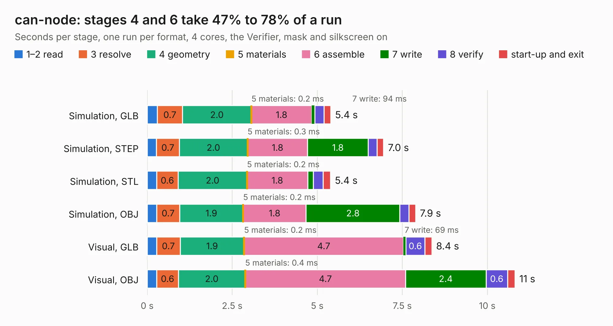

# 2688. can-node

Board 2,688 of the 3,100 of [Corpus Testing](../Corpus-Testing.md), on [Corpus Page 25](../CorpusTestingPages/Corpus-Testing-25.md#2688-can-node).

| Mode and format | 1–2 read | 3 resolve | 4 geometry | 5 materials | 6 assemble | 7 write | 8 verify | start-up and exit | Total |
|---|---:|---:|---:|---:|---:|---:|---:|---:|---:|
| Simulation, GLB | 0.3 | 0.7 | 2.0 | 0.2&nbsp;ms | 1.8 | 94&nbsp;ms | 0.3 | 0.2 | 5.4 |
| Simulation, STEP | 0.3 | 0.7 | 2.0 | 0.3&nbsp;ms | 1.8 | 1.8 | 0.3 | 0.2 | 7.0 |
| Simulation, STL | 0.3 | 0.6 | 2.0 | 0.2&nbsp;ms | 1.8 | 0.2 | 0.3 | 0.2 | 5.4 |
| Simulation, OBJ | 0.3 | 0.7 | 1.9 | 0.2&nbsp;ms | 1.8 | 2.8 | 0.3 | 0.2 | 7.9 |
| Visual, GLB | 0.3 | 0.7 | 1.9 | 0.2&nbsp;ms | 4.7 | 69&nbsp;ms | 0.6 | 0.2 | 8.4 |
| Visual, OBJ | 0.3 | 0.6 | 2.0 | 0.4&nbsp;ms | 4.7 | 2.4 | 0.6 | 0.2 | 10.8 |

<table align="center"><tr><td valign="top">

| Board | Repo: [sufst/pcb](https://github.com/sufst/pcb) Board: `can-node.kicad_pcb` |
|---|---|
| Folder | debug-board / can-node |
| Complexity | 320&nbsp;/&nbsp;1000 (size&nbsp;205, features&nbsp;115) |
| KESE&nbsp;features | through vias, rounded, trapezoid or chamfered pads, arc tracks, filled zones, curved board outline, knockout text, stack-up, dielectric εr and tanδ |
| Tested | 9th November 2026 |
| Copper&nbsp;layers | 2 |
| File&nbsp;format | KiCad 9 (20241229) |
| Parts,&nbsp;tracks,&nbsp;vias | 86, 337, 35 |
| Triangles,&nbsp;simulation | 565,364 in 78 parts |
| Verifier | PASS in all six runs |

</td><td valign="top">

<table>
<tr><th>File type</th><th>File size</th><th>Peak memory used</th></tr>
<tr><th colspan="3" align="left">Simulation</th></tr>
<tr><td>GLB</td><td align="right">20&nbsp;MB</td><td align="right">337&nbsp;MB</td></tr>
<tr><td>STEP</td><td align="right">91&nbsp;MB</td><td align="right">392&nbsp;MB</td></tr>
<tr><td>STL</td><td align="right">28&nbsp;MB</td><td align="right">315&nbsp;MB</td></tr>
<tr><td>OBJ</td><td align="right">57&nbsp;MB</td><td align="right">437&nbsp;MB</td></tr>
<tr><th colspan="3" align="left">Visual</th></tr>
<tr><td>GLB</td><td align="right">16&nbsp;MB</td><td align="right">444&nbsp;MB</td></tr>
<tr><td>OBJ</td><td align="right">46&nbsp;MB</td><td align="right">403&nbsp;MB</td></tr>
</table>

</td></tr></table>

| Previous | Next |
|:---|---:|
| [2687. Dash-PCB](b2687b_pcb_Dash-PCB.md) | [2689. Discharge](b2689b_pcb_Discharge.md) |
