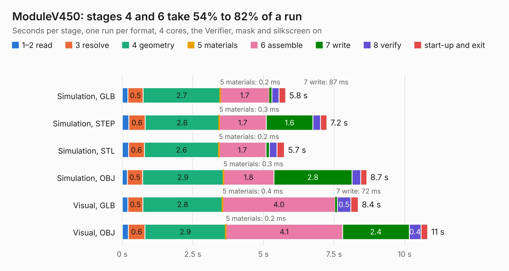

# 2692. ModuleV450

Board 2,692 of the 3,132 of [Corpus Testing](../Corpus-Testing.md), on [Corpus Page 25](../CorpusTestingPages/Corpus-Testing-25.md#2692-modulev450).

| Mode and format | 1–2 read | 3 resolve | 4 geometry | 5 materials | 6 assemble | 7 write | 8 verify | start-up and exit | Total |
|---|---:|---:|---:|---:|---:|---:|---:|---:|---:|
| Simulation, GLB | 0.2 | 0.5 | 2.7 | 0.2&nbsp;ms | 1.7 | 87&nbsp;ms | 0.3 | 0.2 | 5.8 |
| Simulation, STEP | 0.2 | 0.6 | 2.6 | 0.3&nbsp;ms | 1.7 | 1.6 | 0.3 | 0.2 | 7.2 |
| Simulation, STL | 0.2 | 0.6 | 2.6 | 0.2&nbsp;ms | 1.7 | 0.1 | 0.3 | 0.3 | 5.7 |
| Simulation, OBJ | 0.2 | 0.5 | 2.9 | 0.3&nbsp;ms | 1.8 | 2.8 | 0.3 | 0.2 | 8.7 |
| Visual, GLB | 0.2 | 0.5 | 2.8 | 0.4&nbsp;ms | 4.0 | 72&nbsp;ms | 0.5 | 0.3 | 8.4 |
| Visual, OBJ | 0.2 | 0.6 | 2.9 | 0.2&nbsp;ms | 4.1 | 2.4 | 0.4 | 0.2 | 10.8 |

<table align="center"><tr><td valign="top">

| Board | Repo: [stuartpittaway/diybmsv4](https://github.com/stuartpittaway/diybmsv4) Board: `ModuleV450.kicad_pcb` |
|---|---|
| Folder | ModuleV450 |
| Complexity | 213&nbsp;/&nbsp;1000 (size&nbsp;158, features&nbsp;55) |
| KESE&nbsp;features | through vias, rounded, trapezoid or chamfered pads, filled zones, curved board outline |
| Tested | 9th November 2026 |
| Copper&nbsp;layers | 2 |
| File&nbsp;format | KiCad 5 (20171130) |
| Parts,&nbsp;tracks,&nbsp;vias | 39, 209, 96 |
| Triangles,&nbsp;simulation | 522,076 in 38 parts |
| Verifier | PASS in all six runs |

</td><td valign="top">

<table>
<tr><th>File type</th><th>File size</th><th>Peak memory used</th></tr>
<tr><th colspan="3" align="left">Simulation</th></tr>
<tr><td>GLB</td><td align="right">18&nbsp;MB</td><td align="right">341&nbsp;MB</td></tr>
<tr><td>STEP</td><td align="right">92&nbsp;MB</td><td align="right">355&nbsp;MB</td></tr>
<tr><td>STL</td><td align="right">26&nbsp;MB</td><td align="right">321&nbsp;MB</td></tr>
<tr><td>OBJ</td><td align="right">54&nbsp;MB</td><td align="right">356&nbsp;MB</td></tr>
<tr><th colspan="3" align="left">Visual</th></tr>
<tr><td>GLB</td><td align="right">15&nbsp;MB</td><td align="right">351&nbsp;MB</td></tr>
<tr><td>OBJ</td><td align="right">43&nbsp;MB</td><td align="right">352&nbsp;MB</td></tr>
</table>

</td></tr></table>

| Previous | Next |
|:---|---:|
| [2691. ModuleV440](b2691b_diybmsv4_ModuleV440.md) | [2693. Module_16S](b2693b_diybmsv4_Module-16S.md) |
