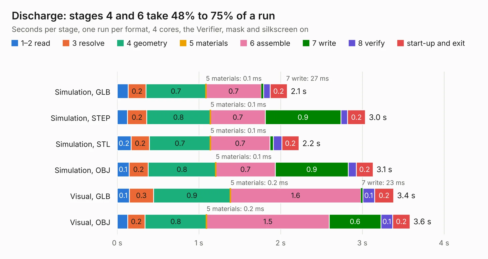

# 2692. Discharge

Board 2,692 of the 3,103 of [Corpus Testing](../Corpus-Testing.md), on [Corpus Page 25](../CorpusTestingPages/Corpus-Testing-25.md#2692-discharge).

| Mode and format | 1–2 read | 3 resolve | 4 geometry | 5 materials | 6 assemble | 7 write | 8 verify | start-up and exit | Total |
|---|---:|---:|---:|---:|---:|---:|---:|---:|---:|
| Simulation, GLB | 0.1 | 0.2 | 0.7 | 0.1&nbsp;ms | 0.7 | 27&nbsp;ms | 80&nbsp;ms | 0.2 | 2.1 |
| Simulation, STEP | 0.1 | 0.2 | 0.8 | 0.1&nbsp;ms | 0.7 | 0.9 | 82&nbsp;ms | 0.2 | 3.0 |
| Simulation, STL | 0.2 | 0.2 | 0.7 | 0.1&nbsp;ms | 0.7 | 39&nbsp;ms | 0.1 | 0.2 | 2.2 |
| Simulation, OBJ | 0.1 | 0.2 | 0.8 | 0.1&nbsp;ms | 0.7 | 0.9 | 97&nbsp;ms | 0.2 | 3.1 |
| Visual, GLB | 0.1 | 0.3 | 0.9 | 0.2&nbsp;ms | 1.6 | 23&nbsp;ms | 0.1 | 0.2 | 3.4 |
| Visual, OBJ | 0.1 | 0.2 | 0.8 | 0.2&nbsp;ms | 1.5 | 0.6 | 0.1 | 0.2 | 3.6 |

<table align="center"><tr><td valign="top">

| Board | Repo: [sufst/pcb](https://github.com/sufst/pcb) Board: `Discharge.kicad_pcb` |
|---|---|
| Folder | discharge |
| Complexity | 201&nbsp;/&nbsp;1000 (size&nbsp;121, features&nbsp;80) |
| KESE&nbsp;features | through vias, rounded, trapezoid or chamfered pads, curved board outline, knockout text, stack-up, dielectric εr and tanδ |
| Tested | 9th November 2026 |
| Copper&nbsp;layers | 2 |
| File&nbsp;format | KiCad 7 (20221018) |
| Parts,&nbsp;tracks,&nbsp;vias | 16, 72, 5 |
| Triangles,&nbsp;simulation | 155,512 in 24 parts |
| Verifier | PASS in all six runs |

</td><td valign="top">

<table>
<tr><th>File type</th><th>File size</th><th>Peak memory used</th></tr>
<tr><th colspan="3" align="left">Simulation</th></tr>
<tr><td>GLB</td><td align="right">5.4&nbsp;MB</td><td align="right">199&nbsp;MB</td></tr>
<tr><td>STEP</td><td align="right">23&nbsp;MB</td><td align="right">208&nbsp;MB</td></tr>
<tr><td>STL</td><td align="right">7.8&nbsp;MB</td><td align="right">195&nbsp;MB</td></tr>
<tr><td>OBJ</td><td align="right">15&nbsp;MB</td><td align="right">200&nbsp;MB</td></tr>
<tr><th colspan="3" align="left">Visual</th></tr>
<tr><td>GLB</td><td align="right">4.0&nbsp;MB</td><td align="right">171&nbsp;MB</td></tr>
<tr><td>OBJ</td><td align="right">11&nbsp;MB</td><td align="right">167&nbsp;MB</td></tr>
</table>

</td></tr></table>

| Previous | Next |
|:---|---:|
| [2691. can-node](b2691b_pcb_can-node.md) | [2693. hv_sense](b2693b_pcb_hv-sense.md) |
