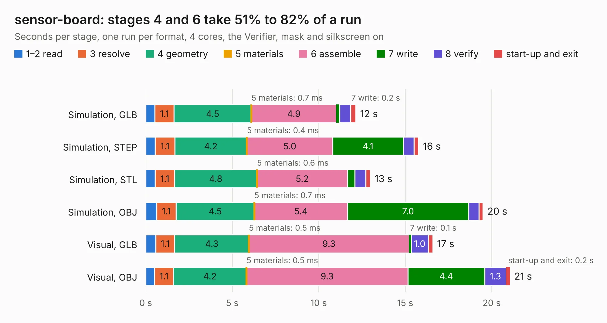

# 2692. sensor-board

Board 2,692 of the 3,116 of [Corpus Testing](../Corpus-Testing.md), on [Corpus Page 25](../CorpusTestingPages/Corpus-Testing-25.md#2692-sensor-board).

| Mode and format | 1–2 read | 3 resolve | 4 geometry | 5 materials | 6 assemble | 7 write | 8 verify | start-up and exit | Total |
|---|---:|---:|---:|---:|---:|---:|---:|---:|---:|
| Simulation, GLB | 0.5 | 1.1 | 4.5 | 0.7&nbsp;ms | 4.9 | 0.2 | 0.6 | 0.3 | 12.1 |
| Simulation, STEP | 0.5 | 1.1 | 4.2 | 0.4&nbsp;ms | 5.0 | 4.1 | 0.6 | 0.3 | 15.8 |
| Simulation, STL | 0.5 | 1.1 | 4.8 | 0.6&nbsp;ms | 5.2 | 0.4 | 0.6 | 0.3 | 13.0 |
| Simulation, OBJ | 0.6 | 1.1 | 4.5 | 0.7&nbsp;ms | 5.4 | 7.0 | 0.6 | 0.2 | 19.5 |
| Visual, GLB | 0.6 | 1.1 | 4.3 | 0.5&nbsp;ms | 9.3 | 0.1 | 1.0 | 0.3 | 16.6 |
| Visual, OBJ | 0.5 | 1.1 | 4.2 | 0.5&nbsp;ms | 9.3 | 4.4 | 1.3 | 0.2 | 21.1 |

<table align="center"><tr><td valign="top">

| Board | Repo: [sufst/pcb](https://github.com/sufst/pcb) Board: `sensor-board.kicad_pcb` |
|---|---|
| Folder | archive / sensor-board |
| Complexity | 319&nbsp;/&nbsp;1000 (size&nbsp;234, features&nbsp;85) |
| KESE&nbsp;features | through vias, rounded, trapezoid or chamfered pads, filled zones, curved board outline, stack-up, dielectric εr and tanδ |
| Tested | 9th November 2026 |
| Copper&nbsp;layers | 4 |
| File&nbsp;format | KiCad 8 (20240108) |
| Parts,&nbsp;tracks,&nbsp;vias | 95, 679, 65 |
| Triangles,&nbsp;simulation | 1,192,408 in 126 parts |
| Verifier | PASS in all six runs |

</td><td valign="top">

<table>
<tr><th>File type</th><th>File size</th><th>Peak memory used</th></tr>
<tr><th colspan="3" align="left">Simulation</th></tr>
<tr><td>GLB</td><td align="right">41&nbsp;MB</td><td align="right">484&nbsp;MB</td></tr>
<tr><td>STEP</td><td align="right">175&nbsp;MB</td><td align="right">570&nbsp;MB</td></tr>
<tr><td>STL</td><td align="right">60&nbsp;MB</td><td align="right">489&nbsp;MB</td></tr>
<tr><td>OBJ</td><td align="right">121&nbsp;MB</td><td align="right">828&nbsp;MB</td></tr>
<tr><th colspan="3" align="left">Visual</th></tr>
<tr><td>GLB</td><td align="right">26&nbsp;MB</td><td align="right">712&nbsp;MB</td></tr>
<tr><td>OBJ</td><td align="right">78&nbsp;MB</td><td align="right">706&nbsp;MB</td></tr>
</table>

</td></tr></table>

| Previous | Next |
|:---|---:|
| [2691. segment](b2691b_pcb_segment.md) | [2693. strain-gauge-amp-breakout](b2693b_pcb_strain-gauge-amp-breakout.md) |
