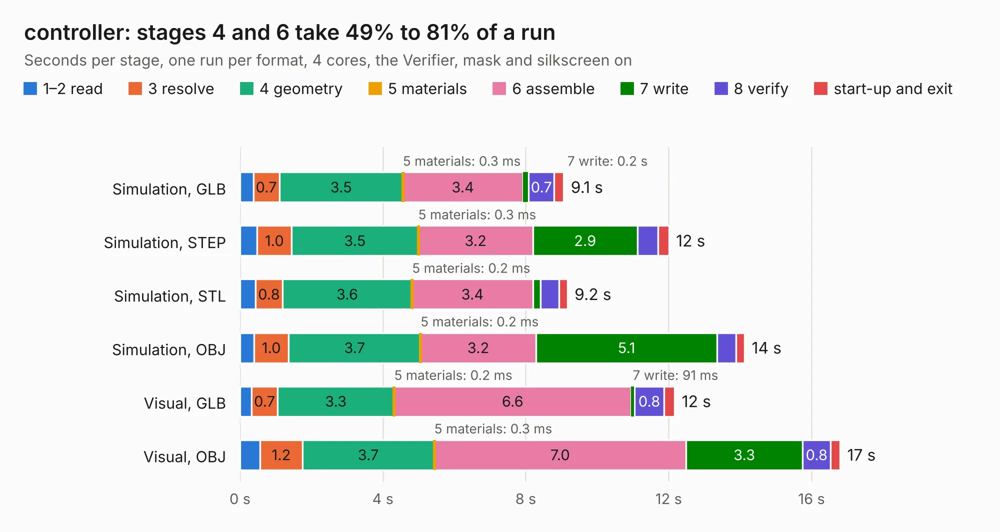

# 2693. controller

Board 2,693 of the 3,124 of [Corpus Testing](../Corpus-Testing.md), on [Corpus Page 25](../CorpusTestingPages/Corpus-Testing-25.md#2693-controller).

| Mode and format | 1–2 read | 3 resolve | 4 geometry | 5 materials | 6 assemble | 7 write | 8 verify | start-up and exit | Total |
|---|---:|---:|---:|---:|---:|---:|---:|---:|---:|
| Simulation, GLB | 0.4 | 0.7 | 3.5 | 0.3&nbsp;ms | 3.4 | 0.2 | 0.7 | 0.3 | 9.1 |
| Simulation, STEP | 0.5 | 1.0 | 3.5 | 0.3&nbsp;ms | 3.2 | 2.9 | 0.6 | 0.3 | 12.0 |
| Simulation, STL | 0.4 | 0.8 | 3.6 | 0.2&nbsp;ms | 3.4 | 0.2 | 0.5 | 0.2 | 9.2 |
| Simulation, OBJ | 0.4 | 1.0 | 3.7 | 0.2&nbsp;ms | 3.2 | 5.1 | 0.5 | 0.2 | 14.1 |
| Visual, GLB | 0.3 | 0.7 | 3.3 | 0.2&nbsp;ms | 6.6 | 91&nbsp;ms | 0.8 | 0.3 | 12.2 |
| Visual, OBJ | 0.6 | 1.2 | 3.7 | 0.3&nbsp;ms | 7.0 | 3.3 | 0.8 | 0.3 | 16.8 |

<table align="center"><tr><td valign="top">

| Board | Repo: [StuckAtPrototype/Racer](https://github.com/StuckAtPrototype/Racer) Board: `controller.kicad_pcb` |
|---|---|
| Folder | hardware / thumbtroller |
| Complexity | 318&nbsp;/&nbsp;1000 (size&nbsp;183, features&nbsp;135) |
| KESE&nbsp;features | through vias, slotted holes, custom pads, rounded, trapezoid or chamfered pads, filled zones, copper drawings, curved board outline, TrueType text, stack-up, dielectric εr and tanδ |
| Tested | 9th November 2026 |
| Copper&nbsp;layers | 4 |
| File&nbsp;format | KiCad 8 (20240108) |
| Parts,&nbsp;tracks,&nbsp;vias | 58, 430, 62 |
| Triangles,&nbsp;simulation | 833,932 in 71 parts |
| Verifier | PASS in all six runs |

</td><td valign="top">

<table>
<tr><th>File type</th><th>File size</th><th>Peak memory used</th></tr>
<tr><th colspan="3" align="left">Simulation</th></tr>
<tr><td>GLB</td><td align="right">29&nbsp;MB</td><td align="right">394&nbsp;MB</td></tr>
<tr><td>STEP</td><td align="right">136&nbsp;MB</td><td align="right">490&nbsp;MB</td></tr>
<tr><td>STL</td><td align="right">42&nbsp;MB</td><td align="right">401&nbsp;MB</td></tr>
<tr><td>OBJ</td><td align="right">86&nbsp;MB</td><td align="right">627&nbsp;MB</td></tr>
<tr><th colspan="3" align="left">Visual</th></tr>
<tr><td>GLB</td><td align="right">21&nbsp;MB</td><td align="right">536&nbsp;MB</td></tr>
<tr><td>OBJ</td><td align="right">63&nbsp;MB</td><td align="right">527&nbsp;MB</td></tr>
</table>

</td></tr></table>

| Previous | Next |
|:---|---:|
| [2692. racer](b2692b_Racer_racer.md) | [2694. ail-LED](b2694b_pcb_ail-LED.md) |
