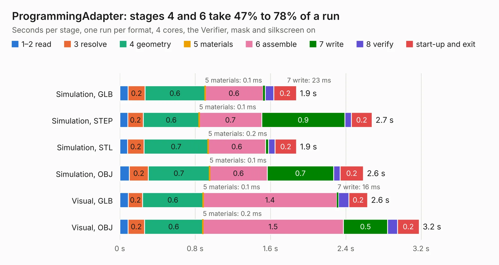

# 2694. ProgrammingAdapter

Board 2,694 of the 3,131 of [Corpus Testing](../Corpus-Testing.md), on [Corpus Page 25](../CorpusTestingPages/Corpus-Testing-25.md#2694-programmingadapter).

| Mode and format | 1–2 read | 3 resolve | 4 geometry | 5 materials | 6 assemble | 7 write | 8 verify | start-up and exit | Total |
|---|---:|---:|---:|---:|---:|---:|---:|---:|---:|
| Simulation, GLB | 88&nbsp;ms | 0.2 | 0.6 | 0.1&nbsp;ms | 0.6 | 23&nbsp;ms | 92&nbsp;ms | 0.2 | 1.9 |
| Simulation, STEP | 84&nbsp;ms | 0.2 | 0.6 | 0.1&nbsp;ms | 0.7 | 0.9 | 70&nbsp;ms | 0.2 | 2.7 |
| Simulation, STL | 82&nbsp;ms | 0.2 | 0.7 | 0.2&nbsp;ms | 0.6 | 32&nbsp;ms | 71&nbsp;ms | 0.2 | 1.9 |
| Simulation, OBJ | 0.1 | 0.2 | 0.7 | 0.1&nbsp;ms | 0.6 | 0.7 | 70&nbsp;ms | 0.2 | 2.6 |
| Visual, GLB | 90&nbsp;ms | 0.2 | 0.6 | 0.1&nbsp;ms | 1.4 | 16&nbsp;ms | 0.1 | 0.2 | 2.6 |
| Visual, OBJ | 87&nbsp;ms | 0.2 | 0.6 | 0.2&nbsp;ms | 1.5 | 0.5 | 0.1 | 0.2 | 3.2 |

<table align="center"><tr><td valign="top">

| Board | Repo: [stuartpittaway/diybmsv4](https://github.com/stuartpittaway/diybmsv4) Board: `ProgrammingAdapter.kicad_pcb` |
|---|---|
| Folder | ProgrammingAdapter |
| Complexity | 145&nbsp;/&nbsp;1000 (size&nbsp;100, features&nbsp;45) |
| KESE&nbsp;features | through vias, filled zones, curved board outline |
| Tested | 9th November 2026 |
| Copper&nbsp;layers | 2 |
| File&nbsp;format | KiCad 5 (20171130) |
| Parts,&nbsp;tracks,&nbsp;vias | 3, 45, 6 |
| Triangles,&nbsp;simulation | 130,918 in 17 parts |
| Verifier | PASS in all six runs |

</td><td valign="top">

<table>
<tr><th>File type</th><th>File size</th><th>Peak memory used</th></tr>
<tr><th colspan="3" align="left">Simulation</th></tr>
<tr><td>GLB</td><td align="right">4.6&nbsp;MB</td><td align="right">187&nbsp;MB</td></tr>
<tr><td>STEP</td><td align="right">22&nbsp;MB</td><td align="right">193&nbsp;MB</td></tr>
<tr><td>STL</td><td align="right">6.5&nbsp;MB</td><td align="right">191&nbsp;MB</td></tr>
<tr><td>OBJ</td><td align="right">13&nbsp;MB</td><td align="right">185&nbsp;MB</td></tr>
<tr><th colspan="3" align="left">Visual</th></tr>
<tr><td>GLB</td><td align="right">3.2&nbsp;MB</td><td align="right">158&nbsp;MB</td></tr>
<tr><td>OBJ</td><td align="right">9.0&nbsp;MB</td><td align="right">157&nbsp;MB</td></tr>
</table>

</td></tr></table>

| Previous | Next |
|:---|---:|
| [2693. Module_16S_PassiveBalanceAddOn](b2693b_diybmsv4_Module-16S-PassiveBalanceAddOn.md) | [2695. TemperaturePCB](b2695b_diybmsv4_TemperaturePCB.md) |
