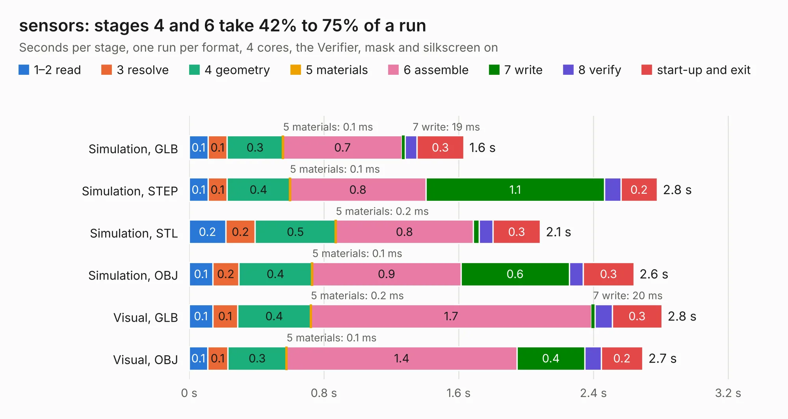

# 2698. sensors

Board 2,698 of the 3,132 of [Corpus Testing](../Corpus-Testing.md), on [Corpus Page 25](../CorpusTestingPages/Corpus-Testing-25.md#2698-sensors).

| Mode and format | 1–2 read | 3 resolve | 4 geometry | 5 materials | 6 assemble | 7 write | 8 verify | start-up and exit | Total |
|---|---:|---:|---:|---:|---:|---:|---:|---:|---:|
| Simulation, GLB | 0.1 | 0.1 | 0.3 | 0.1&nbsp;ms | 0.7 | 19&nbsp;ms | 70&nbsp;ms | 0.3 | 1.6 |
| Simulation, STEP | 0.1 | 0.1 | 0.4 | 0.1&nbsp;ms | 0.8 | 1.1 | 97&nbsp;ms | 0.2 | 2.8 |
| Simulation, STL | 0.2 | 0.2 | 0.5 | 0.2&nbsp;ms | 0.8 | 37&nbsp;ms | 82&nbsp;ms | 0.3 | 2.1 |
| Simulation, OBJ | 0.1 | 0.2 | 0.4 | 0.1&nbsp;ms | 0.9 | 0.6 | 82&nbsp;ms | 0.3 | 2.6 |
| Visual, GLB | 0.1 | 0.1 | 0.4 | 0.2&nbsp;ms | 1.7 | 20&nbsp;ms | 0.1 | 0.3 | 2.8 |
| Visual, OBJ | 0.1 | 0.1 | 0.3 | 0.1&nbsp;ms | 1.4 | 0.4 | 97&nbsp;ms | 0.2 | 2.7 |

<table align="center"><tr><td valign="top">

| Board | Repo: [StuckAtPrototype/Racer](https://github.com/StuckAtPrototype/Racer) Board: `sensors.kicad_pcb` |
|---|---|
| Folder | hardware / racer-sensors |
| Complexity | 185&nbsp;/&nbsp;1000 (size&nbsp;140, features&nbsp;45) |
| KESE&nbsp;features | through vias, rounded, trapezoid or chamfered pads, filled zones |
| Tested | 9th November 2026 |
| Copper&nbsp;layers | 4 |
| File&nbsp;format | KiCad 8 (20240108) |
| Parts,&nbsp;tracks,&nbsp;vias | 14, 75, 12 |
| Triangles,&nbsp;simulation | 106,594 in 21 parts |
| Verifier | PASS in all six runs |

</td><td valign="top">

<table>
<tr><th>File type</th><th>File size</th><th>Peak memory used</th></tr>
<tr><th colspan="3" align="left">Simulation</th></tr>
<tr><td>GLB</td><td align="right">3.7&nbsp;MB</td><td align="right">187&nbsp;MB</td></tr>
<tr><td>STEP</td><td align="right">18&nbsp;MB</td><td align="right">199&nbsp;MB</td></tr>
<tr><td>STL</td><td align="right">5.3&nbsp;MB</td><td align="right">188&nbsp;MB</td></tr>
<tr><td>OBJ</td><td align="right">10&nbsp;MB</td><td align="right">189&nbsp;MB</td></tr>
<tr><th colspan="3" align="left">Visual</th></tr>
<tr><td>GLB</td><td align="right">2.9&nbsp;MB</td><td align="right">153&nbsp;MB</td></tr>
<tr><td>OBJ</td><td align="right">8.2&nbsp;MB</td><td align="right">152&nbsp;MB</td></tr>
</table>

</td></tr></table>

| Previous | Next |
|:---|---:|
| [2697. TemperaturePCB_PANEL](b2697b_diybmsv4_TemperaturePCB-PANEL.md) | [2699. racer](b2699b_Racer_racer.md) |
