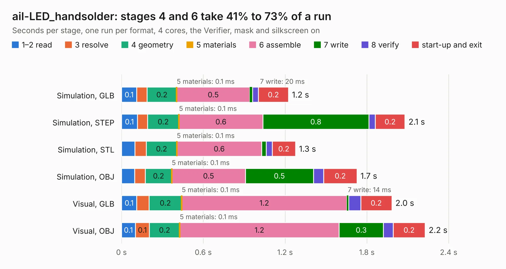

# 2698. ail-LED_handsolder

Board 2,698 of the 3,128 of [Corpus Testing](../Corpus-Testing.md), on [Corpus Page 25](../CorpusTestingPages/Corpus-Testing-25.md#2698-ail-led_handsolder).

| Mode and format | 1–2 read | 3 resolve | 4 geometry | 5 materials | 6 assemble | 7 write | 8 verify | start-up and exit | Total |
|---|---:|---:|---:|---:|---:|---:|---:|---:|---:|
| Simulation, GLB | 0.1 | 76&nbsp;ms | 0.2 | 0.1&nbsp;ms | 0.5 | 20&nbsp;ms | 44&nbsp;ms | 0.2 | 1.2 |
| Simulation, STEP | 0.1 | 74&nbsp;ms | 0.2 | 0.1&nbsp;ms | 0.6 | 0.8 | 48&nbsp;ms | 0.2 | 2.1 |
| Simulation, STL | 99&nbsp;ms | 84&nbsp;ms | 0.2 | 0.1&nbsp;ms | 0.6 | 32&nbsp;ms | 45&nbsp;ms | 0.2 | 1.3 |
| Simulation, OBJ | 97&nbsp;ms | 79&nbsp;ms | 0.2 | 0.1&nbsp;ms | 0.5 | 0.5 | 75&nbsp;ms | 0.2 | 1.7 |
| Visual, GLB | 0.1 | 89&nbsp;ms | 0.2 | 0.1&nbsp;ms | 1.2 | 14&nbsp;ms | 88&nbsp;ms | 0.2 | 2.0 |
| Visual, OBJ | 0.1 | 0.1 | 0.2 | 0.1&nbsp;ms | 1.2 | 0.3 | 71&nbsp;ms | 0.2 | 2.2 |

<table align="center"><tr><td valign="top">

| Board | Repo: [sufst/pcb](https://github.com/sufst/pcb) Board: `ail-LED_handsolder.kicad_pcb` |
|---|---|
| Folder | ail-LED |
| Complexity | 205&nbsp;/&nbsp;1000 (size&nbsp;95, features&nbsp;110) |
| KESE&nbsp;features | through vias, custom pads, rounded, trapezoid or chamfered pads, filled zones, copper drawings, curved board outline, stack-up, dielectric εr and tanδ |
| Tested | 9th November 2026 |
| Copper&nbsp;layers | 2 |
| File&nbsp;format | KiCad 7 (20221018) |
| Parts,&nbsp;tracks,&nbsp;vias | 18, 7, 3 |
| Triangles,&nbsp;simulation | 96,088 in 27 parts |
| Verifier | PASS in all six runs |

</td><td valign="top">

<table>
<tr><th>File type</th><th>File size</th><th>Peak memory used</th></tr>
<tr><th colspan="3" align="left">Simulation</th></tr>
<tr><td>GLB</td><td align="right">3.8&nbsp;MB</td><td align="right">182&nbsp;MB</td></tr>
<tr><td>STEP</td><td align="right">16&nbsp;MB</td><td align="right">194&nbsp;MB</td></tr>
<tr><td>STL</td><td align="right">4.8&nbsp;MB</td><td align="right">182&nbsp;MB</td></tr>
<tr><td>OBJ</td><td align="right">10&nbsp;MB</td><td align="right">187&nbsp;MB</td></tr>
<tr><th colspan="3" align="left">Visual</th></tr>
<tr><td>GLB</td><td align="right">2.3&nbsp;MB</td><td align="right">153&nbsp;MB</td></tr>
<tr><td>OBJ</td><td align="right">6.2&nbsp;MB</td><td align="right">154&nbsp;MB</td></tr>
</table>

</td></tr></table>

| Previous | Next |
|:---|---:|
| [2697. ail-LED](b2697b_pcb_ail-LED.md) | [2699. ail](b2699b_pcb_ail.md) |
