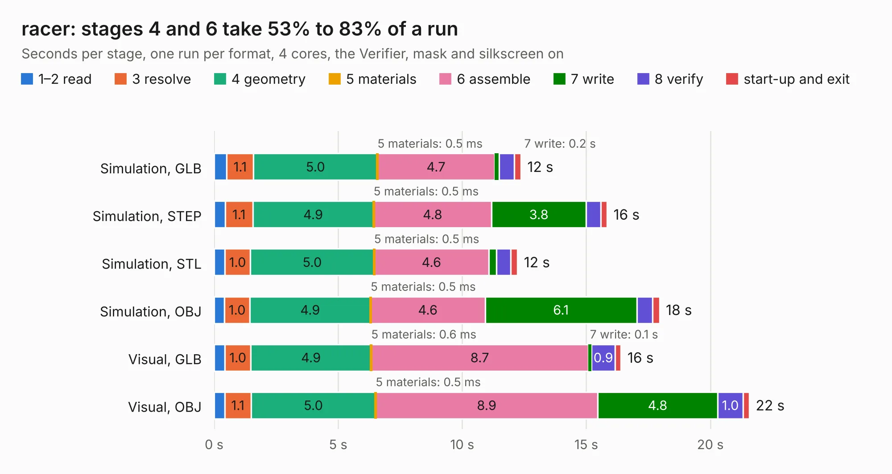

# 2699. racer

Board 2,699 of the 3,132 of [Corpus Testing](../Corpus-Testing.md), on [Corpus Page 25](../CorpusTestingPages/Corpus-Testing-25.md#2699-racer).

| Mode and format | 1–2 read | 3 resolve | 4 geometry | 5 materials | 6 assemble | 7 write | 8 verify | start-up and exit | Total |
|---|---:|---:|---:|---:|---:|---:|---:|---:|---:|
| Simulation, GLB | 0.5 | 1.1 | 5.0 | 0.5&nbsp;ms | 4.7 | 0.2 | 0.6 | 0.3 | 12.4 |
| Simulation, STEP | 0.4 | 1.1 | 4.9 | 0.5&nbsp;ms | 4.8 | 3.8 | 0.6 | 0.3 | 15.8 |
| Simulation, STL | 0.4 | 1.0 | 5.0 | 0.5&nbsp;ms | 4.6 | 0.3 | 0.6 | 0.3 | 12.2 |
| Simulation, OBJ | 0.4 | 1.0 | 4.9 | 0.5&nbsp;ms | 4.6 | 6.1 | 0.6 | 0.3 | 17.9 |
| Visual, GLB | 0.4 | 1.0 | 4.9 | 0.6&nbsp;ms | 8.7 | 0.1 | 0.9 | 0.2 | 16.4 |
| Visual, OBJ | 0.4 | 1.1 | 5.0 | 0.5&nbsp;ms | 8.9 | 4.8 | 1.0 | 0.2 | 21.6 |

<table align="center"><tr><td valign="top">

| Board | Repo: [StuckAtPrototype/Racer](https://github.com/StuckAtPrototype/Racer) Board: `racer.kicad_pcb` |
|---|---|
| Folder | hardware / racer |
| Complexity | 325&nbsp;/&nbsp;1000 (size&nbsp;190, features&nbsp;135) |
| KESE&nbsp;features | through vias, slotted holes, custom pads, rounded, trapezoid or chamfered pads, filled zones, copper drawings, curved board outline, TrueType text, stack-up, dielectric εr and tanδ |
| Tested | 9th November 2026 |
| Copper&nbsp;layers | 4 |
| File&nbsp;format | KiCad 9 (20241229) |
| Parts,&nbsp;tracks,&nbsp;vias | 70, 546, 107 |
| Triangles,&nbsp;simulation | 1,031,612 in 87 parts |
| Verifier | PASS in all six runs |

</td><td valign="top">

<table>
<tr><th>File type</th><th>File size</th><th>Peak memory used</th></tr>
<tr><th colspan="3" align="left">Simulation</th></tr>
<tr><td>GLB</td><td align="right">36&nbsp;MB</td><td align="right">483&nbsp;MB</td></tr>
<tr><td>STEP</td><td align="right">164&nbsp;MB</td><td align="right">571&nbsp;MB</td></tr>
<tr><td>STL</td><td align="right">52&nbsp;MB</td><td align="right">475&nbsp;MB</td></tr>
<tr><td>OBJ</td><td align="right">106&nbsp;MB</td><td align="right">730&nbsp;MB</td></tr>
<tr><th colspan="3" align="left">Visual</th></tr>
<tr><td>GLB</td><td align="right">25&nbsp;MB</td><td align="right">581&nbsp;MB</td></tr>
<tr><td>OBJ</td><td align="right">77&nbsp;MB</td><td align="right">618&nbsp;MB</td></tr>
</table>

</td></tr></table>

| Previous | Next |
|:---|---:|
| [2698. sensors](b2698b_Racer_sensors.md) | [2700. controller](b2700b_Racer_controller.md) |
