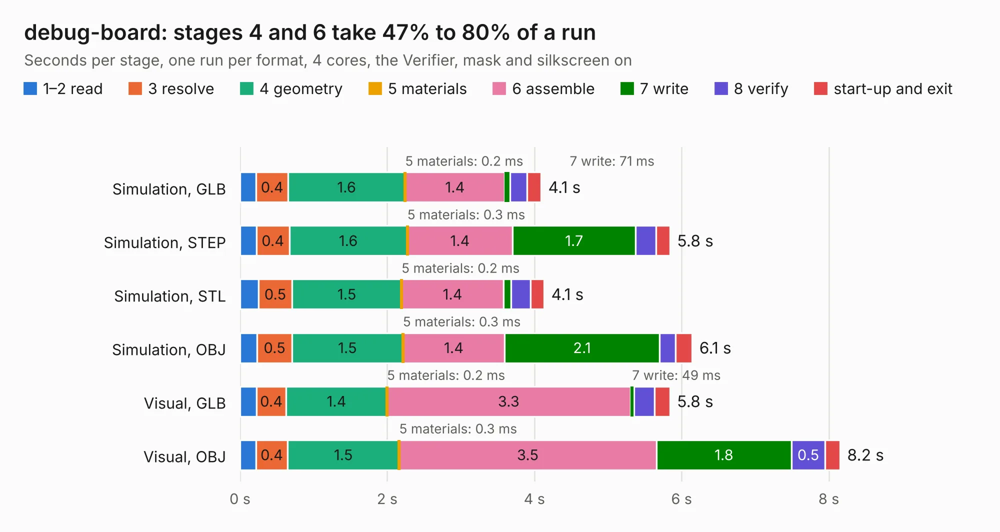

# 2700. debug-board

Board 2,700 of the 3,128 of [Corpus Testing](../Corpus-Testing.md), on [Corpus Page 25](../CorpusTestingPages/Corpus-Testing-25.md#2700-debug-board).

| Mode and format | 1–2 read | 3 resolve | 4 geometry | 5 materials | 6 assemble | 7 write | 8 verify | start-up and exit | Total |
|---|---:|---:|---:|---:|---:|---:|---:|---:|---:|
| Simulation, GLB | 0.2 | 0.4 | 1.6 | 0.2&nbsp;ms | 1.4 | 71&nbsp;ms | 0.2 | 0.2 | 4.1 |
| Simulation, STEP | 0.2 | 0.4 | 1.6 | 0.3&nbsp;ms | 1.4 | 1.7 | 0.3 | 0.2 | 5.8 |
| Simulation, STL | 0.2 | 0.5 | 1.5 | 0.2&nbsp;ms | 1.4 | 0.1 | 0.3 | 0.2 | 4.1 |
| Simulation, OBJ | 0.2 | 0.5 | 1.5 | 0.3&nbsp;ms | 1.4 | 2.1 | 0.2 | 0.2 | 6.1 |
| Visual, GLB | 0.2 | 0.4 | 1.4 | 0.2&nbsp;ms | 3.3 | 49&nbsp;ms | 0.3 | 0.2 | 5.8 |
| Visual, OBJ | 0.2 | 0.4 | 1.5 | 0.3&nbsp;ms | 3.5 | 1.8 | 0.5 | 0.2 | 8.2 |

<table align="center"><tr><td valign="top">

| Board | Repo: [sufst/pcb](https://github.com/sufst/pcb) Board: `debug-board.kicad_pcb` |
|---|---|
| Folder | archive / debug-board |
| Complexity | 311&nbsp;/&nbsp;1000 (size&nbsp;196, features&nbsp;115) |
| KESE&nbsp;features | through vias, rounded, trapezoid or chamfered pads, arc tracks, filled zones, curved board outline, knockout text, stack-up, dielectric εr and tanδ |
| Tested | 9th November 2026 |
| Copper&nbsp;layers | 2 |
| File&nbsp;format | KiCad 8 (20240108) |
| Parts,&nbsp;tracks,&nbsp;vias | 53, 279, 21 |
| Triangles,&nbsp;simulation | 435,016 in 66 parts |
| Verifier | PASS in all six runs |

</td><td valign="top">

<table>
<tr><th>File type</th><th>File size</th><th>Peak memory used</th></tr>
<tr><th colspan="3" align="left">Simulation</th></tr>
<tr><td>GLB</td><td align="right">15&nbsp;MB</td><td align="right">318&nbsp;MB</td></tr>
<tr><td>STEP</td><td align="right">68&nbsp;MB</td><td align="right">318&nbsp;MB</td></tr>
<tr><td>STL</td><td align="right">22&nbsp;MB</td><td align="right">313&nbsp;MB</td></tr>
<tr><td>OBJ</td><td align="right">43&nbsp;MB</td><td align="right">340&nbsp;MB</td></tr>
<tr><th colspan="3" align="left">Visual</th></tr>
<tr><td>GLB</td><td align="right">11&nbsp;MB</td><td align="right">339&nbsp;MB</td></tr>
<tr><td>OBJ</td><td align="right">33&nbsp;MB</td><td align="right">339&nbsp;MB</td></tr>
</table>

</td></tr></table>

| Previous | Next |
|:---|---:|
| [2699. ail](b2699b_pcb_ail.md) | [2701. latching](b2701b_pcb_latching.md) |
