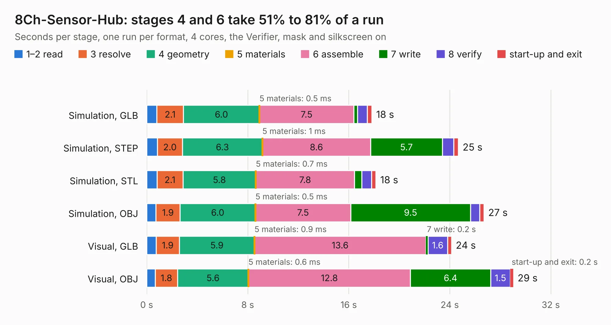

# 2703. 8Ch-Sensor-Hub

Board 2,703 of the 3,104 of [Corpus Testing](../Corpus-Testing.md), on [Corpus Page 26](../CorpusTestingPages/Corpus-Testing-26.md#2703-8ch-sensor-hub).

| Mode and format | 1–2 read | 3 resolve | 4 geometry | 5 materials | 6 assemble | 7 write | 8 verify | start-up and exit | Total |
|---|---:|---:|---:|---:|---:|---:|---:|---:|---:|
| Simulation, GLB | 0.8 | 2.1 | 6.0 | 0.5&nbsp;ms | 7.5 | 0.3 | 0.8 | 0.4 | 17.8 |
| Simulation, STEP | 0.8 | 2.0 | 6.3 | 1&nbsp;ms | 8.6 | 5.7 | 0.9 | 0.4 | 24.7 |
| Simulation, STL | 0.8 | 2.1 | 5.8 | 0.7&nbsp;ms | 7.8 | 0.6 | 0.8 | 0.3 | 18.1 |
| Simulation, OBJ | 0.7 | 1.9 | 6.0 | 0.5&nbsp;ms | 7.5 | 9.5 | 0.7 | 0.3 | 26.7 |
| Visual, GLB | 0.7 | 1.9 | 5.9 | 0.9&nbsp;ms | 13.6 | 0.2 | 1.6 | 0.3 | 24.1 |
| Visual, OBJ | 0.7 | 1.8 | 5.6 | 0.6&nbsp;ms | 12.8 | 6.4 | 1.5 | 0.2 | 29.0 |

<table align="center"><tr><td valign="top">

| Board | Repo: [sufst/pcb](https://github.com/sufst/pcb) Board: `8Ch-Sensor-Hub.kicad_pcb` |
|---|---|
| Folder | sensor-hub |
| Complexity | 364&nbsp;/&nbsp;1000 (size&nbsp;239, features&nbsp;125) |
| KESE&nbsp;features | through vias, custom pads, rounded, trapezoid or chamfered pads, filled zones, copper drawings, curved board outline, knockout text, stack-up, dielectric εr and tanδ |
| Tested | 9th November 2026 |
| Copper&nbsp;layers | 4 |
| File&nbsp;format | KiCad 9 (20241229) |
| Parts,&nbsp;tracks,&nbsp;vias | 111, 527, 186 |
| Triangles,&nbsp;simulation | 1,586,974 in 105 parts |
| Verifier | PASS in all six runs |

</td><td valign="top">

<table>
<tr><th>File type</th><th>File size</th><th>Peak memory used</th></tr>
<tr><th colspan="3" align="left">Simulation</th></tr>
<tr><td>GLB</td><td align="right">54&nbsp;MB</td><td align="right">620&nbsp;MB</td></tr>
<tr><td>STEP</td><td align="right">219&nbsp;MB</td><td align="right">734&nbsp;MB</td></tr>
<tr><td>STL</td><td align="right">79&nbsp;MB</td><td align="right">606&nbsp;MB</td></tr>
<tr><td>OBJ</td><td align="right">163&nbsp;MB</td><td align="right">1.1&nbsp;GB</td></tr>
<tr><th colspan="3" align="left">Visual</th></tr>
<tr><td>GLB</td><td align="right">35&nbsp;MB</td><td align="right">681&nbsp;MB</td></tr>
<tr><td>OBJ</td><td align="right">106&nbsp;MB</td><td align="right">810&nbsp;MB</td></tr>
</table>

</td></tr></table>

| Previous | Next |
|:---|---:|
| [2702. 16Ch-Sensor-Hub](b2702b_pcb_16Ch-Sensor-Hub.md) | [2704. ss-relay](b2704b_pcb_ss-relay.md) |
