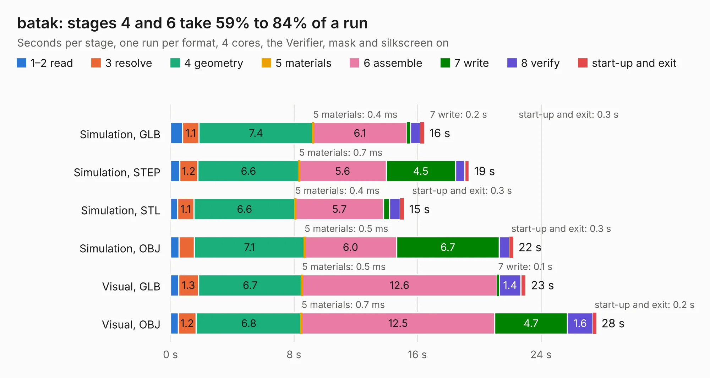

# 2703. batak

Board 2,703 of the 3,122 of [Corpus Testing](../Corpus-Testing.md), on [Corpus Page 26](../CorpusTestingPages/Corpus-Testing-26.md#2703-batak).

| Mode and format | 1–2 read | 3 resolve | 4 geometry | 5 materials | 6 assemble | 7 write | 8 verify | start-up and exit | Total |
|---|---:|---:|---:|---:|---:|---:|---:|---:|---:|
| Simulation, GLB | 0.8 | 1.1 | 7.4 | 0.4&nbsp;ms | 6.1 | 0.2 | 0.6 | 0.3 | 16.4 |
| Simulation, STEP | 0.6 | 1.2 | 6.6 | 0.7&nbsp;ms | 5.6 | 4.5 | 0.6 | 0.3 | 19.3 |
| Simulation, STL | 0.5 | 1.1 | 6.6 | 0.4&nbsp;ms | 5.7 | 0.4 | 0.7 | 0.3 | 15.1 |
| Simulation, OBJ | 0.5 | 1.0 | 7.1 | 0.5&nbsp;ms | 6.0 | 6.7 | 0.7 | 0.3 | 22.2 |
| Visual, GLB | 0.5 | 1.3 | 6.7 | 0.5&nbsp;ms | 12.6 | 0.1 | 1.4 | 0.3 | 23.0 |
| Visual, OBJ | 0.5 | 1.2 | 6.8 | 0.7&nbsp;ms | 12.5 | 4.7 | 1.6 | 0.2 | 27.6 |

<table align="center"><tr><td valign="top">

| Board | Repo: [sufst/pcb](https://github.com/sufst/pcb) Board: `batak.kicad_pcb` |
|---|---|
| Folder | batak |
| Complexity | 309&nbsp;/&nbsp;1000 (size&nbsp;189, features&nbsp;120) |
| KESE&nbsp;features | through vias, slotted holes, custom pads, rounded, trapezoid or chamfered pads, filled zones, copper drawings, curved board outline, stack-up, dielectric εr and tanδ |
| Tested | 9th November 2026 |
| Copper&nbsp;layers | 2 |
| File&nbsp;format | KiCad 9 (20241229) |
| Parts,&nbsp;tracks,&nbsp;vias | 169, 1,040, 71 |
| Triangles,&nbsp;simulation | 1,324,298 in 178 parts |
| Verifier | PASS in all six runs |

</td><td valign="top">

<table>
<tr><th>File type</th><th>File size</th><th>Peak memory used</th></tr>
<tr><th colspan="3" align="left">Simulation</th></tr>
<tr><td>GLB</td><td align="right">45&nbsp;MB</td><td align="right">568&nbsp;MB</td></tr>
<tr><td>STEP</td><td align="right">225&nbsp;MB</td><td align="right">670&nbsp;MB</td></tr>
<tr><td>STL</td><td align="right">66&nbsp;MB</td><td align="right">567&nbsp;MB</td></tr>
<tr><td>OBJ</td><td align="right">136&nbsp;MB</td><td align="right">915&nbsp;MB</td></tr>
<tr><th colspan="3" align="left">Visual</th></tr>
<tr><td>GLB</td><td align="right">32&nbsp;MB</td><td align="right">754&nbsp;MB</td></tr>
<tr><td>OBJ</td><td align="right">96&nbsp;MB</td><td align="right">731&nbsp;MB</td></tr>
</table>

</td></tr></table>

| Previous | Next |
|:---|---:|
| [2702. tsal](b2702b_pcb_tsal.md) | [2704. bms-interface](b2704b_pcb_bms-interface.md) |
