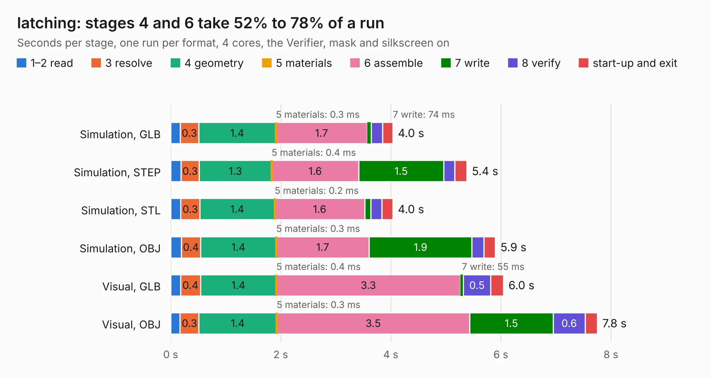

# 2704. latching

Board 2,704 of the 3,131 of [Corpus Testing](../Corpus-Testing.md), on [Corpus Page 26](../CorpusTestingPages/Corpus-Testing-26.md#2704-latching).

| Mode and format | 1–2 read | 3 resolve | 4 geometry | 5 materials | 6 assemble | 7 write | 8 verify | start-up and exit | Total |
|---|---:|---:|---:|---:|---:|---:|---:|---:|---:|
| Simulation, GLB | 0.2 | 0.3 | 1.4 | 0.3&nbsp;ms | 1.7 | 74&nbsp;ms | 0.2 | 0.2 | 4.0 |
| Simulation, STEP | 0.2 | 0.3 | 1.3 | 0.4&nbsp;ms | 1.6 | 1.5 | 0.2 | 0.2 | 5.4 |
| Simulation, STL | 0.2 | 0.3 | 1.4 | 0.2&nbsp;ms | 1.6 | 0.1 | 0.2 | 0.2 | 4.0 |
| Simulation, OBJ | 0.2 | 0.4 | 1.4 | 0.3&nbsp;ms | 1.7 | 1.9 | 0.2 | 0.2 | 5.9 |
| Visual, GLB | 0.2 | 0.4 | 1.4 | 0.4&nbsp;ms | 3.3 | 55&nbsp;ms | 0.5 | 0.2 | 6.0 |
| Visual, OBJ | 0.2 | 0.3 | 1.4 | 0.3&nbsp;ms | 3.5 | 1.5 | 0.6 | 0.2 | 7.8 |

<table align="center"><tr><td valign="top">

| Board | Repo: [sufst/pcb](https://github.com/sufst/pcb) Board: `latching.kicad_pcb` |
|---|---|
| Folder | archive / latching |
| Complexity | 257&nbsp;/&nbsp;1000 (size&nbsp;157, features&nbsp;100) |
| KESE&nbsp;features | through vias, rounded, trapezoid or chamfered pads, filled zones, curved board outline, knockout text, stack-up, dielectric εr and tanδ |
| Tested | 9th November 2026 |
| Copper&nbsp;layers | 2 |
| File&nbsp;format | KiCad 8 (20240108) |
| Parts,&nbsp;tracks,&nbsp;vias | 41, 268, 54 |
| Triangles,&nbsp;simulation | 470,068 in 51 parts |
| Verifier | PASS in all six runs |

</td><td valign="top">

<table>
<tr><th>File type</th><th>File size</th><th>Peak memory used</th></tr>
<tr><th colspan="3" align="left">Simulation</th></tr>
<tr><td>GLB</td><td align="right">16&nbsp;MB</td><td align="right">297&nbsp;MB</td></tr>
<tr><td>STEP</td><td align="right">74&nbsp;MB</td><td align="right">350&nbsp;MB</td></tr>
<tr><td>STL</td><td align="right">24&nbsp;MB</td><td align="right">296&nbsp;MB</td></tr>
<tr><td>OBJ</td><td align="right">47&nbsp;MB</td><td align="right">373&nbsp;MB</td></tr>
<tr><th colspan="3" align="left">Visual</th></tr>
<tr><td>GLB</td><td align="right">13&nbsp;MB</td><td align="right">397&nbsp;MB</td></tr>
<tr><td>OBJ</td><td align="right">39&nbsp;MB</td><td align="right">391&nbsp;MB</td></tr>
</table>

</td></tr></table>

| Previous | Next |
|:---|---:|
| [2703. debug-board](b2703b_pcb_debug-board.md) | [2705. segment](b2705b_pcb_segment.md) |
