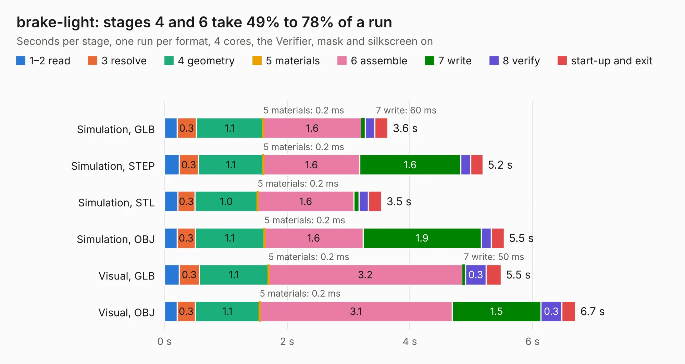

# 2705. brake-light

Board 2,705 of the 3,122 of [Corpus Testing](../Corpus-Testing.md), on [Corpus Page 26](../CorpusTestingPages/Corpus-Testing-26.md#2705-brake-light).

| Mode and format | 1–2 read | 3 resolve | 4 geometry | 5 materials | 6 assemble | 7 write | 8 verify | start-up and exit | Total |
|---|---:|---:|---:|---:|---:|---:|---:|---:|---:|
| Simulation, GLB | 0.2 | 0.3 | 1.1 | 0.2&nbsp;ms | 1.6 | 60&nbsp;ms | 0.2 | 0.2 | 3.6 |
| Simulation, STEP | 0.2 | 0.3 | 1.1 | 0.2&nbsp;ms | 1.6 | 1.6 | 0.2 | 0.2 | 5.2 |
| Simulation, STL | 0.2 | 0.3 | 1.0 | 0.2&nbsp;ms | 1.6 | 83&nbsp;ms | 0.2 | 0.2 | 3.5 |
| Simulation, OBJ | 0.2 | 0.3 | 1.1 | 0.2&nbsp;ms | 1.6 | 1.9 | 0.2 | 0.2 | 5.5 |
| Visual, GLB | 0.2 | 0.3 | 1.1 | 0.2&nbsp;ms | 3.2 | 50&nbsp;ms | 0.3 | 0.2 | 5.5 |
| Visual, OBJ | 0.2 | 0.3 | 1.1 | 0.2&nbsp;ms | 3.1 | 1.5 | 0.3 | 0.2 | 6.7 |

<table align="center"><tr><td valign="top">

| Board | Repo: [sufst/pcb](https://github.com/sufst/pcb) Board: `brake-light.kicad_pcb` |
|---|---|
| Folder | brake-light |
| Complexity | 247&nbsp;/&nbsp;1000 (size&nbsp;152, features&nbsp;95) |
| KESE&nbsp;features | through vias, custom pads, rounded, trapezoid or chamfered pads, filled zones, copper drawings, curved board outline, knockout text |
| Tested | 9th November 2026 |
| Copper&nbsp;layers | 2 |
| File&nbsp;format | KiCad 8 (20240108) |
| Parts,&nbsp;tracks,&nbsp;vias | 62, 203, 13 |
| Triangles,&nbsp;simulation | 372,316 in 49 parts |
| Verifier | PASS in all six runs |

</td><td valign="top">

<table>
<tr><th>File type</th><th>File size</th><th>Peak memory used</th></tr>
<tr><th colspan="3" align="left">Simulation</th></tr>
<tr><td>GLB</td><td align="right">14&nbsp;MB</td><td align="right">283&nbsp;MB</td></tr>
<tr><td>STEP</td><td align="right">68&nbsp;MB</td><td align="right">318&nbsp;MB</td></tr>
<tr><td>STL</td><td align="right">19&nbsp;MB</td><td align="right">285&nbsp;MB</td></tr>
<tr><td>OBJ</td><td align="right">39&nbsp;MB</td><td align="right">327&nbsp;MB</td></tr>
<tr><th colspan="3" align="left">Visual</th></tr>
<tr><td>GLB</td><td align="right">10&nbsp;MB</td><td align="right">298&nbsp;MB</td></tr>
<tr><td>OBJ</td><td align="right">30&nbsp;MB</td><td align="right">305&nbsp;MB</td></tr>
</table>

</td></tr></table>

| Previous | Next |
|:---|---:|
| [2704. bms-interface](b2704b_pcb_bms-interface.md) | [2706. BSPD](b2706b_pcb_BSPD.md) |
