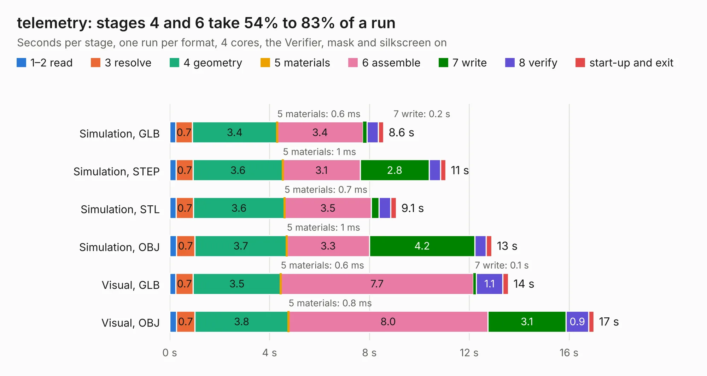

# 2705. telemetry

Board 2,705 of the 3,127 of [Corpus Testing](../Corpus-Testing.md), on [Corpus Page 26](../CorpusTestingPages/Corpus-Testing-26.md#2705-telemetry).

| Mode and format | 1–2 read | 3 resolve | 4 geometry | 5 materials | 6 assemble | 7 write | 8 verify | start-up and exit | Total |
|---|---:|---:|---:|---:|---:|---:|---:|---:|---:|
| Simulation, GLB | 0.2 | 0.7 | 3.4 | 0.6&nbsp;ms | 3.4 | 0.2 | 0.5 | 0.2 | 8.6 |
| Simulation, STEP | 0.3 | 0.7 | 3.6 | 1&nbsp;ms | 3.1 | 2.8 | 0.4 | 0.2 | 11.1 |
| Simulation, STL | 0.3 | 0.7 | 3.6 | 0.7&nbsp;ms | 3.5 | 0.3 | 0.5 | 0.2 | 9.1 |
| Simulation, OBJ | 0.3 | 0.7 | 3.7 | 1&nbsp;ms | 3.3 | 4.2 | 0.5 | 0.2 | 12.9 |
| Visual, GLB | 0.2 | 0.7 | 3.5 | 0.6&nbsp;ms | 7.7 | 0.1 | 1.1 | 0.2 | 13.6 |
| Visual, OBJ | 0.3 | 0.7 | 3.8 | 0.8&nbsp;ms | 8.0 | 3.1 | 0.9 | 0.2 | 17.0 |

<table align="center"><tr><td valign="top">

| Board | Repo: [sufst/pcb](https://github.com/sufst/pcb) Board: `telemetry.kicad_pcb` |
|---|---|
| Folder | archive / telemetry |
| Complexity | 246&nbsp;/&nbsp;1000 (size&nbsp;161, features&nbsp;85) |
| KESE&nbsp;features | through vias, rounded, trapezoid or chamfered pads, filled zones, curved board outline, stack-up, dielectric εr and tanδ |
| Tested | 9th November 2026 |
| Copper&nbsp;layers | 2 |
| File&nbsp;format | KiCad 7 (20221018) |
| Parts,&nbsp;tracks,&nbsp;vias | 44, 423, 37 |
| Triangles,&nbsp;simulation | 1,117,864 in 147 parts |
| Verifier | PASS in all six runs |

</td><td valign="top">

<table>
<tr><th>File type</th><th>File size</th><th>Peak memory used</th></tr>
<tr><th colspan="3" align="left">Simulation</th></tr>
<tr><td>GLB</td><td align="right">37&nbsp;MB</td><td align="right">475&nbsp;MB</td></tr>
<tr><td>STEP</td><td align="right">178&nbsp;MB</td><td align="right">595&nbsp;MB</td></tr>
<tr><td>STL</td><td align="right">56&nbsp;MB</td><td align="right">480&nbsp;MB</td></tr>
<tr><td>OBJ</td><td align="right">112&nbsp;MB</td><td align="right">797&nbsp;MB</td></tr>
<tr><th colspan="3" align="left">Visual</th></tr>
<tr><td>GLB</td><td align="right">26&nbsp;MB</td><td align="right">653&nbsp;MB</td></tr>
<tr><td>OBJ</td><td align="right">79&nbsp;MB</td><td align="right">638&nbsp;MB</td></tr>
</table>

</td></tr></table>

| Previous | Next |
|:---|---:|
| [2704. strain-gauge-amp-breakout](b2704b_pcb_strain-gauge-amp-breakout.md) | [2706. test-rig](b2706b_pcb_test-rig.md) |
