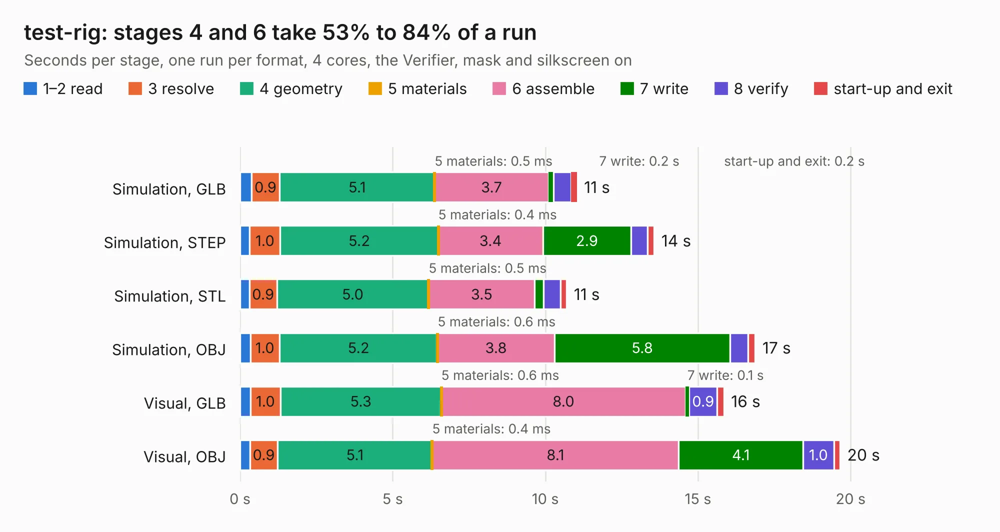

# 2706. test-rig

Board 2,706 of the 3,128 of [Corpus Testing](../Corpus-Testing.md), on [Corpus Page 26](../CorpusTestingPages/Corpus-Testing-26.md#2706-test-rig).

| Mode and format | 1–2 read | 3 resolve | 4 geometry | 5 materials | 6 assemble | 7 write | 8 verify | start-up and exit | Total |
|---|---:|---:|---:|---:|---:|---:|---:|---:|---:|
| Simulation, GLB | 0.4 | 0.9 | 5.1 | 0.5&nbsp;ms | 3.7 | 0.2 | 0.6 | 0.2 | 11.0 |
| Simulation, STEP | 0.3 | 1.0 | 5.2 | 0.4&nbsp;ms | 3.4 | 2.9 | 0.5 | 0.2 | 13.6 |
| Simulation, STL | 0.3 | 0.9 | 5.0 | 0.5&nbsp;ms | 3.5 | 0.3 | 0.5 | 0.2 | 10.7 |
| Simulation, OBJ | 0.3 | 1.0 | 5.2 | 0.6&nbsp;ms | 3.8 | 5.8 | 0.6 | 0.2 | 16.9 |
| Visual, GLB | 0.3 | 1.0 | 5.3 | 0.6&nbsp;ms | 8.0 | 0.1 | 0.9 | 0.2 | 15.8 |
| Visual, OBJ | 0.3 | 0.9 | 5.1 | 0.4&nbsp;ms | 8.1 | 4.1 | 1.0 | 0.2 | 19.7 |

<table align="center"><tr><td valign="top">

| Board | Repo: [sufst/pcb](https://github.com/sufst/pcb) Board: `test-rig.kicad_pcb` |
|---|---|
| Folder | archive / test-rig |
| Complexity | 264&nbsp;/&nbsp;1000 (size&nbsp;154, features&nbsp;110) |
| KESE&nbsp;features | through vias, slotted holes, rounded, trapezoid or chamfered pads, filled zones, curved board outline, knockout text, stack-up, dielectric εr and tanδ |
| Tested | 9th November 2026 |
| Copper&nbsp;layers | 2 |
| File&nbsp;format | KiCad 7 (20221018) |
| Parts,&nbsp;tracks,&nbsp;vias | 60, 259, 6 |
| Triangles,&nbsp;simulation | 1,130,338 in 68 parts |
| Verifier | PASS in all six runs |

</td><td valign="top">

<table>
<tr><th>File type</th><th>File size</th><th>Peak memory used</th></tr>
<tr><th colspan="3" align="left">Simulation</th></tr>
<tr><td>GLB</td><td align="right">38&nbsp;MB</td><td align="right">530&nbsp;MB</td></tr>
<tr><td>STEP</td><td align="right">174&nbsp;MB</td><td align="right">598&nbsp;MB</td></tr>
<tr><td>STL</td><td align="right">57&nbsp;MB</td><td align="right">545&nbsp;MB</td></tr>
<tr><td>OBJ</td><td align="right">114&nbsp;MB</td><td align="right">769&nbsp;MB</td></tr>
<tr><th colspan="3" align="left">Visual</th></tr>
<tr><td>GLB</td><td align="right">27&nbsp;MB</td><td align="right">680&nbsp;MB</td></tr>
<tr><td>OBJ</td><td align="right">82&nbsp;MB</td><td align="right">679&nbsp;MB</td></tr>
</table>

</td></tr></table>

| Previous | Next |
|:---|---:|
| [2705. telemetry](b2705b_pcb_telemetry.md) | [2707. tsal](b2707b_pcb_tsal.md) |
