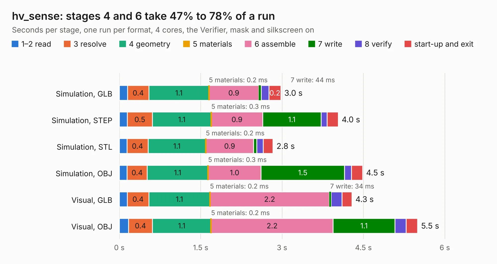

# 2707. hv_sense

Board 2,707 of the 3,117 of [Corpus Testing](../Corpus-Testing.md), on [Corpus Page 26](../CorpusTestingPages/Corpus-Testing-26.md#2707-hv_sense).

| Mode and format | 1–2 read | 3 resolve | 4 geometry | 5 materials | 6 assemble | 7 write | 8 verify | start-up and exit | Total |
|---|---:|---:|---:|---:|---:|---:|---:|---:|---:|
| Simulation, GLB | 0.2 | 0.4 | 1.1 | 0.2&nbsp;ms | 0.9 | 44&nbsp;ms | 0.1 | 0.2 | 3.0 |
| Simulation, STEP | 0.1 | 0.5 | 1.1 | 0.3&nbsp;ms | 0.9 | 1.1 | 0.1 | 0.2 | 4.0 |
| Simulation, STL | 0.1 | 0.4 | 1.1 | 0.2&nbsp;ms | 0.9 | 60&nbsp;ms | 0.1 | 0.2 | 2.8 |
| Simulation, OBJ | 0.1 | 0.4 | 1.1 | 0.3&nbsp;ms | 1.0 | 1.5 | 0.1 | 0.2 | 4.5 |
| Visual, GLB | 0.1 | 0.4 | 1.1 | 0.2&nbsp;ms | 2.2 | 34&nbsp;ms | 0.2 | 0.2 | 4.3 |
| Visual, OBJ | 0.2 | 0.4 | 1.1 | 0.2&nbsp;ms | 2.2 | 1.1 | 0.2 | 0.2 | 5.5 |

<table align="center"><tr><td valign="top">

| Board | Repo: [sufst/pcb](https://github.com/sufst/pcb) Board: `hv_sense.kicad_pcb` |
|---|---|
| Folder | hv-sense |
| Complexity | 250&nbsp;/&nbsp;1000 (size&nbsp;150, features&nbsp;100) |
| KESE&nbsp;features | through vias, rounded, trapezoid or chamfered pads, filled zones, curved board outline, knockout text, stack-up, dielectric εr and tanδ |
| Tested | 9th November 2026 |
| Copper&nbsp;layers | 2 |
| File&nbsp;format | KiCad 7 (20221018) |
| Parts,&nbsp;tracks,&nbsp;vias | 24, 94, 104 |
| Triangles,&nbsp;simulation | 272,196 in 32 parts |
| Verifier | PASS in all six runs |

</td><td valign="top">

<table>
<tr><th>File type</th><th>File size</th><th>Peak memory used</th></tr>
<tr><th colspan="3" align="left">Simulation</th></tr>
<tr><td>GLB</td><td align="right">9.4&nbsp;MB</td><td align="right">227&nbsp;MB</td></tr>
<tr><td>STEP</td><td align="right">32&nbsp;MB</td><td align="right">263&nbsp;MB</td></tr>
<tr><td>STL</td><td align="right">14&nbsp;MB</td><td align="right">242&nbsp;MB</td></tr>
<tr><td>OBJ</td><td align="right">27&nbsp;MB</td><td align="right">228&nbsp;MB</td></tr>
<tr><th colspan="3" align="left">Visual</th></tr>
<tr><td>GLB</td><td align="right">7.7&nbsp;MB</td><td align="right">239&nbsp;MB</td></tr>
<tr><td>OBJ</td><td align="right">22&nbsp;MB</td><td align="right">241&nbsp;MB</td></tr>
</table>

</td></tr></table>

| Previous | Next |
|:---|---:|
| [2706. Discharge](b2706b_pcb_Discharge.md) | [2708. CAN_Bridge](b2708b_pcb_CAN-Bridge.md) |
