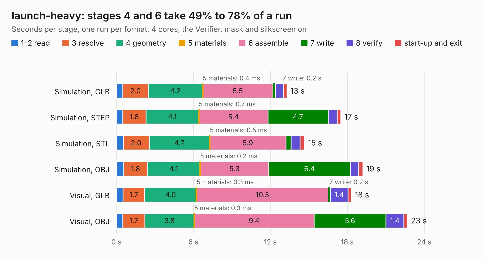

# 2708. launch-heavy

Board 2,708 of the 3,100 of [Corpus Testing](../Corpus-Testing.md), on [Corpus Page 26](../CorpusTestingPages/Corpus-Testing-26.md#2708-launch-heavy).

| Mode and format | 1–2 read | 3 resolve | 4 geometry | 5 materials | 6 assemble | 7 write | 8 verify | start-up and exit | Total |
|---|---:|---:|---:|---:|---:|---:|---:|---:|---:|
| Simulation, GLB | 0.5 | 2.0 | 4.2 | 0.4&nbsp;ms | 5.5 | 0.2 | 0.6 | 0.3 | 13.3 |
| Simulation, STEP | 0.5 | 1.8 | 4.1 | 0.7&nbsp;ms | 5.4 | 4.7 | 0.7 | 0.3 | 17.5 |
| Simulation, STL | 0.5 | 2.0 | 4.7 | 0.5&nbsp;ms | 5.9 | 0.4 | 0.7 | 0.3 | 14.7 |
| Simulation, OBJ | 0.6 | 1.8 | 4.1 | 0.2&nbsp;ms | 5.3 | 6.4 | 0.7 | 0.3 | 19.2 |
| Visual, GLB | 0.5 | 1.7 | 4.0 | 0.3&nbsp;ms | 10.3 | 0.2 | 1.4 | 0.3 | 18.3 |
| Visual, OBJ | 0.5 | 1.7 | 3.8 | 0.3&nbsp;ms | 9.4 | 5.6 | 1.4 | 0.3 | 22.7 |

<table align="center"><tr><td valign="top">

| Board | Repo: [system76/launch](https://github.com/system76/launch) Board: `launch-heavy.kicad_pcb` |
|---|---|
| Folder | pcb-heavy |
| Complexity | 285&nbsp;/&nbsp;1000 (size&nbsp;175, features&nbsp;110) |
| KESE&nbsp;features | through vias, rounded, trapezoid or chamfered pads, arc tracks, filled zones, copper text, curved board outline, stack-up, dielectric εr and tanδ |
| Tested | 9th November 2026 |
| Copper&nbsp;layers | 2 |
| File&nbsp;format | KiCad 6 (20211014) |
| Parts,&nbsp;tracks,&nbsp;vias | 64, 390, 202 |
| Triangles,&nbsp;simulation | 1,013,844 in 68 parts |
| Verifier | PASS in all six runs |

</td><td valign="top">

<table>
<tr><th>File type</th><th>File size</th><th>Peak memory used</th></tr>
<tr><th colspan="3" align="left">Simulation</th></tr>
<tr><td>GLB</td><td align="right">36&nbsp;MB</td><td align="right">482&nbsp;MB</td></tr>
<tr><td>STEP</td><td align="right">188&nbsp;MB</td><td align="right">615&nbsp;MB</td></tr>
<tr><td>STL</td><td align="right">51&nbsp;MB</td><td align="right">508&nbsp;MB</td></tr>
<tr><td>OBJ</td><td align="right">105&nbsp;MB</td><td align="right">716&nbsp;MB</td></tr>
<tr><th colspan="3" align="left">Visual</th></tr>
<tr><td>GLB</td><td align="right">30&nbsp;MB</td><td align="right">715&nbsp;MB</td></tr>
<tr><td>OBJ</td><td align="right">91&nbsp;MB</td><td align="right">692&nbsp;MB</td></tr>
</table>

</td></tr></table>

| Previous | Next |
|:---|---:|
| [2707. Raemixx500](b2707b_raemixx500_Raemixx500.md) | [2709. launch-iso](b2709b_launch_launch-iso.md) |
