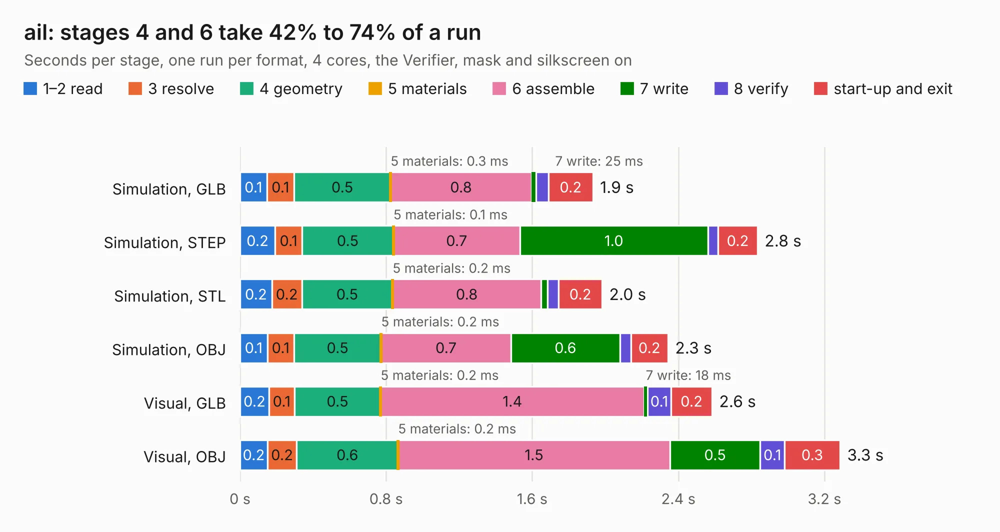

# 2710. ail

Board 2,710 of the 3,139 of [Corpus Testing](../Corpus-Testing.md), on [Corpus Page 26](../CorpusTestingPages/Corpus-Testing-26.md#2710-ail).

| Mode and format | 1–2 read | 3 resolve | 4 geometry | 5 materials | 6 assemble | 7 write | 8 verify | start-up and exit | Total |
|---|---:|---:|---:|---:|---:|---:|---:|---:|---:|
| Simulation, GLB | 0.1 | 0.1 | 0.5 | 0.3&nbsp;ms | 0.8 | 25&nbsp;ms | 68&nbsp;ms | 0.2 | 1.9 |
| Simulation, STEP | 0.2 | 0.1 | 0.5 | 0.1&nbsp;ms | 0.7 | 1.0 | 56&nbsp;ms | 0.2 | 2.8 |
| Simulation, STL | 0.2 | 0.2 | 0.5 | 0.2&nbsp;ms | 0.8 | 37&nbsp;ms | 60&nbsp;ms | 0.2 | 2.0 |
| Simulation, OBJ | 0.1 | 0.1 | 0.5 | 0.2&nbsp;ms | 0.7 | 0.6 | 59&nbsp;ms | 0.2 | 2.3 |
| Visual, GLB | 0.2 | 0.1 | 0.5 | 0.2&nbsp;ms | 1.4 | 18&nbsp;ms | 0.1 | 0.2 | 2.6 |
| Visual, OBJ | 0.2 | 0.2 | 0.6 | 0.2&nbsp;ms | 1.5 | 0.5 | 0.1 | 0.3 | 3.3 |

<table align="center"><tr><td valign="top">

| Board | Repo: [sufst/pcb](https://github.com/sufst/pcb) Board: `ail.kicad_pcb` |
|---|---|
| Folder | ail |
| Complexity | 211&nbsp;/&nbsp;1000 (size&nbsp;126, features&nbsp;85) |
| KESE&nbsp;features | rounded, trapezoid or chamfered pads, filled zones, curved board outline, knockout text, stack-up, dielectric εr and tanδ |
| Tested | 9th November 2026 |
| Copper&nbsp;layers | 2 |
| File&nbsp;format | KiCad 8 (20240108) |
| Parts,&nbsp;tracks,&nbsp;vias | 29, 83, 0 |
| Triangles,&nbsp;simulation | 114,676 in 34 parts |
| Verifier | PASS in all six runs |

</td><td valign="top">

<table>
<tr><th>File type</th><th>File size</th><th>Peak memory used</th></tr>
<tr><th colspan="3" align="left">Simulation</th></tr>
<tr><td>GLB</td><td align="right">4.1&nbsp;MB</td><td align="right">199&nbsp;MB</td></tr>
<tr><td>STEP</td><td align="right">23&nbsp;MB</td><td align="right">212&nbsp;MB</td></tr>
<tr><td>STL</td><td align="right">5.7&nbsp;MB</td><td align="right">198&nbsp;MB</td></tr>
<tr><td>OBJ</td><td align="right">11&nbsp;MB</td><td align="right">198&nbsp;MB</td></tr>
<tr><th colspan="3" align="left">Visual</th></tr>
<tr><td>GLB</td><td align="right">3.5&nbsp;MB</td><td align="right">172&nbsp;MB</td></tr>
<tr><td>OBJ</td><td align="right">9.5&nbsp;MB</td><td align="right">167&nbsp;MB</td></tr>
</table>

</td></tr></table>

| Previous | Next |
|:---|---:|
| [2709. ail-LED_handsolder](b2709b_pcb_ail-LED-handsolder.md) | [2711. debug-board](b2711b_pcb_debug-board.md) |
