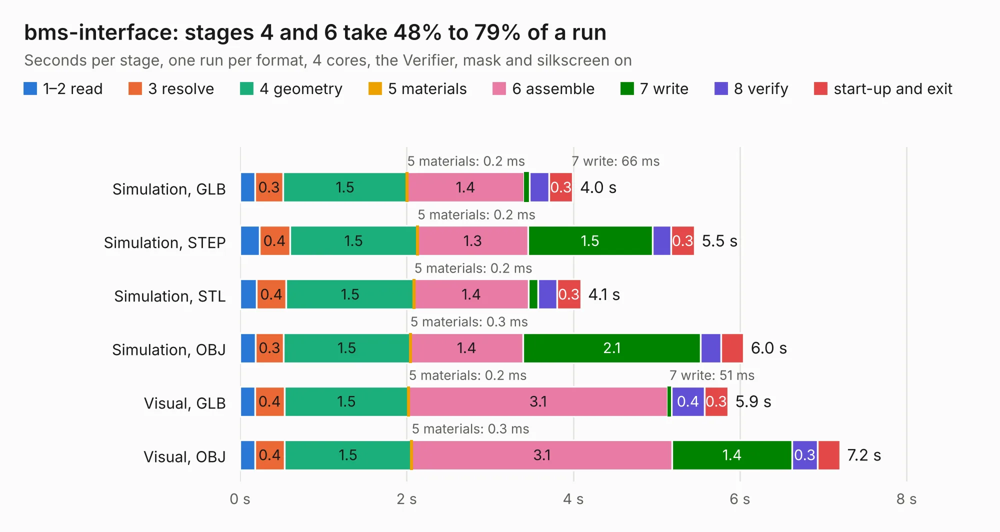

# 2710. bms-interface

Board 2,710 of the 3,129 of [Corpus Testing](../Corpus-Testing.md), on [Corpus Page 26](../CorpusTestingPages/Corpus-Testing-26.md#2710-bms-interface).

| Mode and format | 1–2 read | 3 resolve | 4 geometry | 5 materials | 6 assemble | 7 write | 8 verify | start-up and exit | Total |
|---|---:|---:|---:|---:|---:|---:|---:|---:|---:|
| Simulation, GLB | 0.2 | 0.3 | 1.5 | 0.2&nbsp;ms | 1.4 | 66&nbsp;ms | 0.2 | 0.3 | 4.0 |
| Simulation, STEP | 0.2 | 0.4 | 1.5 | 0.2&nbsp;ms | 1.3 | 1.5 | 0.2 | 0.3 | 5.5 |
| Simulation, STL | 0.2 | 0.4 | 1.5 | 0.2&nbsp;ms | 1.4 | 0.1 | 0.2 | 0.3 | 4.1 |
| Simulation, OBJ | 0.2 | 0.3 | 1.5 | 0.3&nbsp;ms | 1.4 | 2.1 | 0.2 | 0.3 | 6.0 |
| Visual, GLB | 0.2 | 0.4 | 1.5 | 0.2&nbsp;ms | 3.1 | 51&nbsp;ms | 0.4 | 0.3 | 5.9 |
| Visual, OBJ | 0.2 | 0.4 | 1.5 | 0.3&nbsp;ms | 3.1 | 1.4 | 0.3 | 0.3 | 7.2 |

<table align="center"><tr><td valign="top">

| Board | Repo: [sufst/pcb](https://github.com/sufst/pcb) Board: `bms-interface.kicad_pcb` |
|---|---|
| Folder | bms-interface |
| Complexity | 219&nbsp;/&nbsp;1000 (size&nbsp;129, features&nbsp;90) |
| KESE&nbsp;features | through vias, rounded, trapezoid or chamfered pads, filled zones, curved board outline, stack-up, dielectric εr and tanδ, mask and silkscreen colours |
| Tested | 9th November 2026 |
| Copper&nbsp;layers | 2 |
| File&nbsp;format | KiCad 9 (20241229) |
| Parts,&nbsp;tracks,&nbsp;vias | 11, 88, 32 |
| Triangles,&nbsp;simulation | 350,714 in 15 parts |
| Verifier | PASS in all six runs |

</td><td valign="top">

<table>
<tr><th>File type</th><th>File size</th><th>Peak memory used</th></tr>
<tr><th colspan="3" align="left">Simulation</th></tr>
<tr><td>GLB</td><td align="right">12&nbsp;MB</td><td align="right">270&nbsp;MB</td></tr>
<tr><td>STEP</td><td align="right">44&nbsp;MB</td><td align="right">291&nbsp;MB</td></tr>
<tr><td>STL</td><td align="right">18&nbsp;MB</td><td align="right">253&nbsp;MB</td></tr>
<tr><td>OBJ</td><td align="right">35&nbsp;MB</td><td align="right">280&nbsp;MB</td></tr>
<tr><th colspan="3" align="left">Visual</th></tr>
<tr><td>GLB</td><td align="right">8.4&nbsp;MB</td><td align="right">272&nbsp;MB</td></tr>
<tr><td>OBJ</td><td align="right">24&nbsp;MB</td><td align="right">274&nbsp;MB</td></tr>
</table>

</td></tr></table>

| Previous | Next |
|:---|---:|
| [2709. batak](b2709b_pcb_batak.md) | [2711. brake-light](b2711b_pcb_brake-light.md) |
