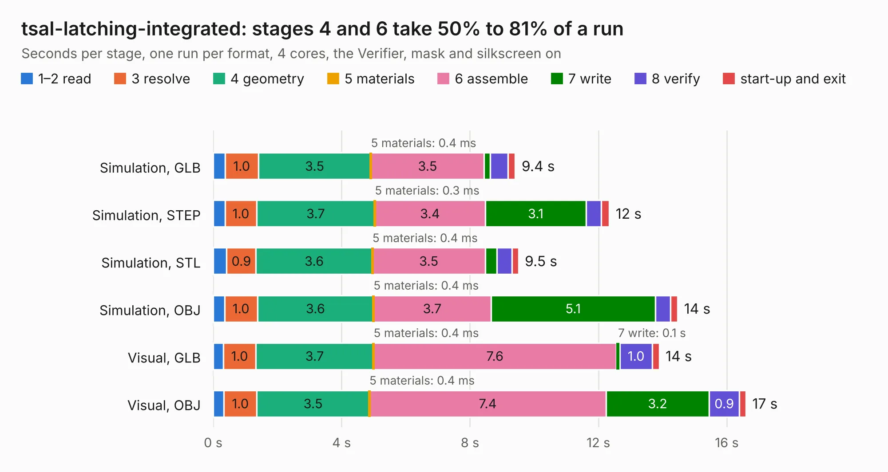

# 2710. tsal-latching-integrated

Board 2,710 of the 3,107 of [Corpus Testing](../Corpus-Testing.md), on [Corpus Page 26](../CorpusTestingPages/Corpus-Testing-26.md#2710-tsal-latching-integrated).

| Mode and format | 1–2 read | 3 resolve | 4 geometry | 5 materials | 6 assemble | 7 write | 8 verify | start-up and exit | Total |
|---|---:|---:|---:|---:|---:|---:|---:|---:|---:|
| Simulation, GLB | 0.4 | 1.0 | 3.5 | 0.4&nbsp;ms | 3.5 | 0.2 | 0.6 | 0.2 | 9.4 |
| Simulation, STEP | 0.4 | 1.0 | 3.7 | 0.3&nbsp;ms | 3.4 | 3.1 | 0.5 | 0.3 | 12.3 |
| Simulation, STL | 0.4 | 0.9 | 3.6 | 0.4&nbsp;ms | 3.5 | 0.4 | 0.5 | 0.2 | 9.5 |
| Simulation, OBJ | 0.4 | 1.0 | 3.6 | 0.4&nbsp;ms | 3.7 | 5.1 | 0.5 | 0.2 | 14.5 |
| Visual, GLB | 0.3 | 1.0 | 3.7 | 0.4&nbsp;ms | 7.6 | 0.1 | 1.0 | 0.2 | 13.9 |
| Visual, OBJ | 0.3 | 1.0 | 3.5 | 0.4&nbsp;ms | 7.4 | 3.2 | 0.9 | 0.2 | 16.6 |

<table align="center"><tr><td valign="top">

| Board | Repo: [sufst/pcb](https://github.com/sufst/pcb) Board: `tsal-latching-integrated.kicad_pcb` |
|---|---|
| Folder | tsal-latching-integrated |
| Complexity | 311&nbsp;/&nbsp;1000 (size&nbsp;186, features&nbsp;125) |
| KESE&nbsp;features | through vias, custom pads, rounded, trapezoid or chamfered pads, filled zones, copper drawings, curved board outline, knockout text, stack-up, dielectric εr and tanδ |
| Tested | 9th November 2026 |
| Copper&nbsp;layers | 4 |
| File&nbsp;format | KiCad 8 (20240108) |
| Parts,&nbsp;tracks,&nbsp;vias | 80, 429, 62 |
| Triangles,&nbsp;simulation | 1,076,692 in 77 parts |
| Verifier | PASS in all six runs |

</td><td valign="top">

<table>
<tr><th>File type</th><th>File size</th><th>Peak memory used</th></tr>
<tr><th colspan="3" align="left">Simulation</th></tr>
<tr><td>GLB</td><td align="right">37&nbsp;MB</td><td align="right">461&nbsp;MB</td></tr>
<tr><td>STEP</td><td align="right">156&nbsp;MB</td><td align="right">536&nbsp;MB</td></tr>
<tr><td>STL</td><td align="right">54&nbsp;MB</td><td align="right">456&nbsp;MB</td></tr>
<tr><td>OBJ</td><td align="right">109&nbsp;MB</td><td align="right">767&nbsp;MB</td></tr>
<tr><th colspan="3" align="left">Visual</th></tr>
<tr><td>GLB</td><td align="right">24&nbsp;MB</td><td align="right">661&nbsp;MB</td></tr>
<tr><td>OBJ</td><td align="right">73&nbsp;MB</td><td align="right">602&nbsp;MB</td></tr>
</table>

</td></tr></table>

| Previous | Next |
|:---|---:|
| [2709. trc](b2709b_pcb_trc.md) | [2711. tsal-led](b2711b_pcb_tsal-led.md) |
