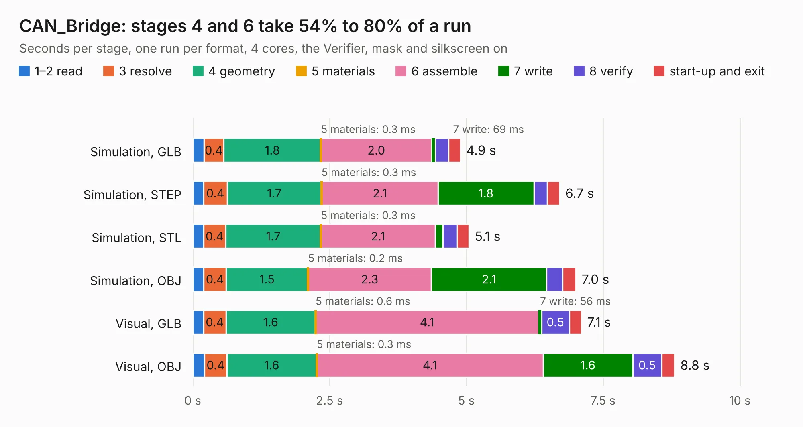

# 2712. CAN_Bridge

Board 2,712 of the 3,121 of [Corpus Testing](../Corpus-Testing.md), on [Corpus Page 26](../CorpusTestingPages/Corpus-Testing-26.md#2712-can_bridge).

| Mode and format | 1–2 read | 3 resolve | 4 geometry | 5 materials | 6 assemble | 7 write | 8 verify | start-up and exit | Total |
|---|---:|---:|---:|---:|---:|---:|---:|---:|---:|
| Simulation, GLB | 0.2 | 0.4 | 1.8 | 0.3&nbsp;ms | 2.0 | 69&nbsp;ms | 0.2 | 0.2 | 4.9 |
| Simulation, STEP | 0.2 | 0.4 | 1.7 | 0.3&nbsp;ms | 2.1 | 1.8 | 0.2 | 0.2 | 6.7 |
| Simulation, STL | 0.2 | 0.4 | 1.7 | 0.3&nbsp;ms | 2.1 | 0.1 | 0.3 | 0.2 | 5.1 |
| Simulation, OBJ | 0.2 | 0.4 | 1.5 | 0.2&nbsp;ms | 2.3 | 2.1 | 0.3 | 0.2 | 7.0 |
| Visual, GLB | 0.2 | 0.4 | 1.6 | 0.6&nbsp;ms | 4.1 | 56&nbsp;ms | 0.5 | 0.2 | 7.1 |
| Visual, OBJ | 0.2 | 0.4 | 1.6 | 0.3&nbsp;ms | 4.1 | 1.6 | 0.5 | 0.2 | 8.8 |

<table align="center"><tr><td valign="top">

| Board | Repo: [sufst/pcb](https://github.com/sufst/pcb) Board: `CAN_Bridge.kicad_pcb` |
|---|---|
| Folder | isolator |
| Complexity | 294&nbsp;/&nbsp;1000 (size&nbsp;194, features&nbsp;100) |
| KESE&nbsp;features | through vias, rounded, trapezoid or chamfered pads, filled zones, curved board outline, knockout text, stack-up, dielectric εr and tanδ |
| Tested | 9th November 2026 |
| Copper&nbsp;layers | 2 |
| File&nbsp;format | KiCad 7 (20221018) |
| Parts,&nbsp;tracks,&nbsp;vias | 41, 283, 32 |
| Triangles,&nbsp;simulation | 459,396 in 84 parts |
| Verifier | PASS in all six runs |

</td><td valign="top">

<table>
<tr><th>File type</th><th>File size</th><th>Peak memory used</th></tr>
<tr><th colspan="3" align="left">Simulation</th></tr>
<tr><td>GLB</td><td align="right">16&nbsp;MB</td><td align="right">305&nbsp;MB</td></tr>
<tr><td>STEP</td><td align="right">76&nbsp;MB</td><td align="right">350&nbsp;MB</td></tr>
<tr><td>STL</td><td align="right">23&nbsp;MB</td><td align="right">303&nbsp;MB</td></tr>
<tr><td>OBJ</td><td align="right">46&nbsp;MB</td><td align="right">368&nbsp;MB</td></tr>
<tr><th colspan="3" align="left">Visual</th></tr>
<tr><td>GLB</td><td align="right">13&nbsp;MB</td><td align="right">350&nbsp;MB</td></tr>
<tr><td>OBJ</td><td align="right">37&nbsp;MB</td><td align="right">352&nbsp;MB</td></tr>
</table>

</td></tr></table>

| Previous | Next |
|:---|---:|
| [2711. hv_sense](b2711b_pcb_hv-sense.md) | [2713. lvbms-connector](b2713b_pcb_lvbms-connector.md) |
