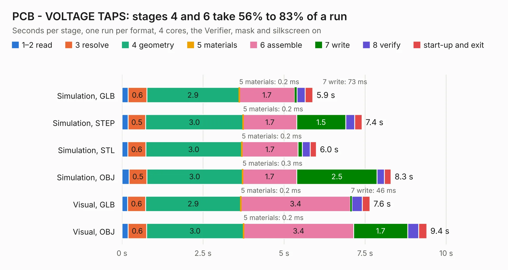

# 2712. PCB - VOLTAGE TAPS

Board 2,712 of the 3,119 of [Corpus Testing](../Corpus-Testing.md), on [Corpus Page 26](../CorpusTestingPages/Corpus-Testing-26.md#2712-pcb---voltage-taps).

| Mode and format | 1–2 read | 3 resolve | 4 geometry | 5 materials | 6 assemble | 7 write | 8 verify | start-up and exit | Total |
|---|---:|---:|---:|---:|---:|---:|---:|---:|---:|
| Simulation, GLB | 0.2 | 0.6 | 2.9 | 0.2&nbsp;ms | 1.7 | 73&nbsp;ms | 0.2 | 0.2 | 5.9 |
| Simulation, STEP | 0.2 | 0.5 | 3.0 | 0.2&nbsp;ms | 1.7 | 1.5 | 0.3 | 0.2 | 7.4 |
| Simulation, STL | 0.2 | 0.6 | 3.0 | 0.2&nbsp;ms | 1.7 | 0.1 | 0.2 | 0.2 | 6.0 |
| Simulation, OBJ | 0.2 | 0.5 | 3.0 | 0.3&nbsp;ms | 1.7 | 2.5 | 0.2 | 0.2 | 8.3 |
| Visual, GLB | 0.2 | 0.6 | 2.9 | 0.2&nbsp;ms | 3.4 | 46&nbsp;ms | 0.3 | 0.2 | 7.6 |
| Visual, OBJ | 0.2 | 0.6 | 3.0 | 0.2&nbsp;ms | 3.4 | 1.7 | 0.3 | 0.3 | 9.4 |

<table align="center"><tr><td valign="top">

| Board | Repo: [sufst/pcb](https://github.com/sufst/pcb) Board: `PCB - VOLTAGE TAPS.kicad_pcb` |
|---|---|
| Folder | PCB - VOLTAGE TAPS |
| Complexity | 267&nbsp;/&nbsp;1000 (size&nbsp;122, features&nbsp;145) |
| KESE&nbsp;features | slotted holes, custom pads, rounded, trapezoid or chamfered pads, arc tracks, copper drawings, curved board outline, knockout text, TrueType text, stack-up, dielectric εr and tanδ, copper finish |
| Tested | 9th November 2026 |
| Copper&nbsp;layers | 2 |
| File&nbsp;format | KiCad 7 (20221018) |
| Parts,&nbsp;tracks,&nbsp;vias | 26, 68, 0 |
| Triangles,&nbsp;simulation | 459,532 in 25 parts |
| Verifier | PASS in all six runs |

</td><td valign="top">

<table>
<tr><th>File type</th><th>File size</th><th>Peak memory used</th></tr>
<tr><th colspan="3" align="left">Simulation</th></tr>
<tr><td>GLB</td><td align="right">17&nbsp;MB</td><td align="right">273&nbsp;MB</td></tr>
<tr><td>STEP</td><td align="right">94&nbsp;MB</td><td align="right">325&nbsp;MB</td></tr>
<tr><td>STL</td><td align="right">23&nbsp;MB</td><td align="right">266&nbsp;MB</td></tr>
<tr><td>OBJ</td><td align="right">49&nbsp;MB</td><td align="right">374&nbsp;MB</td></tr>
<tr><th colspan="3" align="left">Visual</th></tr>
<tr><td>GLB</td><td align="right">10&nbsp;MB</td><td align="right">286&nbsp;MB</td></tr>
<tr><td>OBJ</td><td align="right">30&nbsp;MB</td><td align="right">304&nbsp;MB</td></tr>
</table>

</td></tr></table>

| Previous | Next |
|:---|---:|
| [2711. lvbms-connector](b2711b_pcb_lvbms-connector.md) | [2713. precharge](b2713b_pcb_precharge.md) |
