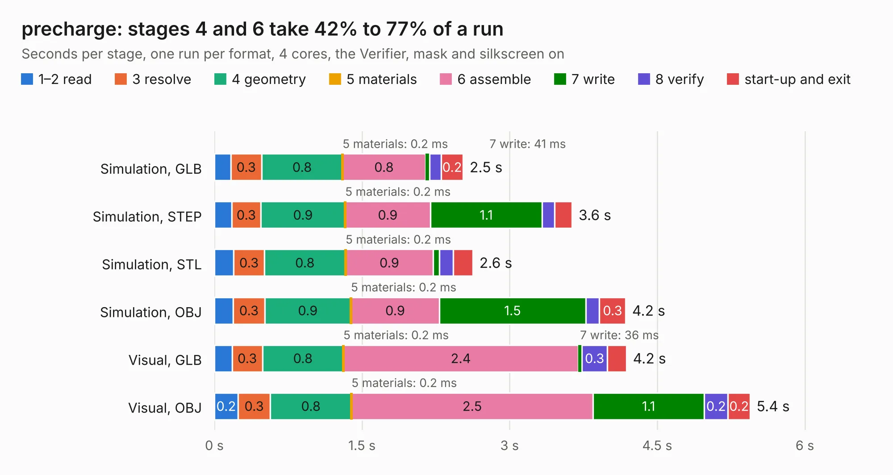

# 2712. precharge

Board 2,712 of the 3,118 of [Corpus Testing](../Corpus-Testing.md), on [Corpus Page 26](../CorpusTestingPages/Corpus-Testing-26.md#2712-precharge).

| Mode and format | 1–2 read | 3 resolve | 4 geometry | 5 materials | 6 assemble | 7 write | 8 verify | start-up and exit | Total |
|---|---:|---:|---:|---:|---:|---:|---:|---:|---:|
| Simulation, GLB | 0.2 | 0.3 | 0.8 | 0.2&nbsp;ms | 0.8 | 41&nbsp;ms | 0.1 | 0.2 | 2.5 |
| Simulation, STEP | 0.2 | 0.3 | 0.9 | 0.2&nbsp;ms | 0.9 | 1.1 | 0.1 | 0.2 | 3.6 |
| Simulation, STL | 0.2 | 0.3 | 0.8 | 0.2&nbsp;ms | 0.9 | 65&nbsp;ms | 0.1 | 0.2 | 2.6 |
| Simulation, OBJ | 0.2 | 0.3 | 0.9 | 0.2&nbsp;ms | 0.9 | 1.5 | 0.1 | 0.3 | 4.2 |
| Visual, GLB | 0.2 | 0.3 | 0.8 | 0.2&nbsp;ms | 2.4 | 36&nbsp;ms | 0.3 | 0.2 | 4.2 |
| Visual, OBJ | 0.2 | 0.3 | 0.8 | 0.2&nbsp;ms | 2.5 | 1.1 | 0.2 | 0.2 | 5.4 |

<table align="center"><tr><td valign="top">

| Board | Repo: [sufst/pcb](https://github.com/sufst/pcb) Board: `precharge.kicad_pcb` |
|---|---|
| Folder | precharge |
| Complexity | 221&nbsp;/&nbsp;1000 (size&nbsp;141, features&nbsp;80) |
| KESE&nbsp;features | through vias, rounded, trapezoid or chamfered pads, curved board outline, knockout text, stack-up, dielectric εr and tanδ |
| Tested | 9th November 2026 |
| Copper&nbsp;layers | 2 |
| File&nbsp;format | KiCad 9 (20241229) |
| Parts,&nbsp;tracks,&nbsp;vias | 40, 153, 4 |
| Triangles,&nbsp;simulation | 243,334 in 48 parts |
| Verifier | PASS in all six runs |

</td><td valign="top">

<table>
<tr><th>File type</th><th>File size</th><th>Peak memory used</th></tr>
<tr><th colspan="3" align="left">Simulation</th></tr>
<tr><td>GLB</td><td align="right">8.3&nbsp;MB</td><td align="right">232&nbsp;MB</td></tr>
<tr><td>STEP</td><td align="right">39&nbsp;MB</td><td align="right">246&nbsp;MB</td></tr>
<tr><td>STL</td><td align="right">12&nbsp;MB</td><td align="right">236&nbsp;MB</td></tr>
<tr><td>OBJ</td><td align="right">24&nbsp;MB</td><td align="right">224&nbsp;MB</td></tr>
<tr><th colspan="3" align="left">Visual</th></tr>
<tr><td>GLB</td><td align="right">6.8&nbsp;MB</td><td align="right">223&nbsp;MB</td></tr>
<tr><td>OBJ</td><td align="right">19&nbsp;MB</td><td align="right">222&nbsp;MB</td></tr>
</table>

</td></tr></table>

| Previous | Next |
|:---|---:|
| [2711. PCB - VOLTAGE TAPS](b2711b_pcb_PCB-VOLTAGE-TAPS.md) | [2713. right-sidepanel](b2713b_pcb_right-sidepanel.md) |
