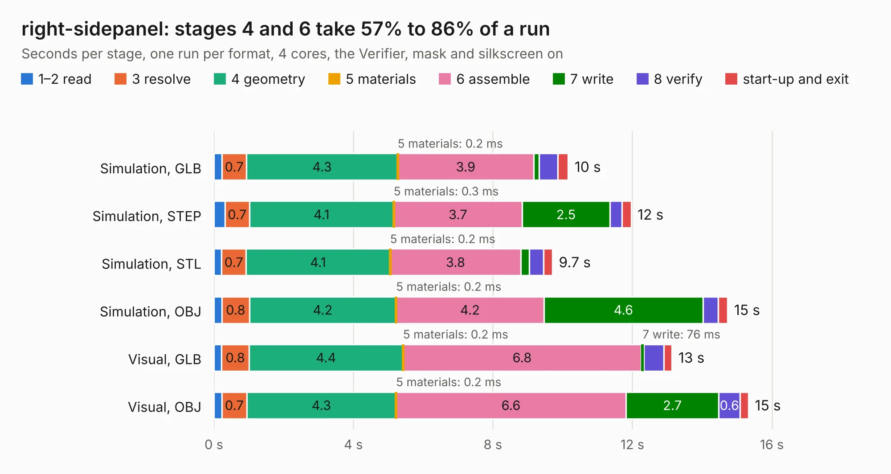

# 2712. right-sidepanel

Board 2,712 of the 3,117 of [Corpus Testing](../Corpus-Testing.md), on [Corpus Page 26](../CorpusTestingPages/Corpus-Testing-26.md#2712-right-sidepanel).

| Mode and format | 1–2 read | 3 resolve | 4 geometry | 5 materials | 6 assemble | 7 write | 8 verify | start-up and exit | Total |
|---|---:|---:|---:|---:|---:|---:|---:|---:|---:|
| Simulation, GLB | 0.2 | 0.7 | 4.3 | 0.2&nbsp;ms | 3.9 | 0.2 | 0.5 | 0.3 | 10.2 |
| Simulation, STEP | 0.3 | 0.7 | 4.1 | 0.3&nbsp;ms | 3.7 | 2.5 | 0.4 | 0.3 | 12.0 |
| Simulation, STL | 0.2 | 0.7 | 4.1 | 0.2&nbsp;ms | 3.8 | 0.2 | 0.4 | 0.3 | 9.7 |
| Simulation, OBJ | 0.2 | 0.8 | 4.2 | 0.2&nbsp;ms | 4.2 | 4.6 | 0.4 | 0.3 | 14.7 |
| Visual, GLB | 0.2 | 0.8 | 4.4 | 0.2&nbsp;ms | 6.8 | 76&nbsp;ms | 0.6 | 0.2 | 13.1 |
| Visual, OBJ | 0.2 | 0.7 | 4.3 | 0.2&nbsp;ms | 6.6 | 2.7 | 0.6 | 0.2 | 15.3 |

<table align="center"><tr><td valign="top">

| Board | Repo: [sufst/pcb](https://github.com/sufst/pcb) Board: `right-sidepanel.kicad_pcb` |
|---|---|
| Folder | right-sidepanel |
| Complexity | 230&nbsp;/&nbsp;1000 (size&nbsp;160, features&nbsp;70) |
| KESE&nbsp;features | through vias, rounded, trapezoid or chamfered pads, filled zones, curved board outline, knockout text |
| Tested | 9th November 2026 |
| Copper&nbsp;layers | 2 |
| File&nbsp;format | KiCad 9 (20241229) |
| Parts,&nbsp;tracks,&nbsp;vias | 34, 122, 155 |
| Triangles,&nbsp;simulation | 775,100 in 39 parts |
| Note | panel |
| Verifier | PASS in all six runs |

</td><td valign="top">

<table>
<tr><th>File type</th><th>File size</th><th>Peak memory used</th></tr>
<tr><th colspan="3" align="left">Simulation</th></tr>
<tr><td>GLB</td><td align="right">26&nbsp;MB</td><td align="right">346&nbsp;MB</td></tr>
<tr><td>STEP</td><td align="right">96&nbsp;MB</td><td align="right">441&nbsp;MB</td></tr>
<tr><td>STL</td><td align="right">39&nbsp;MB</td><td align="right">348&nbsp;MB</td></tr>
<tr><td>OBJ</td><td align="right">78&nbsp;MB</td><td align="right">581&nbsp;MB</td></tr>
<tr><th colspan="3" align="left">Visual</th></tr>
<tr><td>GLB</td><td align="right">15&nbsp;MB</td><td align="right">476&nbsp;MB</td></tr>
<tr><td>OBJ</td><td align="right">44&nbsp;MB</td><td align="right">440&nbsp;MB</td></tr>
</table>

</td></tr></table>

| Previous | Next |
|:---|---:|
| [2711. precharge](b2711b_pcb_precharge.md) | [2713. rotary-switch](b2713b_pcb_rotary-switch.md) |
