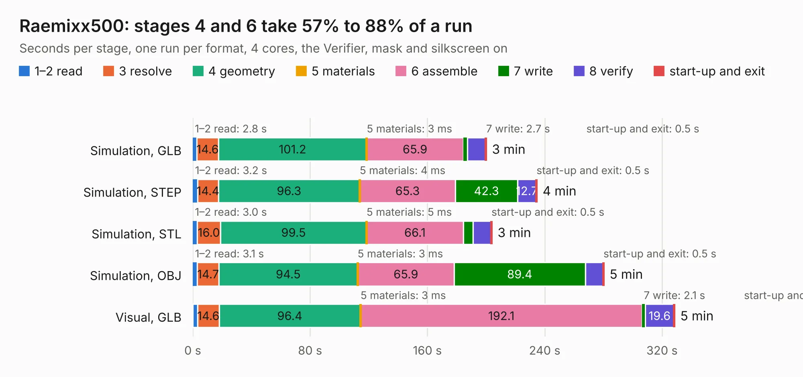

# 2712. Raemixx500

Board 2,712 of the 3,105 of [Corpus Testing](../Corpus-Testing.md), on [Corpus Page 26](../CorpusTestingPages/Corpus-Testing-26.md#2712-raemixx500).

| Mode and format | 1–2 read | 3 resolve | 4 geometry | 5 materials | 6 assemble | 7 write | 8 verify | start-up and exit | Total |
|---|---:|---:|---:|---:|---:|---:|---:|---:|---:|
| Simulation, GLB | 2.8 | 14.6 | 101.2 | 3&nbsp;ms | 65.9 | 2.7 | 12.5 | 0.5 | 200.1 |
| Simulation, STEP | 3.2 | 14.4 | 96.3 | 4&nbsp;ms | 65.3 | 42.3 | 12.7 | 0.5 | 234.7 |
| Simulation, STL | 3.0 | 16.0 | 99.5 | 5&nbsp;ms | 66.1 | 6.5 | 12.4 | 0.5 | 204.0 |
| Simulation, OBJ | 3.1 | 14.7 | 94.5 | 3&nbsp;ms | 65.9 | 89.4 | 12.1 | 0.5 | 280.3 |
| Visual, GLB | 3.3 | 14.6 | 96.4 | 3&nbsp;ms | 192.1 | 2.1 | 19.6 | 0.4 | 328.5 |
| Visual, OBJ | 2.8 | 14.5 | 95.5 | 5&nbsp;ms | 188.1 | 57.8 | 18.5 | 0.4 | 377.6 |

<table align="center"><tr><td valign="top">

| Board | Repo: [sukkopera/raemixx500](https://github.com/sukkopera/raemixx500) Board: `Raemixx500.kicad_pcb` |
|---|---|
| Complexity | 362&nbsp;/&nbsp;1000 (size&nbsp;277, features&nbsp;85) |
| KESE&nbsp;features | through vias, slotted holes, rounded, trapezoid or chamfered pads, drill offsets, filled zones, copper text, curved board outline |
| Tested | 9th November 2026 |
| Copper&nbsp;layers | 2 |
| File&nbsp;format | KiCad 5 (20171130) |
| Parts,&nbsp;tracks,&nbsp;vias | 362, 11,735, 902 |
| Triangles,&nbsp;simulation | 15,351,150 in 483 parts |
| Verifier | PASS in all six runs |

</td><td valign="top">

<table>
<tr><th>File type</th><th>File size</th><th>Peak memory used</th></tr>
<tr><th colspan="3" align="left">Simulation</th></tr>
<tr><td>GLB</td><td align="right">519&nbsp;MB</td><td align="right">4.5&nbsp;GB</td></tr>
<tr><td>STEP</td><td align="right">2.6&nbsp;GB</td><td align="right">5.6&nbsp;GB</td></tr>
<tr><td>STL</td><td align="right">768&nbsp;MB</td><td align="right">4.5&nbsp;GB</td></tr>
<tr><td>OBJ</td><td align="right">1.7&nbsp;GB</td><td align="right">9.5&nbsp;GB</td></tr>
<tr><th colspan="3" align="left">Visual</th></tr>
<tr><td>GLB</td><td align="right">369&nbsp;MB</td><td align="right">5.5&nbsp;GB</td></tr>
<tr><td>OBJ</td><td align="right">1.2&nbsp;GB</td><td align="right">7.3&nbsp;GB</td></tr>
</table>

</td></tr></table>

| Previous | Next |
|:---|---:|
| [2711. LittleSixteen](b2711b_LittleSixteen_LittleSixteen.md) | [2713. launch-heavy](b2713b_launch_launch-heavy.md) |
