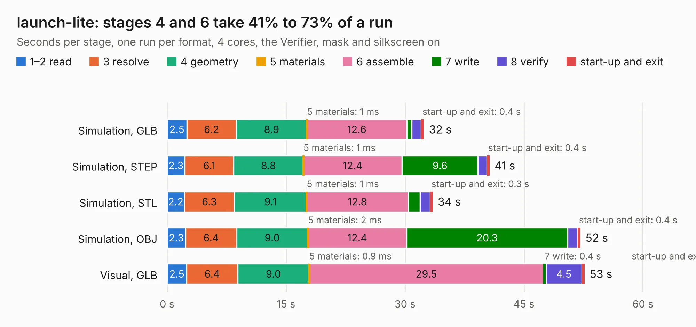

# 2713. launch-lite

Board 2,713 of the 3,102 of [Corpus Testing](../Corpus-Testing.md), on [Corpus Page 26](../CorpusTestingPages/Corpus-Testing-26.md#2713-launch-lite).

| Mode and format | 1–2 read | 3 resolve | 4 geometry | 5 materials | 6 assemble | 7 write | 8 verify | start-up and exit | Total |
|---|---:|---:|---:|---:|---:|---:|---:|---:|---:|
| Simulation, GLB | 2.5 | 6.2 | 8.9 | 1&nbsp;ms | 12.6 | 0.6 | 1.2 | 0.4 | 32.4 |
| Simulation, STEP | 2.3 | 6.1 | 8.8 | 1&nbsp;ms | 12.4 | 9.6 | 1.1 | 0.4 | 40.7 |
| Simulation, STL | 2.2 | 6.3 | 9.1 | 1&nbsp;ms | 12.8 | 1.5 | 1.3 | 0.3 | 33.5 |
| Simulation, OBJ | 2.3 | 6.4 | 9.0 | 2&nbsp;ms | 12.4 | 20.3 | 1.3 | 0.4 | 52.1 |
| Visual, GLB | 2.5 | 6.4 | 9.0 | 0.9&nbsp;ms | 29.5 | 0.4 | 4.5 | 0.4 | 52.7 |
| Visual, OBJ | 2.4 | 6.3 | 9.1 | 1&nbsp;ms | 28.5 | 12.5 | 5.5 | 0.4 | 64.7 |

<table align="center"><tr><td valign="top">

| Board | Repo: [system76/launch](https://github.com/system76/launch) Board: `launch-lite.kicad_pcb` |
|---|---|
| Folder | pcb-lite |
| Complexity | 388&nbsp;/&nbsp;1000 (size&nbsp;258, features&nbsp;130) |
| KESE&nbsp;features | through vias, slotted holes, custom pads, rounded, trapezoid or chamfered pads, filled zones, copper drawings, copper text, curved board outline, stack-up, dielectric εr and tanδ |
| Tested | 9th November 2026 |
| Copper&nbsp;layers | 4 |
| File&nbsp;format | KiCad 6 (20211014) |
| Parts,&nbsp;tracks,&nbsp;vias | 211, 1,375, 292 |
| Triangles,&nbsp;simulation | 3,642,802 in 223 parts |
| Verifier | PASS in all six runs |

</td><td valign="top">

<table>
<tr><th>File type</th><th>File size</th><th>Peak memory used</th></tr>
<tr><th colspan="3" align="left">Simulation</th></tr>
<tr><td>GLB</td><td align="right">126&nbsp;MB</td><td align="right">1.3&nbsp;GB</td></tr>
<tr><td>STEP</td><td align="right">668&nbsp;MB</td><td align="right">1.6&nbsp;GB</td></tr>
<tr><td>STL</td><td align="right">182&nbsp;MB</td><td align="right">1.3&nbsp;GB</td></tr>
<tr><td>OBJ</td><td align="right">395&nbsp;MB</td><td align="right">2.5&nbsp;GB</td></tr>
<tr><th colspan="3" align="left">Visual</th></tr>
<tr><td>GLB</td><td align="right">74&nbsp;MB</td><td align="right">1.3&nbsp;GB</td></tr>
<tr><td>OBJ</td><td align="right">229&nbsp;MB</td><td align="right">1.7&nbsp;GB</td></tr>
</table>

</td></tr></table>

| Previous | Next |
|:---|---:|
| [2712. launch-lite-iso](b2712b_launch_launch-lite-iso.md) | [2714. launch](b2714b_launch_launch.md) |
