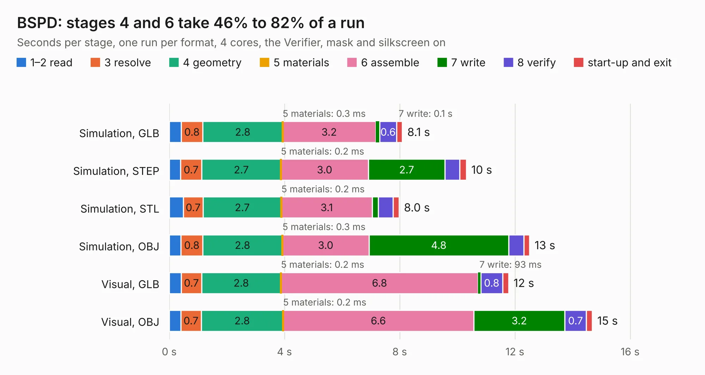

# 2714. BSPD

Board 2,714 of the 3,131 of [Corpus Testing](../Corpus-Testing.md), on [Corpus Page 26](../CorpusTestingPages/Corpus-Testing-26.md#2714-bspd).

| Mode and format | 1–2 read | 3 resolve | 4 geometry | 5 materials | 6 assemble | 7 write | 8 verify | start-up and exit | Total |
|---|---:|---:|---:|---:|---:|---:|---:|---:|---:|
| Simulation, GLB | 0.4 | 0.8 | 2.8 | 0.3&nbsp;ms | 3.2 | 0.1 | 0.6 | 0.2 | 8.1 |
| Simulation, STEP | 0.4 | 0.7 | 2.7 | 0.2&nbsp;ms | 3.0 | 2.7 | 0.5 | 0.2 | 10.3 |
| Simulation, STL | 0.5 | 0.7 | 2.7 | 0.2&nbsp;ms | 3.1 | 0.2 | 0.5 | 0.2 | 8.0 |
| Simulation, OBJ | 0.4 | 0.8 | 2.8 | 0.3&nbsp;ms | 3.0 | 4.8 | 0.5 | 0.2 | 12.5 |
| Visual, GLB | 0.4 | 0.7 | 2.8 | 0.2&nbsp;ms | 6.8 | 93&nbsp;ms | 0.8 | 0.2 | 11.8 |
| Visual, OBJ | 0.4 | 0.7 | 2.8 | 0.2&nbsp;ms | 6.6 | 3.2 | 0.7 | 0.2 | 14.7 |

<table align="center"><tr><td valign="top">

| Board | Repo: [sufst/pcb](https://github.com/sufst/pcb) Board: `BSPD.kicad_pcb` |
|---|---|
| Folder | bspd |
| Complexity | 321&nbsp;/&nbsp;1000 (size&nbsp;181, features&nbsp;140) |
| KESE&nbsp;features | through vias, custom pads, rounded, trapezoid or chamfered pads, filled zones, copper drawings, curved board outline, knockout text, TrueType text, stack-up, dielectric εr and tanδ |
| Tested | 9th November 2026 |
| Copper&nbsp;layers | 4 |
| File&nbsp;format | KiCad 9 (20241229) |
| Parts,&nbsp;tracks,&nbsp;vias | 68, 363, 41 |
| Triangles,&nbsp;simulation | 986,096 in 70 parts |
| Verifier | PASS in all six runs |

</td><td valign="top">

<table>
<tr><th>File type</th><th>File size</th><th>Peak memory used</th></tr>
<tr><th colspan="3" align="left">Simulation</th></tr>
<tr><td>GLB</td><td align="right">34&nbsp;MB</td><td align="right">415&nbsp;MB</td></tr>
<tr><td>STEP</td><td align="right">160&nbsp;MB</td><td align="right">511&nbsp;MB</td></tr>
<tr><td>STL</td><td align="right">49&nbsp;MB</td><td align="right">452&nbsp;MB</td></tr>
<tr><td>OBJ</td><td align="right">100&nbsp;MB</td><td align="right">672&nbsp;MB</td></tr>
<tr><th colspan="3" align="left">Visual</th></tr>
<tr><td>GLB</td><td align="right">23&nbsp;MB</td><td align="right">562&nbsp;MB</td></tr>
<tr><td>OBJ</td><td align="right">68&nbsp;MB</td><td align="right">552&nbsp;MB</td></tr>
</table>

</td></tr></table>

| Previous | Next |
|:---|---:|
| [2713. brake-light](b2713b_pcb_brake-light.md) | [2715. can-repeater](b2715b_pcb_can-repeater.md) |
