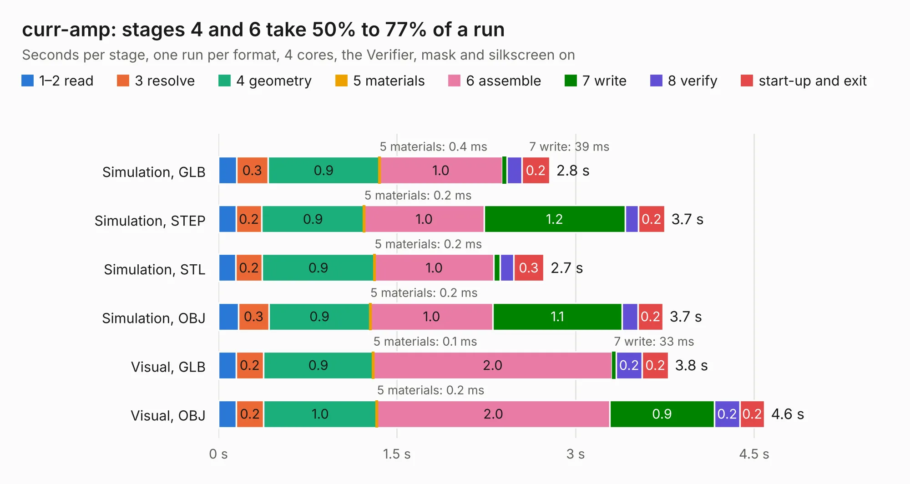

# 2714. curr-amp

Board 2,714 of the 3,129 of [Corpus Testing](../Corpus-Testing.md), on [Corpus Page 26](../CorpusTestingPages/Corpus-Testing-26.md#2714-curr-amp).

| Mode and format | 1–2 read | 3 resolve | 4 geometry | 5 materials | 6 assemble | 7 write | 8 verify | start-up and exit | Total |
|---|---:|---:|---:|---:|---:|---:|---:|---:|---:|
| Simulation, GLB | 0.2 | 0.3 | 0.9 | 0.4&nbsp;ms | 1.0 | 39&nbsp;ms | 0.1 | 0.2 | 2.8 |
| Simulation, STEP | 0.1 | 0.2 | 0.9 | 0.2&nbsp;ms | 1.0 | 1.2 | 0.1 | 0.2 | 3.7 |
| Simulation, STL | 0.1 | 0.2 | 0.9 | 0.2&nbsp;ms | 1.0 | 54&nbsp;ms | 0.1 | 0.3 | 2.7 |
| Simulation, OBJ | 0.2 | 0.3 | 0.9 | 0.2&nbsp;ms | 1.0 | 1.1 | 0.1 | 0.2 | 3.7 |
| Visual, GLB | 0.1 | 0.2 | 0.9 | 0.1&nbsp;ms | 2.0 | 33&nbsp;ms | 0.2 | 0.2 | 3.8 |
| Visual, OBJ | 0.2 | 0.2 | 1.0 | 0.2&nbsp;ms | 2.0 | 0.9 | 0.2 | 0.2 | 4.6 |

<table align="center"><tr><td valign="top">

| Board | Repo: [sufst/pcb](https://github.com/sufst/pcb) Board: `curr-amp.kicad_pcb` |
|---|---|
| Folder | curr-amp |
| Complexity | 238&nbsp;/&nbsp;1000 (size&nbsp;143, features&nbsp;95) |
| KESE&nbsp;features | through vias, custom pads, rounded, trapezoid or chamfered pads, filled zones, copper drawings, curved board outline, knockout text |
| Tested | 9th November 2026 |
| Copper&nbsp;layers | 2 |
| File&nbsp;format | KiCad 8 (20240108) |
| Parts,&nbsp;tracks,&nbsp;vias | 33, 181, 11 |
| Triangles,&nbsp;simulation | 219,220 in 37 parts |
| Verifier | PASS in all six runs |

</td><td valign="top">

<table>
<tr><th>File type</th><th>File size</th><th>Peak memory used</th></tr>
<tr><th colspan="3" align="left">Simulation</th></tr>
<tr><td>GLB</td><td align="right">7.6&nbsp;MB</td><td align="right">224&nbsp;MB</td></tr>
<tr><td>STEP</td><td align="right">39&nbsp;MB</td><td align="right">248&nbsp;MB</td></tr>
<tr><td>STL</td><td align="right">11&nbsp;MB</td><td align="right">224&nbsp;MB</td></tr>
<tr><td>OBJ</td><td align="right">22&nbsp;MB</td><td align="right">224&nbsp;MB</td></tr>
<tr><th colspan="3" align="left">Visual</th></tr>
<tr><td>GLB</td><td align="right">6.5&nbsp;MB</td><td align="right">225&nbsp;MB</td></tr>
<tr><td>OBJ</td><td align="right">19&nbsp;MB</td><td align="right">226&nbsp;MB</td></tr>
</table>

</td></tr></table>

| Previous | Next |
|:---|---:|
| [2713. can-repeater](b2713b_pcb_can-repeater.md) | [2715. Dash-PCB](b2715b_pcb_Dash-PCB.md) |
