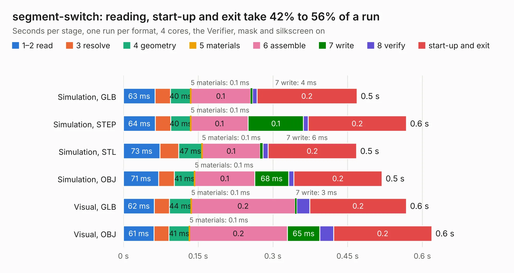

# 2716. segment-switch

Board 2,716 of the 3,119 of [Corpus Testing](../Corpus-Testing.md), on [Corpus Page 26](../CorpusTestingPages/Corpus-Testing-26.md#2716-segment-switch).

| Mode and format | 1–2 read | 3 resolve | 4 geometry | 5 materials | 6 assemble | 7 write | 8 verify | start-up and exit | Total |
|---|---:|---:|---:|---:|---:|---:|---:|---:|---:|
| Simulation, GLB | 63&nbsp;ms | 31&nbsp;ms | 40&nbsp;ms | 0.1&nbsp;ms | 0.1 | 4&nbsp;ms | 9&nbsp;ms | 0.2 | 0.5 |
| Simulation, STEP | 64&nbsp;ms | 31&nbsp;ms | 40&nbsp;ms | 0.1&nbsp;ms | 0.1 | 0.1 | 10&nbsp;ms | 0.2 | 0.6 |
| Simulation, STL | 73&nbsp;ms | 37&nbsp;ms | 47&nbsp;ms | 0.1&nbsp;ms | 0.1 | 6&nbsp;ms | 10&nbsp;ms | 0.2 | 0.5 |
| Simulation, OBJ | 71&nbsp;ms | 32&nbsp;ms | 41&nbsp;ms | 0.1&nbsp;ms | 0.1 | 68&nbsp;ms | 11&nbsp;ms | 0.2 | 0.5 |
| Visual, GLB | 62&nbsp;ms | 31&nbsp;ms | 44&nbsp;ms | 0.1&nbsp;ms | 0.2 | 3&nbsp;ms | 27&nbsp;ms | 0.2 | 0.6 |
| Visual, OBJ | 61&nbsp;ms | 30&nbsp;ms | 41&nbsp;ms | 0.1&nbsp;ms | 0.2 | 65&nbsp;ms | 28&nbsp;ms | 0.2 | 0.6 |

<table align="center"><tr><td valign="top">

| Board | Repo: [sufst/pcb](https://github.com/sufst/pcb) Board: `segment-switch.kicad_pcb` |
|---|---|
| Folder | segment-switch |
| Complexity | 120&nbsp;/&nbsp;1000 (size&nbsp;65, features&nbsp;55) |
| KESE&nbsp;features | rounded, trapezoid or chamfered pads, filled zones, curved board outline, knockout text |
| Tested | 9th November 2026 |
| Copper&nbsp;layers | 2 |
| File&nbsp;format | KiCad 9 (20241229) |
| Parts,&nbsp;tracks,&nbsp;vias | 2, 8, 0 |
| Triangles,&nbsp;simulation | 16,958 in 10 parts |
| Verifier | PASS in all six runs |

</td><td valign="top">

<table>
<tr><th>File type</th><th>File size</th><th>Peak memory used</th></tr>
<tr><th colspan="3" align="left">Simulation</th></tr>
<tr><td>GLB</td><td align="right">617&nbsp;kB</td><td align="right">61&nbsp;MB</td></tr>
<tr><td>STEP</td><td align="right">2.8&nbsp;MB</td><td align="right">64&nbsp;MB</td></tr>
<tr><td>STL</td><td align="right">849&nbsp;kB</td><td align="right">61&nbsp;MB</td></tr>
<tr><td>OBJ</td><td align="right">1.7&nbsp;MB</td><td align="right">63&nbsp;MB</td></tr>
<tr><th colspan="3" align="left">Visual</th></tr>
<tr><td>GLB</td><td align="right">599&nbsp;kB</td><td align="right">87&nbsp;MB</td></tr>
<tr><td>OBJ</td><td align="right">1.6&nbsp;MB</td><td align="right">89&nbsp;MB</td></tr>
</table>

</td></tr></table>

| Previous | Next |
|:---|---:|
| [2715. rotary-switch](b2715b_pcb_rotary-switch.md) | [2717. 16Ch-Sensor-Hub](b2717b_pcb_16Ch-Sensor-Hub.md) |
