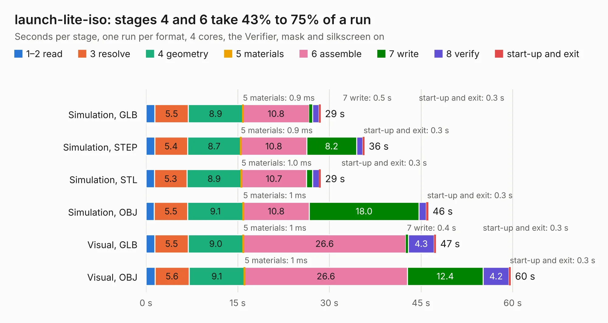

# 2717. launch-lite-iso

Board 2,717 of the 3,107 of [Corpus Testing](../Corpus-Testing.md), on [Corpus Page 26](../CorpusTestingPages/Corpus-Testing-26.md#2717-launch-lite-iso).

| Mode and format | 1–2 read | 3 resolve | 4 geometry | 5 materials | 6 assemble | 7 write | 8 verify | start-up and exit | Total |
|---|---:|---:|---:|---:|---:|---:|---:|---:|---:|
| Simulation, GLB | 1.5 | 5.5 | 8.9 | 0.9&nbsp;ms | 10.8 | 0.5 | 1.1 | 0.3 | 28.6 |
| Simulation, STEP | 1.4 | 5.4 | 8.7 | 0.9&nbsp;ms | 10.8 | 8.2 | 1.0 | 0.3 | 35.7 |
| Simulation, STL | 1.4 | 5.3 | 8.9 | 1.0&nbsp;ms | 10.7 | 1.0 | 1.1 | 0.3 | 28.6 |
| Simulation, OBJ | 1.3 | 5.5 | 9.1 | 1&nbsp;ms | 10.8 | 18.0 | 1.2 | 0.3 | 46.2 |
| Visual, GLB | 1.5 | 5.5 | 9.0 | 1&nbsp;ms | 26.6 | 0.4 | 4.3 | 0.3 | 47.4 |
| Visual, OBJ | 1.5 | 5.6 | 9.1 | 1&nbsp;ms | 26.6 | 12.4 | 4.2 | 0.3 | 59.7 |

<table align="center"><tr><td valign="top">

| Board | Repo: [system76/launch](https://github.com/system76/launch) Board: `launch-lite-iso.kicad_pcb` |
|---|---|
| Folder | pcb-lite-iso |
| Complexity | 403&nbsp;/&nbsp;1000 (size&nbsp;258, features&nbsp;145) |
| KESE&nbsp;features | through vias, slotted holes, custom pads, rounded, trapezoid or chamfered pads, arc tracks, filled zones, copper drawings, copper text, curved board outline, stack-up, dielectric εr and tanδ |
| Tested | 9th November 2026 |
| Copper&nbsp;layers | 4 |
| File&nbsp;format | KiCad 6 (20211014) |
| Parts,&nbsp;tracks,&nbsp;vias | 214, 1,358, 307 |
| Triangles,&nbsp;simulation | 3,028,702 in 226 parts |
| Verifier | PASS in all six runs |

</td><td valign="top">

<table>
<tr><th>File type</th><th>File size</th><th>Peak memory used</th></tr>
<tr><th colspan="3" align="left">Simulation</th></tr>
<tr><td>GLB</td><td align="right">104&nbsp;MB</td><td align="right">1.1&nbsp;GB</td></tr>
<tr><td>STEP</td><td align="right">436&nbsp;MB</td><td align="right">1.3&nbsp;GB</td></tr>
<tr><td>STL</td><td align="right">151&nbsp;MB</td><td align="right">1.1&nbsp;GB</td></tr>
<tr><td>OBJ</td><td align="right">326&nbsp;MB</td><td align="right">2.0&nbsp;GB</td></tr>
<tr><th colspan="3" align="left">Visual</th></tr>
<tr><td>GLB</td><td align="right">70&nbsp;MB</td><td align="right">1.2&nbsp;GB</td></tr>
<tr><td>OBJ</td><td align="right">218&nbsp;MB</td><td align="right">1.6&nbsp;GB</td></tr>
</table>

</td></tr></table>

| Previous | Next |
|:---|---:|
| [2716. launch-iso](b2716b_launch_launch-iso.md) | [2718. launch-lite](b2718b_launch_launch-lite.md) |
