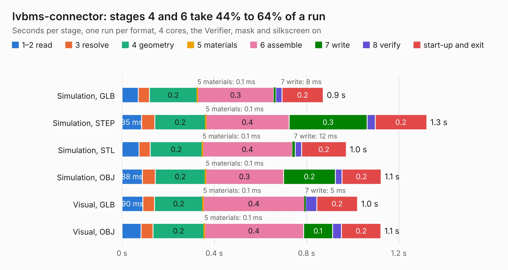

# 2719. lvbms-connector

Board 2,719 of the 3,128 of [Corpus Testing](../Corpus-Testing.md), on [Corpus Page 26](../CorpusTestingPages/Corpus-Testing-26.md#2719-lvbms-connector).

| Mode and format | 1–2 read | 3 resolve | 4 geometry | 5 materials | 6 assemble | 7 write | 8 verify | start-up and exit | Total |
|---|---:|---:|---:|---:|---:|---:|---:|---:|---:|
| Simulation, GLB | 70&nbsp;ms | 48&nbsp;ms | 0.2 | 0.1&nbsp;ms | 0.3 | 8&nbsp;ms | 28&nbsp;ms | 0.2 | 0.9 |
| Simulation, STEP | 85&nbsp;ms | 57&nbsp;ms | 0.2 | 0.1&nbsp;ms | 0.4 | 0.3 | 35&nbsp;ms | 0.2 | 1.3 |
| Simulation, STL | 73&nbsp;ms | 50&nbsp;ms | 0.2 | 0.1&nbsp;ms | 0.4 | 12&nbsp;ms | 27&nbsp;ms | 0.2 | 1.0 |
| Simulation, OBJ | 88&nbsp;ms | 56&nbsp;ms | 0.2 | 0.1&nbsp;ms | 0.3 | 0.2 | 28&nbsp;ms | 0.2 | 1.1 |
| Visual, GLB | 90&nbsp;ms | 51&nbsp;ms | 0.2 | 0.1&nbsp;ms | 0.4 | 5&nbsp;ms | 48&nbsp;ms | 0.2 | 1.0 |
| Visual, OBJ | 82&nbsp;ms | 52&nbsp;ms | 0.2 | 0.1&nbsp;ms | 0.4 | 0.1 | 39&nbsp;ms | 0.2 | 1.1 |

<table align="center"><tr><td valign="top">

| Board | Repo: [sufst/pcb](https://github.com/sufst/pcb) Board: `lvbms-connector.kicad_pcb` |
|---|---|
| Folder | lvbms-conn |
| Complexity | 62&nbsp;/&nbsp;1000 (size&nbsp;32, features&nbsp;30) |
| KESE&nbsp;features | rounded, trapezoid or chamfered pads, filled zones |
| Tested | 9th November 2026 |
| Copper&nbsp;layers | 2 |
| File&nbsp;format | KiCad 8 (20240108) |
| Parts,&nbsp;tracks,&nbsp;vias | 3, 0, 0 |
| Triangles,&nbsp;simulation | 45,170 in 17 parts |
| Verifier | PASS in all six runs |

</td><td valign="top">

<table>
<tr><th>File type</th><th>File size</th><th>Peak memory used</th></tr>
<tr><th colspan="3" align="left">Simulation</th></tr>
<tr><td>GLB</td><td align="right">1.5&nbsp;MB</td><td align="right">66&nbsp;MB</td></tr>
<tr><td>STEP</td><td align="right">5.4&nbsp;MB</td><td align="right">70&nbsp;MB</td></tr>
<tr><td>STL</td><td align="right">2.3&nbsp;MB</td><td align="right">68&nbsp;MB</td></tr>
<tr><td>OBJ</td><td align="right">4.3&nbsp;MB</td><td align="right">85&nbsp;MB</td></tr>
<tr><th colspan="3" align="left">Visual</th></tr>
<tr><td>GLB</td><td align="right">931&nbsp;kB</td><td align="right">99&nbsp;MB</td></tr>
<tr><td>OBJ</td><td align="right">2.5&nbsp;MB</td><td align="right">100&nbsp;MB</td></tr>
</table>

</td></tr></table>

| Previous | Next |
|:---|---:|
| [2718. CAN_Bridge](b2718b_pcb_CAN-Bridge.md) | [2720. PCB - VOLTAGE TAPS](b2720b_pcb_PCB-VOLTAGE-TAPS.md) |
