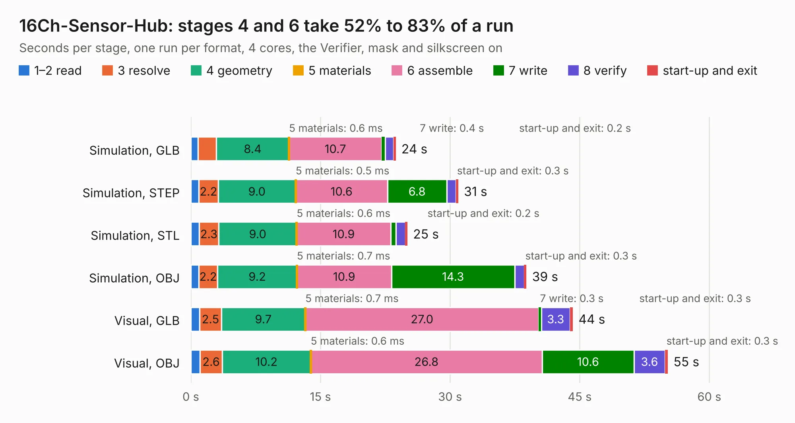

# 2721. 16Ch-Sensor-Hub

Board 2,721 of the 3,123 of [Corpus Testing](../Corpus-Testing.md), on [Corpus Page 26](../CorpusTestingPages/Corpus-Testing-26.md#2721-16ch-sensor-hub).

| Mode and format | 1–2 read | 3 resolve | 4 geometry | 5 materials | 6 assemble | 7 write | 8 verify | start-up and exit | Total |
|---|---:|---:|---:|---:|---:|---:|---:|---:|---:|
| Simulation, GLB | 0.8 | 2.1 | 8.4 | 0.6&nbsp;ms | 10.7 | 0.4 | 1.0 | 0.2 | 23.7 |
| Simulation, STEP | 0.9 | 2.2 | 9.0 | 0.5&nbsp;ms | 10.6 | 6.8 | 1.1 | 0.3 | 30.9 |
| Simulation, STL | 1.0 | 2.3 | 9.0 | 0.6&nbsp;ms | 10.9 | 0.6 | 1.1 | 0.2 | 25.1 |
| Simulation, OBJ | 0.9 | 2.2 | 9.2 | 0.7&nbsp;ms | 10.9 | 14.3 | 1.1 | 0.3 | 38.8 |
| Visual, GLB | 1.0 | 2.5 | 9.7 | 0.7&nbsp;ms | 27.0 | 0.3 | 3.3 | 0.3 | 44.2 |
| Visual, OBJ | 1.1 | 2.6 | 10.2 | 0.6&nbsp;ms | 26.8 | 10.6 | 3.6 | 0.3 | 55.2 |

<table align="center"><tr><td valign="top">

| Board | Repo: [sufst/pcb](https://github.com/sufst/pcb) Board: `16Ch-Sensor-Hub.kicad_pcb` |
|---|---|
| Folder | sensor-hub |
| Complexity | 375&nbsp;/&nbsp;1000 (size&nbsp;250, features&nbsp;125) |
| KESE&nbsp;features | through vias, custom pads, rounded, trapezoid or chamfered pads, filled zones, copper drawings, curved board outline, knockout text, stack-up, dielectric εr and tanδ |
| Tested | 9th November 2026 |
| Copper&nbsp;layers | 4 |
| File&nbsp;format | KiCad 9 (20241229) |
| Parts,&nbsp;tracks,&nbsp;vias | 170, 906, 236 |
| Triangles,&nbsp;simulation | 2,375,892 in 122 parts |
| Verifier | PASS in all six runs |

</td><td valign="top">

<table>
<tr><th>File type</th><th>File size</th><th>Peak memory used</th></tr>
<tr><th colspan="3" align="left">Simulation</th></tr>
<tr><td>GLB</td><td align="right">82&nbsp;MB</td><td align="right">845&nbsp;MB</td></tr>
<tr><td>STEP</td><td align="right">389&nbsp;MB</td><td align="right">1.0&nbsp;GB</td></tr>
<tr><td>STL</td><td align="right">119&nbsp;MB</td><td align="right">824&nbsp;MB</td></tr>
<tr><td>OBJ</td><td align="right">252&nbsp;MB</td><td align="right">1.6&nbsp;GB</td></tr>
<tr><th colspan="3" align="left">Visual</th></tr>
<tr><td>GLB</td><td align="right">52&nbsp;MB</td><td align="right">979&nbsp;MB</td></tr>
<tr><td>OBJ</td><td align="right">159&nbsp;MB</td><td align="right">1.2&nbsp;GB</td></tr>
</table>

</td></tr></table>

| Previous | Next |
|:---|---:|
| [2720. segment-switch](b2720b_pcb_segment-switch.md) | [2722. 8Ch-Sensor-Hub](b2722b_pcb_8Ch-Sensor-Hub.md) |
