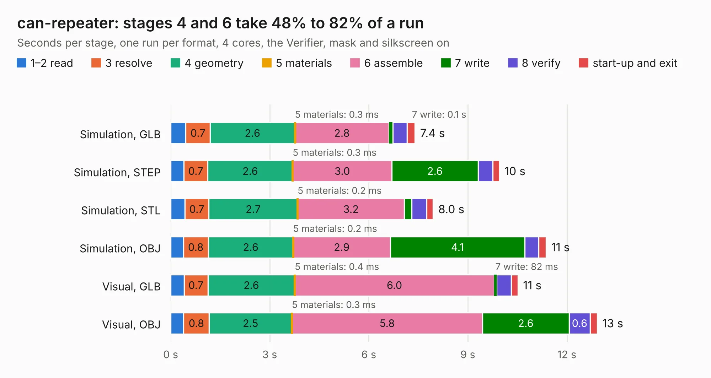

# 2723. can-repeater

Board 2,723 of the 3,139 of [Corpus Testing](../Corpus-Testing.md), on [Corpus Page 26](../CorpusTestingPages/Corpus-Testing-26.md#2723-can-repeater).

| Mode and format | 1–2 read | 3 resolve | 4 geometry | 5 materials | 6 assemble | 7 write | 8 verify | start-up and exit | Total |
|---|---:|---:|---:|---:|---:|---:|---:|---:|---:|
| Simulation, GLB | 0.5 | 0.7 | 2.6 | 0.3&nbsp;ms | 2.8 | 0.1 | 0.4 | 0.2 | 7.4 |
| Simulation, STEP | 0.4 | 0.7 | 2.6 | 0.3&nbsp;ms | 3.0 | 2.6 | 0.4 | 0.2 | 10.0 |
| Simulation, STL | 0.4 | 0.7 | 2.7 | 0.2&nbsp;ms | 3.2 | 0.2 | 0.4 | 0.2 | 8.0 |
| Simulation, OBJ | 0.4 | 0.8 | 2.6 | 0.2&nbsp;ms | 2.9 | 4.1 | 0.4 | 0.2 | 11.4 |
| Visual, GLB | 0.4 | 0.7 | 2.6 | 0.4&nbsp;ms | 6.0 | 82&nbsp;ms | 0.4 | 0.2 | 10.5 |
| Visual, OBJ | 0.4 | 0.8 | 2.5 | 0.3&nbsp;ms | 5.8 | 2.6 | 0.6 | 0.2 | 12.9 |

<table align="center"><tr><td valign="top">

| Board | Repo: [sufst/pcb](https://github.com/sufst/pcb) Board: `can-repeater.kicad_pcb` |
|---|---|
| Folder | can-repeater |
| Complexity | 362&nbsp;/&nbsp;1000 (size&nbsp;222, features&nbsp;140) |
| KESE&nbsp;features | through vias, custom pads, rounded, trapezoid or chamfered pads, filled zones, copper drawings, curved board outline, knockout text, TrueType text, stack-up, dielectric εr and tanδ |
| Tested | 9th November 2026 |
| Copper&nbsp;layers | 4 |
| File&nbsp;format | KiCad 9 (20241229) |
| Parts,&nbsp;tracks,&nbsp;vias | 61, 338, 74 |
| Triangles,&nbsp;simulation | 787,626 in 94 parts |
| Verifier | PASS in all six runs |

</td><td valign="top">

<table>
<tr><th>File type</th><th>File size</th><th>Peak memory used</th></tr>
<tr><th colspan="3" align="left">Simulation</th></tr>
<tr><td>GLB</td><td align="right">27&nbsp;MB</td><td align="right">370&nbsp;MB</td></tr>
<tr><td>STEP</td><td align="right">130&nbsp;MB</td><td align="right">444&nbsp;MB</td></tr>
<tr><td>STL</td><td align="right">39&nbsp;MB</td><td align="right">379&nbsp;MB</td></tr>
<tr><td>OBJ</td><td align="right">80&nbsp;MB</td><td align="right">554&nbsp;MB</td></tr>
<tr><th colspan="3" align="left">Visual</th></tr>
<tr><td>GLB</td><td align="right">18&nbsp;MB</td><td align="right">499&nbsp;MB</td></tr>
<tr><td>OBJ</td><td align="right">55&nbsp;MB</td><td align="right">497&nbsp;MB</td></tr>
</table>

</td></tr></table>

| Previous | Next |
|:---|---:|
| [2722. BSPD](b2722b_pcb_BSPD.md) | [2724. curr-amp](b2724b_pcb_curr-amp.md) |
