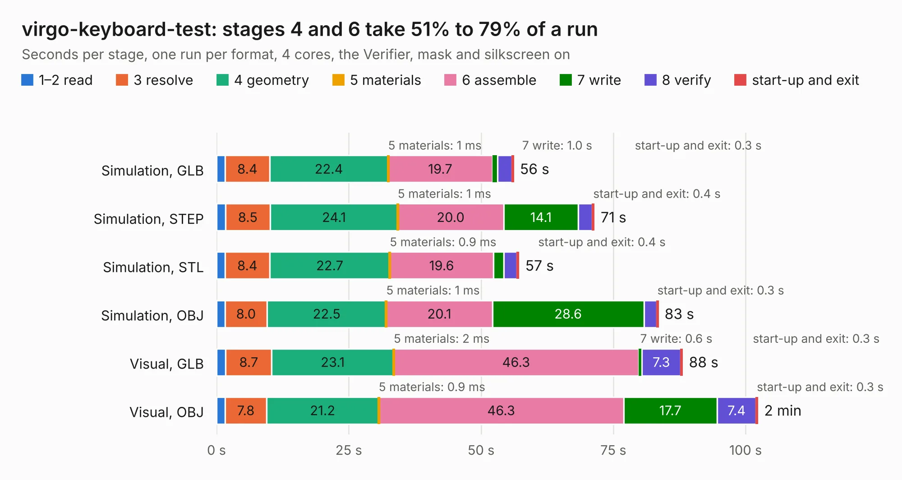

# 2723. virgo-keyboard-test

Board 2,723 of the 3,107 of [Corpus Testing](../Corpus-Testing.md), on [Corpus Page 26](../CorpusTestingPages/Corpus-Testing-26.md#2723-virgo-keyboard-test).

| Mode and format | 1–2 read | 3 resolve | 4 geometry | 5 materials | 6 assemble | 7 write | 8 verify | start-up and exit | Total |
|---|---:|---:|---:|---:|---:|---:|---:|---:|---:|
| Simulation, GLB | 1.6 | 8.4 | 22.4 | 1&nbsp;ms | 19.7 | 1.0 | 2.7 | 0.3 | 56.1 |
| Simulation, STEP | 1.7 | 8.5 | 24.1 | 1&nbsp;ms | 20.0 | 14.1 | 2.6 | 0.4 | 71.4 |
| Simulation, STL | 1.6 | 8.4 | 22.7 | 0.9&nbsp;ms | 19.6 | 1.9 | 2.5 | 0.4 | 57.1 |
| Simulation, OBJ | 1.6 | 8.0 | 22.5 | 1&nbsp;ms | 20.1 | 28.6 | 2.4 | 0.3 | 83.5 |
| Visual, GLB | 1.7 | 8.7 | 23.1 | 2&nbsp;ms | 46.3 | 0.6 | 7.3 | 0.3 | 88.1 |
| Visual, OBJ | 1.6 | 7.8 | 21.2 | 0.9&nbsp;ms | 46.3 | 17.7 | 7.4 | 0.3 | 102.3 |

<table align="center"><tr><td valign="top">

| Board | Repo: [system76/virgo](https://github.com/system76/virgo) Board: `virgo-keyboard-test.kicad_pcb` |
|---|---|
| Folder | pcb-keyboard |
| Complexity | 390&nbsp;/&nbsp;1000 (size&nbsp;265, features&nbsp;125) |
| KESE&nbsp;features | through vias, rounded, trapezoid or chamfered pads, filled zones, copper text, curved board outline, knockout text, stack-up, dielectric εr and tanδ, copper finish |
| Tested | 9th November 2026 |
| Copper&nbsp;layers | 4 |
| File&nbsp;format | KiCad 7 (20221018) |
| Parts,&nbsp;tracks,&nbsp;vias | 261, 1,802, 424 |
| Triangles,&nbsp;simulation | 5,464,548 in 257 parts |
| Verifier | PASS in all six runs |

</td><td valign="top">

<table>
<tr><th>File type</th><th>File size</th><th>Peak memory used</th></tr>
<tr><th colspan="3" align="left">Simulation</th></tr>
<tr><td>GLB</td><td align="right">187&nbsp;MB</td><td align="right">1.6&nbsp;GB</td></tr>
<tr><td>STEP</td><td align="right">835&nbsp;MB</td><td align="right">2.1&nbsp;GB</td></tr>
<tr><td>STL</td><td align="right">273&nbsp;MB</td><td align="right">1.7&nbsp;GB</td></tr>
<tr><td>OBJ</td><td align="right">588&nbsp;MB</td><td align="right">3.6&nbsp;GB</td></tr>
<tr><th colspan="3" align="left">Visual</th></tr>
<tr><td>GLB</td><td align="right">124&nbsp;MB</td><td align="right">2.0&nbsp;GB</td></tr>
<tr><td>OBJ</td><td align="right">395&nbsp;MB</td><td align="right">2.6&nbsp;GB</td></tr>
</table>

</td></tr></table>

| Previous | Next |
|:---|---:|
| [2722. thelio-io](b2722b_thelio-io-hardware_thelio-io.md) | [2724. virgo-rpl-uph](b2724b_virgo_virgo-rpl-uph.md) |
