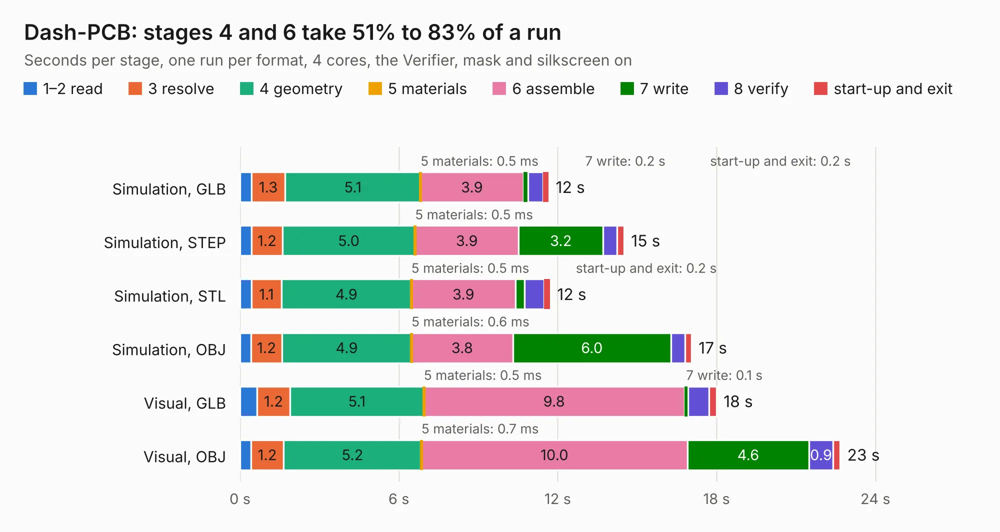

# 2725. Dash-PCB

Board 2,725 of the 3,139 of [Corpus Testing](../Corpus-Testing.md), on [Corpus Page 26](../CorpusTestingPages/Corpus-Testing-26.md#2725-dash-pcb).

| Mode and format | 1–2 read | 3 resolve | 4 geometry | 5 materials | 6 assemble | 7 write | 8 verify | start-up and exit | Total |
|---|---:|---:|---:|---:|---:|---:|---:|---:|---:|
| Simulation, GLB | 0.4 | 1.3 | 5.1 | 0.5&nbsp;ms | 3.9 | 0.2 | 0.6 | 0.2 | 11.7 |
| Simulation, STEP | 0.4 | 1.2 | 5.0 | 0.5&nbsp;ms | 3.9 | 3.2 | 0.5 | 0.3 | 14.5 |
| Simulation, STL | 0.4 | 1.1 | 4.9 | 0.5&nbsp;ms | 3.9 | 0.3 | 0.7 | 0.2 | 11.7 |
| Simulation, OBJ | 0.4 | 1.2 | 4.9 | 0.6&nbsp;ms | 3.8 | 6.0 | 0.5 | 0.2 | 17.0 |
| Visual, GLB | 0.6 | 1.2 | 5.1 | 0.5&nbsp;ms | 9.8 | 0.1 | 0.8 | 0.3 | 18.0 |
| Visual, OBJ | 0.4 | 1.2 | 5.2 | 0.7&nbsp;ms | 10.0 | 4.6 | 0.9 | 0.3 | 22.7 |

<table align="center"><tr><td valign="top">

| Board | Repo: [sufst/pcb](https://github.com/sufst/pcb) Board: `Dash-PCB.kicad_pcb` |
|---|---|
| Folder | dash |
| Complexity | 336&nbsp;/&nbsp;1000 (size&nbsp;211, features&nbsp;125) |
| KESE&nbsp;features | through vias, custom pads, rounded, trapezoid or chamfered pads, filled zones, copper drawings, curved board outline, knockout text, stack-up, dielectric εr and tanδ |
| Tested | 9th November 2026 |
| Copper&nbsp;layers | 2 |
| File&nbsp;format | KiCad 8 (20240108) |
| Parts,&nbsp;tracks,&nbsp;vias | 60, 383, 151 |
| Triangles,&nbsp;simulation | 1,099,544 in 125 parts |
| Verifier | PASS in all six runs |

</td><td valign="top">

<table>
<tr><th>File type</th><th>File size</th><th>Peak memory used</th></tr>
<tr><th colspan="3" align="left">Simulation</th></tr>
<tr><td>GLB</td><td align="right">38&nbsp;MB</td><td align="right">530&nbsp;MB</td></tr>
<tr><td>STEP</td><td align="right">182&nbsp;MB</td><td align="right">584&nbsp;MB</td></tr>
<tr><td>STL</td><td align="right">55&nbsp;MB</td><td align="right">502&nbsp;MB</td></tr>
<tr><td>OBJ</td><td align="right">114&nbsp;MB</td><td align="right">798&nbsp;MB</td></tr>
<tr><th colspan="3" align="left">Visual</th></tr>
<tr><td>GLB</td><td align="right">29&nbsp;MB</td><td align="right">696&nbsp;MB</td></tr>
<tr><td>OBJ</td><td align="right">86&nbsp;MB</td><td align="right">660&nbsp;MB</td></tr>
</table>

</td></tr></table>

| Previous | Next |
|:---|---:|
| [2724. curr-amp](b2724b_pcb_curr-amp.md) | [2726. can-node](b2726b_pcb_can-node.md) |
