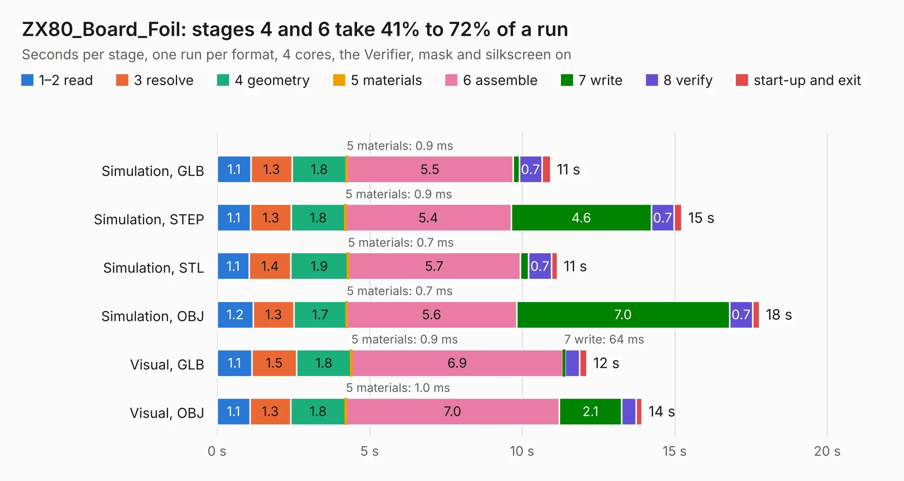

# 2726. ZX80_Board_Foil

Board 2,726 of the 3,107 of [Corpus Testing](../Corpus-Testing.md), on [Corpus Page 26](../CorpusTestingPages/Corpus-Testing-26.md#2726-zx80_board_foil).

| Mode and format | 1–2 read | 3 resolve | 4 geometry | 5 materials | 6 assemble | 7 write | 8 verify | start-up and exit | Total |
|---|---:|---:|---:|---:|---:|---:|---:|---:|---:|
| Simulation, GLB | 1.1 | 1.3 | 1.8 | 0.9&nbsp;ms | 5.5 | 0.2 | 0.7 | 0.3 | 10.9 |
| Simulation, STEP | 1.1 | 1.3 | 1.8 | 0.9&nbsp;ms | 5.4 | 4.6 | 0.7 | 0.3 | 15.2 |
| Simulation, STL | 1.1 | 1.4 | 1.9 | 0.7&nbsp;ms | 5.7 | 0.3 | 0.7 | 0.2 | 11.1 |
| Simulation, OBJ | 1.2 | 1.3 | 1.7 | 0.7&nbsp;ms | 5.6 | 7.0 | 0.7 | 0.2 | 17.8 |
| Visual, GLB | 1.1 | 1.5 | 1.8 | 0.9&nbsp;ms | 6.9 | 64&nbsp;ms | 0.5 | 0.2 | 12.1 |
| Visual, OBJ | 1.1 | 1.3 | 1.8 | 1.0&nbsp;ms | 7.0 | 2.1 | 0.5 | 0.2 | 13.9 |

<table align="center"><tr><td valign="top">

| Board | Repo: [TankedThomas/ZX80](https://github.com/TankedThomas/ZX80) Board: `ZX80_Board_Foil.kicad_pcb` |
|---|---|
| Complexity | 37&nbsp;/&nbsp;1000 (size&nbsp;17, features&nbsp;20) |
| KESE&nbsp;features | filled zones |
| Tested | 9th November 2026 |
| Copper&nbsp;layers | 2 |
| File&nbsp;format | KiCad 7 (20221018) |
| Parts,&nbsp;tracks,&nbsp;vias | 0, 0, 0 |
| Triangles,&nbsp;simulation | 1,185,784 in 8 parts |
| Note | no components |
| Verifier | PASS in all six runs |

</td><td valign="top">

<table>
<tr><th>File type</th><th>File size</th><th>Peak memory used</th></tr>
<tr><th colspan="3" align="left">Simulation</th></tr>
<tr><td>GLB</td><td align="right">45&nbsp;MB</td><td align="right">600&nbsp;MB</td></tr>
<tr><td>STEP</td><td align="right">359&nbsp;MB</td><td align="right">753&nbsp;MB</td></tr>
<tr><td>STL</td><td align="right">59&nbsp;MB</td><td align="right">605&nbsp;MB</td></tr>
<tr><td>OBJ</td><td align="right">134&nbsp;MB</td><td align="right">912&nbsp;MB</td></tr>
<tr><th colspan="3" align="left">Visual</th></tr>
<tr><td>GLB</td><td align="right">15&nbsp;MB</td><td align="right">463&nbsp;MB</td></tr>
<tr><td>OBJ</td><td align="right">44&nbsp;MB</td><td align="right">449&nbsp;MB</td></tr>
</table>

</td></tr></table>

| Previous | Next |
|:---|---:|
| [2725. ZX80_Board](b2725b_ZX80_ZX80-Board.md) | [2727. TAPRX-888](b2727b_TAPRx888_TAPRX-888.md) |
