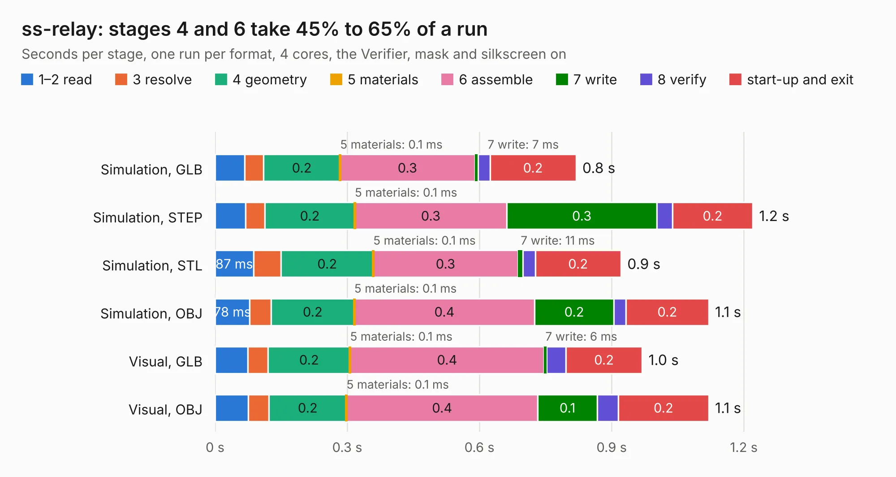

# 2727. ss-relay

Board 2,727 of the 3,128 of [Corpus Testing](../Corpus-Testing.md), on [Corpus Page 26](../CorpusTestingPages/Corpus-Testing-26.md#2727-ss-relay).

| Mode and format | 1–2 read | 3 resolve | 4 geometry | 5 materials | 6 assemble | 7 write | 8 verify | start-up and exit | Total |
|---|---:|---:|---:|---:|---:|---:|---:|---:|---:|
| Simulation, GLB | 67&nbsp;ms | 43&nbsp;ms | 0.2 | 0.1&nbsp;ms | 0.3 | 7&nbsp;ms | 27&nbsp;ms | 0.2 | 0.8 |
| Simulation, STEP | 69&nbsp;ms | 44&nbsp;ms | 0.2 | 0.1&nbsp;ms | 0.3 | 0.3 | 35&nbsp;ms | 0.2 | 1.2 |
| Simulation, STL | 87&nbsp;ms | 63&nbsp;ms | 0.2 | 0.1&nbsp;ms | 0.3 | 11&nbsp;ms | 29&nbsp;ms | 0.2 | 0.9 |
| Simulation, OBJ | 78&nbsp;ms | 49&nbsp;ms | 0.2 | 0.1&nbsp;ms | 0.4 | 0.2 | 27&nbsp;ms | 0.2 | 1.1 |
| Visual, GLB | 74&nbsp;ms | 46&nbsp;ms | 0.2 | 0.1&nbsp;ms | 0.4 | 6&nbsp;ms | 44&nbsp;ms | 0.2 | 1.0 |
| Visual, OBJ | 76&nbsp;ms | 47&nbsp;ms | 0.2 | 0.1&nbsp;ms | 0.4 | 0.1 | 48&nbsp;ms | 0.2 | 1.1 |

<table align="center"><tr><td valign="top">

| Board | Repo: [sufst/pcb](https://github.com/sufst/pcb) Board: `ss-relay.kicad_pcb` |
|---|---|
| Folder | ss-relay |
| Complexity | 160&nbsp;/&nbsp;1000 (size&nbsp;90, features&nbsp;70) |
| KESE&nbsp;features | custom pads, rounded, trapezoid or chamfered pads, filled zones, copper drawings, knockout text |
| Tested | 9th November 2026 |
| Copper&nbsp;layers | 2 |
| File&nbsp;format | KiCad 7 (20221018) |
| Parts,&nbsp;tracks,&nbsp;vias | 7, 21, 0 |
| Triangles,&nbsp;simulation | 46,626 in 18 parts |
| Verifier | PASS in all six runs |

</td><td valign="top">

<table>
<tr><th>File type</th><th>File size</th><th>Peak memory used</th></tr>
<tr><th colspan="3" align="left">Simulation</th></tr>
<tr><td>GLB</td><td align="right">1.6&nbsp;MB</td><td align="right">69&nbsp;MB</td></tr>
<tr><td>STEP</td><td align="right">7.8&nbsp;MB</td><td align="right">75&nbsp;MB</td></tr>
<tr><td>STL</td><td align="right">2.3&nbsp;MB</td><td align="right">69&nbsp;MB</td></tr>
<tr><td>OBJ</td><td align="right">4.5&nbsp;MB</td><td align="right">79&nbsp;MB</td></tr>
<tr><th colspan="3" align="left">Visual</th></tr>
<tr><td>GLB</td><td align="right">1.2&nbsp;MB</td><td align="right">104&nbsp;MB</td></tr>
<tr><td>OBJ</td><td align="right">3.2&nbsp;MB</td><td align="right">107&nbsp;MB</td></tr>
</table>

</td></tr></table>

| Previous | Next |
|:---|---:|
| [2726. 8Ch-Sensor-Hub](b2726b_pcb_8Ch-Sensor-Hub.md) | [2728. tem](b2728b_pcb_tem.md) |
