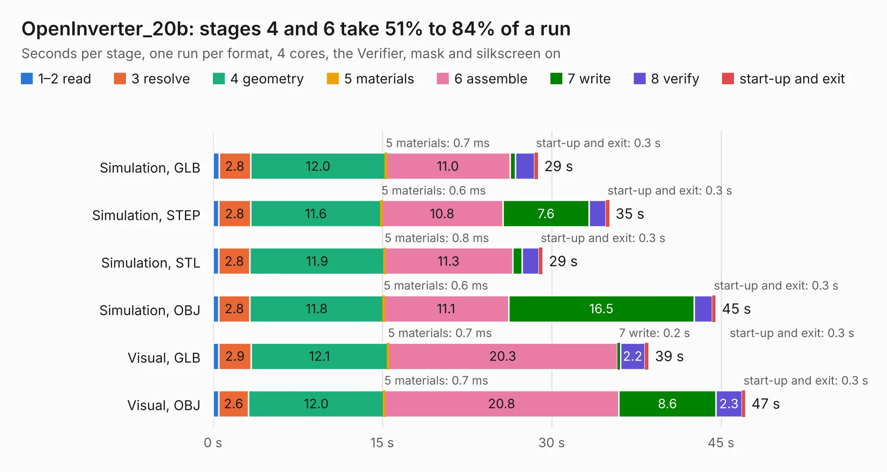

# 2728. OpenInverter_20b

Board 2,728 of the 3,106 of [Corpus Testing](../Corpus-Testing.md), on [Corpus Page 26](../CorpusTestingPages/Corpus-Testing-26.md#2728-openinverter_20b).

| Mode and format | 1–2 read | 3 resolve | 4 geometry | 5 materials | 6 assemble | 7 write | 8 verify | start-up and exit | Total |
|---|---:|---:|---:|---:|---:|---:|---:|---:|---:|
| Simulation, GLB | 0.5 | 2.8 | 12.0 | 0.7&nbsp;ms | 11.0 | 0.5 | 1.7 | 0.3 | 28.8 |
| Simulation, STEP | 0.5 | 2.8 | 11.6 | 0.6&nbsp;ms | 10.8 | 7.6 | 1.5 | 0.3 | 35.1 |
| Simulation, STL | 0.5 | 2.8 | 11.9 | 0.8&nbsp;ms | 11.3 | 0.8 | 1.5 | 0.3 | 29.2 |
| Simulation, OBJ | 0.5 | 2.8 | 11.8 | 0.6&nbsp;ms | 11.1 | 16.5 | 1.6 | 0.3 | 44.5 |
| Visual, GLB | 0.5 | 2.9 | 12.1 | 0.7&nbsp;ms | 20.3 | 0.2 | 2.2 | 0.3 | 38.6 |
| Visual, OBJ | 0.5 | 2.6 | 12.0 | 0.7&nbsp;ms | 20.8 | 8.6 | 2.3 | 0.3 | 47.1 |

<table align="center"><tr><td valign="top">

| Board | Repo: [teknomadix/Open_Inverter_2.0b_Kicad](https://github.com/teknomadix/Open_Inverter_2.0b_Kicad) Board: `OpenInverter_20b.kicad_pcb` |
|---|---|
| Folder | Hardware |
| Complexity | 223&nbsp;/&nbsp;1000 (size&nbsp;188, features&nbsp;35) |
| KESE&nbsp;features | through vias, filled zones |
| Tested | 10th November 2026 |
| Copper&nbsp;layers | 4 |
| File&nbsp;format | KiCad 5 (20171130) |
| Parts,&nbsp;tracks,&nbsp;vias | 61, 744, 28 |
| Triangles,&nbsp;simulation | 2,691,338 in 98 parts |
| Verifier | PASS in all six runs |

</td><td valign="top">

<table>
<tr><th>File type</th><th>File size</th><th>Peak memory used</th></tr>
<tr><th colspan="3" align="left">Simulation</th></tr>
<tr><td>GLB</td><td align="right">92&nbsp;MB</td><td align="right">832&nbsp;MB</td></tr>
<tr><td>STEP</td><td align="right">405&nbsp;MB</td><td align="right">972&nbsp;MB</td></tr>
<tr><td>STL</td><td align="right">135&nbsp;MB</td><td align="right">791&nbsp;MB</td></tr>
<tr><td>OBJ</td><td align="right">284&nbsp;MB</td><td align="right">1.8&nbsp;GB</td></tr>
<tr><th colspan="3" align="left">Visual</th></tr>
<tr><td>GLB</td><td align="right">49&nbsp;MB</td><td align="right">926&nbsp;MB</td></tr>
<tr><td>OBJ</td><td align="right">150&nbsp;MB</td><td align="right">1.1&nbsp;GB</td></tr>
</table>

</td></tr></table>

| Previous | Next |
|:---|---:|
| [2727. DDR4_SoC](b2727b_lpddr4-w-allwinner-soc_DDR4-SoC.md) | [2729. LVPD-board](b2729b_srad-avionics_LVPD-board.md) |
