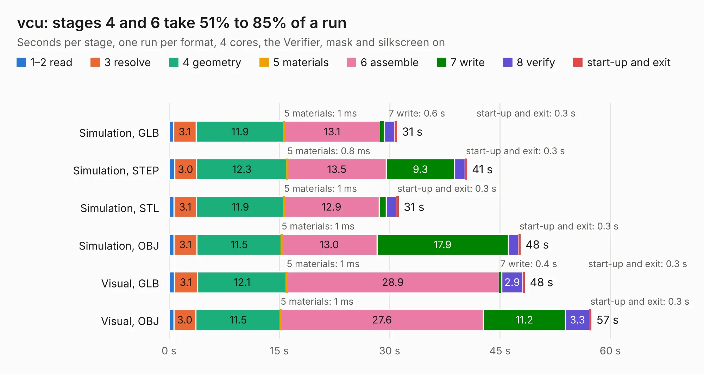

# 2728. vcu

Board 2,728 of the 3,123 of [Corpus Testing](../Corpus-Testing.md), on [Corpus Page 26](../CorpusTestingPages/Corpus-Testing-26.md#2728-vcu).

| Mode and format | 1–2 read | 3 resolve | 4 geometry | 5 materials | 6 assemble | 7 write | 8 verify | start-up and exit | Total |
|---|---:|---:|---:|---:|---:|---:|---:|---:|---:|
| Simulation, GLB | 0.6 | 3.1 | 11.9 | 1&nbsp;ms | 13.1 | 0.6 | 1.4 | 0.3 | 31.0 |
| Simulation, STEP | 0.7 | 3.0 | 12.3 | 0.8&nbsp;ms | 13.5 | 9.3 | 1.4 | 0.3 | 40.5 |
| Simulation, STL | 0.7 | 3.1 | 11.9 | 1&nbsp;ms | 12.9 | 1.0 | 1.4 | 0.3 | 31.2 |
| Simulation, OBJ | 0.7 | 3.1 | 11.5 | 1&nbsp;ms | 13.0 | 17.9 | 1.4 | 0.3 | 47.8 |
| Visual, GLB | 0.7 | 3.1 | 12.1 | 1&nbsp;ms | 28.9 | 0.4 | 2.9 | 0.3 | 48.4 |
| Visual, OBJ | 0.6 | 3.0 | 11.5 | 1&nbsp;ms | 27.6 | 11.2 | 3.3 | 0.3 | 57.4 |

<table align="center"><tr><td valign="top">

| Board | Repo: [sufst/pcb](https://github.com/sufst/pcb) Board: `vcu.kicad_pcb` |
|---|---|
| Folder | vcu |
| Complexity | 346&nbsp;/&nbsp;1000 (size&nbsp;266, features&nbsp;80) |
| KESE&nbsp;features | through vias, rounded, trapezoid or chamfered pads, curved board outline, knockout text, stack-up, dielectric εr and tanδ |
| Tested | 9th November 2026 |
| Copper&nbsp;layers | 4 |
| File&nbsp;format | KiCad 9 (20241229) |
| Parts,&nbsp;tracks,&nbsp;vias | 205, 1,711, 293 |
| Triangles,&nbsp;simulation | 3,172,496 in 345 parts |
| Verifier | PASS in all six runs |

</td><td valign="top">

<table>
<tr><th>File type</th><th>File size</th><th>Peak memory used</th></tr>
<tr><th colspan="3" align="left">Simulation</th></tr>
<tr><td>GLB</td><td align="right">109&nbsp;MB</td><td align="right">1.0&nbsp;GB</td></tr>
<tr><td>STEP</td><td align="right">459&nbsp;MB</td><td align="right">1.3&nbsp;GB</td></tr>
<tr><td>STL</td><td align="right">159&nbsp;MB</td><td align="right">1.0&nbsp;GB</td></tr>
<tr><td>OBJ</td><td align="right">338&nbsp;MB</td><td align="right">2.1&nbsp;GB</td></tr>
<tr><th colspan="3" align="left">Visual</th></tr>
<tr><td>GLB</td><td align="right">70&nbsp;MB</td><td align="right">1.3&nbsp;GB</td></tr>
<tr><td>OBJ</td><td align="right">220&nbsp;MB</td><td align="right">1.5&nbsp;GB</td></tr>
</table>

</td></tr></table>

| Previous | Next |
|:---|---:|
| [2727. tsal-led](b2727b_pcb_tsal-led.md) | [2729. LittleSixteen](b2729b_LittleSixteen_LittleSixteen.md) |
