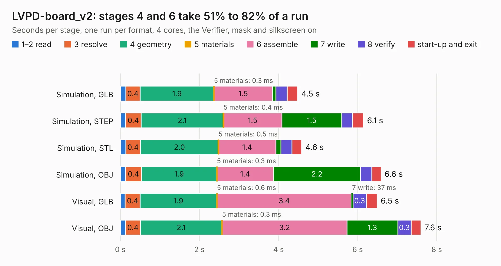

# 2728. LVPD-board_v2

Board 2,728 of the 3,103 of [Corpus Testing](../Corpus-Testing.md), on [Corpus Page 26](../CorpusTestingPages/Corpus-Testing-26.md#2728-lvpd-board_v2).

| Mode and format | 1–2 read | 3 resolve | 4 geometry | 5 materials | 6 assemble | 7 write | 8 verify | start-up and exit | Total |
|---|---:|---:|---:|---:|---:|---:|---:|---:|---:|
| Simulation, GLB | 0.1 | 0.4 | 1.9 | 0.3&nbsp;ms | 1.5 | 89&nbsp;ms | 0.3 | 0.3 | 4.5 |
| Simulation, STEP | 0.1 | 0.4 | 2.1 | 0.4&nbsp;ms | 1.5 | 1.5 | 0.3 | 0.3 | 6.1 |
| Simulation, STL | 0.1 | 0.4 | 2.0 | 0.5&nbsp;ms | 1.4 | 0.1 | 0.3 | 0.2 | 4.6 |
| Simulation, OBJ | 0.1 | 0.4 | 1.9 | 0.3&nbsp;ms | 1.4 | 2.2 | 0.3 | 0.2 | 6.6 |
| Visual, GLB | 0.1 | 0.4 | 1.9 | 0.6&nbsp;ms | 3.4 | 37&nbsp;ms | 0.3 | 0.3 | 6.5 |
| Visual, OBJ | 0.1 | 0.4 | 2.1 | 0.3&nbsp;ms | 3.2 | 1.3 | 0.3 | 0.2 | 7.6 |

<table align="center"><tr><td valign="top">

| Board | Repo: [terrapin-rocket-team/srad-avionics](https://github.com/terrapin-rocket-team/srad-avionics) Board: `LVPD-board_v2.kicad_pcb` |
|---|---|
| Folder | Side_Projects / ARC / PCBs / LVPD-board_v2 |
| Complexity | 128&nbsp;/&nbsp;1000 (size&nbsp;118, features&nbsp;10) |
| KESE&nbsp;features | rounded, trapezoid or chamfered pads |
| Tested | 9th November 2026 |
| Copper&nbsp;layers | 2 |
| File&nbsp;format | KiCad 7 (20221018) |
| Parts,&nbsp;tracks,&nbsp;vias | 9, 105, 0 |
| Triangles,&nbsp;simulation | 394,344 in 66 parts |
| Verifier | PASS in all six runs |

</td><td valign="top">

<table>
<tr><th>File type</th><th>File size</th><th>Peak memory used</th></tr>
<tr><th colspan="3" align="left">Simulation</th></tr>
<tr><td>GLB</td><td align="right">13&nbsp;MB</td><td align="right">253&nbsp;MB</td></tr>
<tr><td>STEP</td><td align="right">49&nbsp;MB</td><td align="right">293&nbsp;MB</td></tr>
<tr><td>STL</td><td align="right">20&nbsp;MB</td><td align="right">246&nbsp;MB</td></tr>
<tr><td>OBJ</td><td align="right">39&nbsp;MB</td><td align="right">310&nbsp;MB</td></tr>
<tr><th colspan="3" align="left">Visual</th></tr>
<tr><td>GLB</td><td align="right">7.8&nbsp;MB</td><td align="right">276&nbsp;MB</td></tr>
<tr><td>OBJ</td><td align="right">23&nbsp;MB</td><td align="right">281&nbsp;MB</td></tr>
</table>

</td></tr></table>

| Previous | Next |
|:---|---:|
| [2727. LVPD-board_Payload](b2727b_srad-avionics_LVPD-board-Payload.md) | [2729. charge_deployment](b2729b_srad-avionics_charge-deployment.md) |
