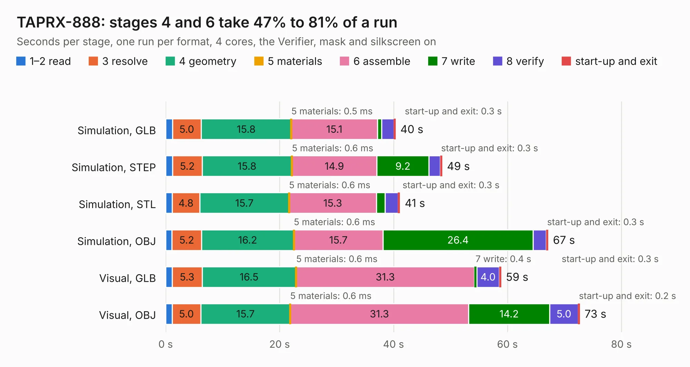

# 2730. TAPRX-888

Board 2,730 of the 3,110 of [Corpus Testing](../Corpus-Testing.md), on [Corpus Page 26](../CorpusTestingPages/Corpus-Testing-26.md#2730-taprx-888).

| Mode and format | 1–2 read | 3 resolve | 4 geometry | 5 materials | 6 assemble | 7 write | 8 verify | start-up and exit | Total |
|---|---:|---:|---:|---:|---:|---:|---:|---:|---:|
| Simulation, GLB | 1.2 | 5.0 | 15.8 | 0.5&nbsp;ms | 15.1 | 0.7 | 2.2 | 0.3 | 40.3 |
| Simulation, STEP | 1.2 | 5.2 | 15.8 | 0.6&nbsp;ms | 14.9 | 9.2 | 2.0 | 0.3 | 48.5 |
| Simulation, STL | 1.1 | 4.8 | 15.7 | 0.6&nbsp;ms | 15.3 | 1.5 | 2.3 | 0.3 | 41.1 |
| Simulation, OBJ | 1.1 | 5.2 | 16.2 | 0.6&nbsp;ms | 15.7 | 26.4 | 2.3 | 0.3 | 67.1 |
| Visual, GLB | 1.1 | 5.3 | 16.5 | 0.6&nbsp;ms | 31.3 | 0.4 | 4.0 | 0.3 | 58.9 |
| Visual, OBJ | 1.1 | 5.0 | 15.7 | 0.6&nbsp;ms | 31.3 | 14.2 | 5.0 | 0.2 | 72.7 |

<table align="center"><tr><td valign="top">

| Board | Repo: [TAPR/TAPRx888](https://github.com/TAPR/TAPRx888) Board: `TAPRX-888.kicad_pcb` |
|---|---|
| Complexity | 440&nbsp;/&nbsp;1000 (size&nbsp;290, features&nbsp;150) |
| KESE&nbsp;features | through vias, microvias, rounded, trapezoid or chamfered pads, filled zones, knockout text, stack-up, dielectric εr and tanδ, copper finish, mask and silkscreen colours |
| Tested | 9th November 2026 |
| Copper&nbsp;layers | 6 |
| File&nbsp;format | KiCad 10 (20260206) |
| Parts,&nbsp;tracks,&nbsp;vias | 197, 1,782, 681 |
| Triangles,&nbsp;simulation | 4,663,198 in 225 parts |
| Verifier | PASS in all six runs |

</td><td valign="top">

<table>
<tr><th>File type</th><th>File size</th><th>Peak memory used</th></tr>
<tr><th colspan="3" align="left">Simulation</th></tr>
<tr><td>GLB</td><td align="right">155&nbsp;MB</td><td align="right">1.6&nbsp;GB</td></tr>
<tr><td>STEP</td><td align="right">524&nbsp;MB</td><td align="right">1.8&nbsp;GB</td></tr>
<tr><td>STL</td><td align="right">233&nbsp;MB</td><td align="right">1.6&nbsp;GB</td></tr>
<tr><td>OBJ</td><td align="right">496&nbsp;MB</td><td align="right">3.0&nbsp;GB</td></tr>
<tr><th colspan="3" align="left">Visual</th></tr>
<tr><td>GLB</td><td align="right">86&nbsp;MB</td><td align="right">1.5&nbsp;GB</td></tr>
<tr><td>OBJ</td><td align="right">277&nbsp;MB</td><td align="right">1.9&nbsp;GB</td></tr>
</table>

</td></tr></table>

| Previous | Next |
|:---|---:|
| [2729. ZX80_Board_Foil](b2729b_ZX80_ZX80-Board-Foil.md) | [2731. DDR4_SoC](b2731b_lpddr4-w-allwinner-soc_DDR4-SoC.md) |
