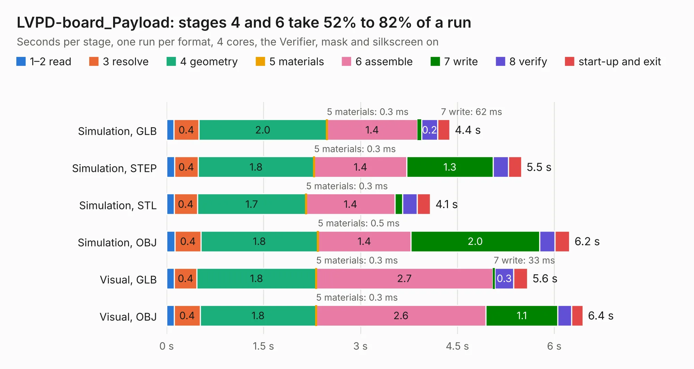

# 2731. LVPD-board_Payload

Board 2,731 of the 3,107 of [Corpus Testing](../Corpus-Testing.md), on [Corpus Page 26](../CorpusTestingPages/Corpus-Testing-26.md#2731-lvpd-board_payload).

| Mode and format | 1–2 read | 3 resolve | 4 geometry | 5 materials | 6 assemble | 7 write | 8 verify | start-up and exit | Total |
|---|---:|---:|---:|---:|---:|---:|---:|---:|---:|
| Simulation, GLB | 0.1 | 0.4 | 2.0 | 0.3&nbsp;ms | 1.4 | 62&nbsp;ms | 0.2 | 0.2 | 4.4 |
| Simulation, STEP | 0.1 | 0.4 | 1.8 | 0.3&nbsp;ms | 1.4 | 1.3 | 0.2 | 0.2 | 5.5 |
| Simulation, STL | 0.1 | 0.4 | 1.7 | 0.3&nbsp;ms | 1.4 | 0.1 | 0.2 | 0.2 | 4.1 |
| Simulation, OBJ | 0.1 | 0.4 | 1.8 | 0.5&nbsp;ms | 1.4 | 2.0 | 0.2 | 0.2 | 6.2 |
| Visual, GLB | 0.1 | 0.4 | 1.8 | 0.3&nbsp;ms | 2.7 | 33&nbsp;ms | 0.3 | 0.2 | 5.6 |
| Visual, OBJ | 0.1 | 0.4 | 1.8 | 0.3&nbsp;ms | 2.6 | 1.1 | 0.2 | 0.2 | 6.4 |

<table align="center"><tr><td valign="top">

| Board | Repo: [terrapin-rocket-team/srad-avionics](https://github.com/terrapin-rocket-team/srad-avionics) Board: `LVPD-board_Payload.kicad_pcb` |
|---|---|
| Folder | Side_Projects / ARC / PCBs / LVPD-board_Payload |
| Complexity | 145&nbsp;/&nbsp;1000 (size&nbsp;120, features&nbsp;25) |
| KESE&nbsp;features | through vias, rounded, trapezoid or chamfered pads |
| Tested | 9th November 2026 |
| Copper&nbsp;layers | 2 |
| File&nbsp;format | KiCad 7 (20221018) |
| Parts,&nbsp;tracks,&nbsp;vias | 10, 102, 2 |
| Triangles,&nbsp;simulation | 412,926 in 66 parts |
| Verifier | PASS in all six runs |

</td><td valign="top">

<table>
<tr><th>File type</th><th>File size</th><th>Peak memory used</th></tr>
<tr><th colspan="3" align="left">Simulation</th></tr>
<tr><td>GLB</td><td align="right">14&nbsp;MB</td><td align="right">257&nbsp;MB</td></tr>
<tr><td>STEP</td><td align="right">51&nbsp;MB</td><td align="right">299&nbsp;MB</td></tr>
<tr><td>STL</td><td align="right">21&nbsp;MB</td><td align="right">264&nbsp;MB</td></tr>
<tr><td>OBJ</td><td align="right">41&nbsp;MB</td><td align="right">323&nbsp;MB</td></tr>
<tr><th colspan="3" align="left">Visual</th></tr>
<tr><td>GLB</td><td align="right">7.8&nbsp;MB</td><td align="right">277&nbsp;MB</td></tr>
<tr><td>OBJ</td><td align="right">23&nbsp;MB</td><td align="right">280&nbsp;MB</td></tr>
</table>

</td></tr></table>

| Previous | Next |
|:---|---:|
| [2730. LVPD-board](b2730b_srad-avionics_LVPD-board.md) | [2732. LVPD-board_v2](b2732b_srad-avionics_LVPD-board-v2.md) |
