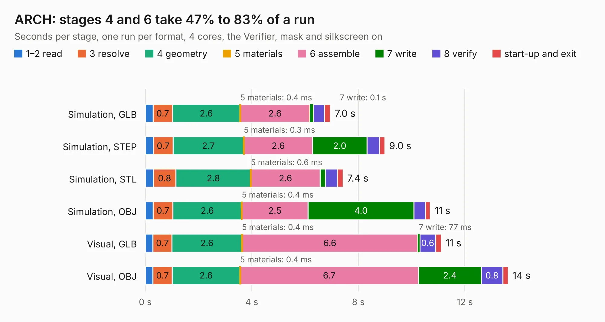

# 2732. ARCH

Board 2,732 of the 3,105 of [Corpus Testing](../Corpus-Testing.md), on [Corpus Page 26](../CorpusTestingPages/Corpus-Testing-26.md#2732-arch).

| Mode and format | 1–2 read | 3 resolve | 4 geometry | 5 materials | 6 assemble | 7 write | 8 verify | start-up and exit | Total |
|---|---:|---:|---:|---:|---:|---:|---:|---:|---:|
| Simulation, GLB | 0.3 | 0.7 | 2.6 | 0.4&nbsp;ms | 2.6 | 0.1 | 0.4 | 0.2 | 7.0 |
| Simulation, STEP | 0.3 | 0.7 | 2.7 | 0.3&nbsp;ms | 2.6 | 2.0 | 0.5 | 0.2 | 9.0 |
| Simulation, STL | 0.3 | 0.8 | 2.8 | 0.6&nbsp;ms | 2.6 | 0.2 | 0.4 | 0.2 | 7.4 |
| Simulation, OBJ | 0.3 | 0.7 | 2.6 | 0.4&nbsp;ms | 2.5 | 4.0 | 0.4 | 0.2 | 10.7 |
| Visual, GLB | 0.3 | 0.7 | 2.6 | 0.4&nbsp;ms | 6.6 | 77&nbsp;ms | 0.6 | 0.2 | 11.1 |
| Visual, OBJ | 0.3 | 0.7 | 2.6 | 0.4&nbsp;ms | 6.7 | 2.4 | 0.8 | 0.2 | 13.6 |

<table align="center"><tr><td valign="top">

| Board | Repo: [terrapin-rocket-team/srad-avionics](https://github.com/terrapin-rocket-team/srad-avionics) Board: `ARCH.kicad_pcb` |
|---|---|
| Folder | Spaceport / PCBs / ARCH |
| Complexity | 306&nbsp;/&nbsp;1000 (size&nbsp;186, features&nbsp;120) |
| KESE&nbsp;features | through vias, slotted holes, custom pads, rounded, trapezoid or chamfered pads, filled zones, copper drawings, curved board outline, stack-up, dielectric εr and tanδ |
| Tested | 9th November 2026 |
| Copper&nbsp;layers | 4 |
| File&nbsp;format | KiCad 9 (20241229) |
| Parts,&nbsp;tracks,&nbsp;vias | 69, 402, 90 |
| Triangles,&nbsp;simulation | 1,008,956 in 94 parts |
| Verifier | PASS in all six runs |

</td><td valign="top">

<table>
<tr><th>File type</th><th>File size</th><th>Peak memory used</th></tr>
<tr><th colspan="3" align="left">Simulation</th></tr>
<tr><td>GLB</td><td align="right">34&nbsp;MB</td><td align="right">436&nbsp;MB</td></tr>
<tr><td>STEP</td><td align="right">135&nbsp;MB</td><td align="right">469&nbsp;MB</td></tr>
<tr><td>STL</td><td align="right">50&nbsp;MB</td><td align="right">457&nbsp;MB</td></tr>
<tr><td>OBJ</td><td align="right">102&nbsp;MB</td><td align="right">687&nbsp;MB</td></tr>
<tr><th colspan="3" align="left">Visual</th></tr>
<tr><td>GLB</td><td align="right">20&nbsp;MB</td><td align="right">505&nbsp;MB</td></tr>
<tr><td>OBJ</td><td align="right">61&nbsp;MB</td><td align="right">543&nbsp;MB</td></tr>
</table>

</td></tr></table>

| Previous | Next |
|:---|---:|
| [2731. charge_deployment](b2731b_srad-avionics_charge-deployment.md) | [2733. BatteryCharger](b2733b_srad-avionics_BatteryCharger.md) |
