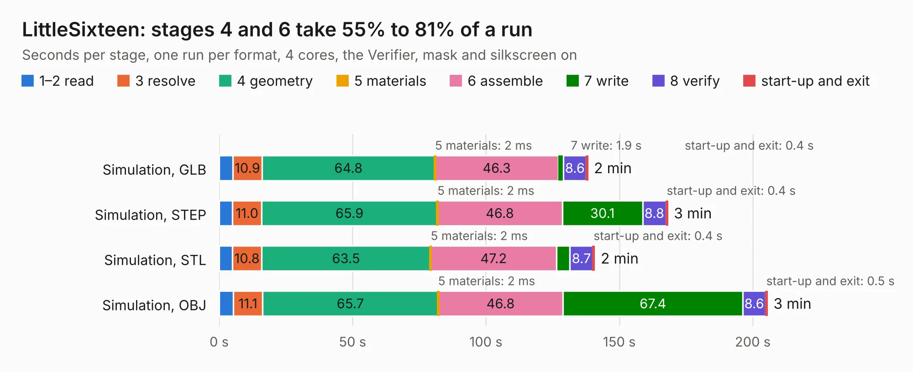

# 2733. LittleSixteen

Board 2,733 of the 3,128 of [Corpus Testing](../Corpus-Testing.md), on [Corpus Page 26](../CorpusTestingPages/Corpus-Testing-26.md#2733-littlesixteen).

| Mode and format | 1–2 read | 3 resolve | 4 geometry | 5 materials | 6 assemble | 7 write | 8 verify | start-up and exit | Total |
|---|---:|---:|---:|---:|---:|---:|---:|---:|---:|
| Simulation, GLB | 5.1 | 10.9 | 64.8 | 2&nbsp;ms | 46.3 | 1.9 | 8.6 | 0.4 | 138.0 |
| Simulation, STEP | 5.0 | 11.0 | 65.9 | 2&nbsp;ms | 46.8 | 30.1 | 8.8 | 0.4 | 168.0 |
| Simulation, STL | 5.0 | 10.8 | 63.5 | 2&nbsp;ms | 47.2 | 5.0 | 8.7 | 0.4 | 140.6 |
| Simulation, OBJ | 5.3 | 11.1 | 65.7 | 2&nbsp;ms | 46.8 | 67.4 | 8.6 | 0.5 | 205.3 |
| Visual, GLB | 5.2 | 10.8 | 64.8 | 2&nbsp;ms | 134.1 | 1.3 | 11.0 | 0.3 | 227.5 |
| Visual, OBJ | 5.0 | 10.8 | 65.8 | 2&nbsp;ms | 139.1 | 46.5 | 12.3 | 0.4 | 279.9 |

<table align="center"><tr><td valign="top">

| Board | Repo: [SukkoPera/LittleSixteen](https://github.com/SukkoPera/LittleSixteen) Board: `LittleSixteen.kicad_pcb` |
|---|---|
| Complexity | 317&nbsp;/&nbsp;1000 (size&nbsp;227, features&nbsp;90) |
| KESE&nbsp;features | through vias, custom pads, drill offsets, filled zones, copper drawings, copper text, curved board outline |
| Tested | 9th November 2026 to 10th November 2026 |
| Copper&nbsp;layers | 2 |
| File&nbsp;format | KiCad 5 (20171130) |
| Parts,&nbsp;tracks,&nbsp;vias | 339, 5,995, 622 |
| Triangles,&nbsp;simulation | 11,236,742 in 387 parts |
| Verifier | PASS in all six runs |

</td><td valign="top">

<table>
<tr><th>File type</th><th>File size</th><th>Peak memory used</th></tr>
<tr><th colspan="3" align="left">Simulation</th></tr>
<tr><td>GLB</td><td align="right">381&nbsp;MB</td><td align="right">3.3&nbsp;GB</td></tr>
<tr><td>STEP</td><td align="right">1.9&nbsp;GB</td><td align="right">4.2&nbsp;GB</td></tr>
<tr><td>STL</td><td align="right">562&nbsp;MB</td><td align="right">3.5&nbsp;GB</td></tr>
<tr><td>OBJ</td><td align="right">1.2&nbsp;GB</td><td align="right">7.1&nbsp;GB</td></tr>
<tr><th colspan="3" align="left">Visual</th></tr>
<tr><td>GLB</td><td align="right">277&nbsp;MB</td><td align="right">4.2&nbsp;GB</td></tr>
<tr><td>OBJ</td><td align="right">887&nbsp;MB</td><td align="right">5.4&nbsp;GB</td></tr>
</table>

</td></tr></table>

| Previous | Next |
|:---|---:|
| [2732. vcu](b2732b_pcb_vcu.md) | [2734. Raemixx500](b2734b_raemixx500_Raemixx500.md) |
