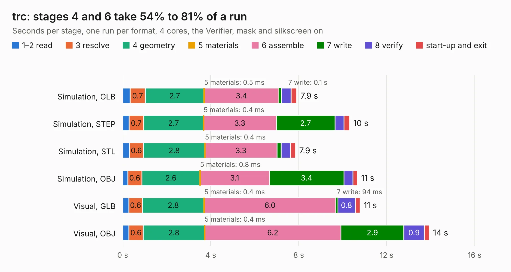

# 2733. trc

Board 2,733 of the 3,132 of [Corpus Testing](../Corpus-Testing.md), on [Corpus Page 26](../CorpusTestingPages/Corpus-Testing-26.md#2733-trc).

| Mode and format | 1–2 read | 3 resolve | 4 geometry | 5 materials | 6 assemble | 7 write | 8 verify | start-up and exit | Total |
|---|---:|---:|---:|---:|---:|---:|---:|---:|---:|
| Simulation, GLB | 0.3 | 0.7 | 2.7 | 0.5&nbsp;ms | 3.4 | 0.1 | 0.4 | 0.3 | 7.9 |
| Simulation, STEP | 0.3 | 0.7 | 2.7 | 0.4&nbsp;ms | 3.3 | 2.7 | 0.4 | 0.3 | 10.3 |
| Simulation, STL | 0.3 | 0.6 | 2.8 | 0.4&nbsp;ms | 3.3 | 0.2 | 0.4 | 0.2 | 7.9 |
| Simulation, OBJ | 0.2 | 0.6 | 2.6 | 0.8&nbsp;ms | 3.1 | 3.4 | 0.4 | 0.2 | 10.7 |
| Visual, GLB | 0.3 | 0.6 | 2.8 | 0.4&nbsp;ms | 6.0 | 94&nbsp;ms | 0.8 | 0.2 | 10.8 |
| Visual, OBJ | 0.3 | 0.6 | 2.8 | 0.4&nbsp;ms | 6.2 | 2.9 | 0.9 | 0.2 | 13.9 |

<table align="center"><tr><td valign="top">

| Board | Repo: [sufst/pcb](https://github.com/sufst/pcb) Board: `trc.kicad_pcb` |
|---|---|
| Folder | trc |
| Complexity | 266&nbsp;/&nbsp;1000 (size&nbsp;166, features&nbsp;100) |
| KESE&nbsp;features | through vias, rounded, trapezoid or chamfered pads, filled zones, curved board outline, knockout text, stack-up, dielectric εr and tanδ |
| Tested | 9th November 2026 |
| Copper&nbsp;layers | 2 |
| File&nbsp;format | KiCad 7 (20221018) |
| Parts,&nbsp;tracks,&nbsp;vias | 56, 364, 89 |
| Triangles,&nbsp;simulation | 721,698 in 71 parts |
| Verifier | PASS in all six runs |

</td><td valign="top">

<table>
<tr><th>File type</th><th>File size</th><th>Peak memory used</th></tr>
<tr><th colspan="3" align="left">Simulation</th></tr>
<tr><td>GLB</td><td align="right">25&nbsp;MB</td><td align="right">370&nbsp;MB</td></tr>
<tr><td>STEP</td><td align="right">121&nbsp;MB</td><td align="right">435&nbsp;MB</td></tr>
<tr><td>STL</td><td align="right">36&nbsp;MB</td><td align="right">372&nbsp;MB</td></tr>
<tr><td>OBJ</td><td align="right">73&nbsp;MB</td><td align="right">525&nbsp;MB</td></tr>
<tr><th colspan="3" align="left">Visual</th></tr>
<tr><td>GLB</td><td align="right">20&nbsp;MB</td><td align="right">529&nbsp;MB</td></tr>
<tr><td>OBJ</td><td align="right">59&nbsp;MB</td><td align="right">540&nbsp;MB</td></tr>
</table>

</td></tr></table>

| Previous | Next |
|:---|---:|
| [2732. tem](b2732b_pcb_tem.md) | [2734. tsal-latching-integrated](b2734b_pcb_tsal-latching-integrated.md) |
