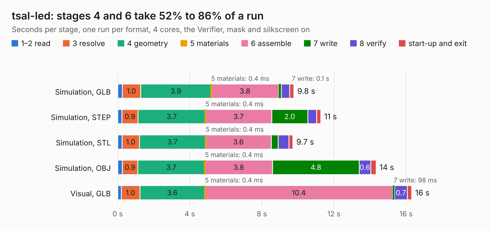

# 2733. tsal-led

Board 2,733 of the 3,130 of [Corpus Testing](../Corpus-Testing.md), on [Corpus Page 26](../CorpusTestingPages/Corpus-Testing-26.md#2733-tsal-led).

| Mode and format | 1–2 read | 3 resolve | 4 geometry | 5 materials | 6 assemble | 7 write | 8 verify | start-up and exit | Total |
|---|---:|---:|---:|---:|---:|---:|---:|---:|---:|
| Simulation, GLB | 0.3 | 1.0 | 3.9 | 0.4&nbsp;ms | 3.8 | 0.1 | 0.5 | 0.2 | 9.8 |
| Simulation, STEP | 0.2 | 0.9 | 3.7 | 0.4&nbsp;ms | 3.7 | 2.0 | 0.5 | 0.2 | 11.3 |
| Simulation, STL | 0.2 | 1.0 | 3.7 | 0.4&nbsp;ms | 3.6 | 0.4 | 0.6 | 0.2 | 9.7 |
| Simulation, OBJ | 0.3 | 0.9 | 3.7 | 0.4&nbsp;ms | 3.8 | 4.8 | 0.6 | 0.3 | 14.3 |
| Visual, GLB | 0.2 | 1.0 | 3.6 | 0.4&nbsp;ms | 10.4 | 98&nbsp;ms | 0.7 | 0.2 | 16.3 |
| Visual, OBJ | 0.3 | 1.0 | 4.0 | 0.3&nbsp;ms | 9.5 | 3.0 | 0.7 | 0.2 | 18.8 |

<table align="center"><tr><td valign="top">

| Board | Repo: [sufst/pcb](https://github.com/sufst/pcb) Board: `tsal-led.kicad_pcb` |
|---|---|
| Folder | tsal-led |
| Complexity | 321&nbsp;/&nbsp;1000 (size&nbsp;191, features&nbsp;130) |
| KESE&nbsp;features | through vias, custom pads, rounded, trapezoid or chamfered pads, filled zones, copper drawings, curved board outline, knockout text, stack-up, dielectric εr and tanδ, mask and silkscreen colours |
| Tested | 9th November 2026 |
| Copper&nbsp;layers | 4 |
| File&nbsp;format | KiCad 9 (20241229) |
| Parts,&nbsp;tracks,&nbsp;vias | 57, 85, 316 |
| Triangles,&nbsp;simulation | 973,862 in 36 parts |
| Verifier | PASS in all six runs |

</td><td valign="top">

<table>
<tr><th>File type</th><th>File size</th><th>Peak memory used</th></tr>
<tr><th colspan="3" align="left">Simulation</th></tr>
<tr><td>GLB</td><td align="right">33&nbsp;MB</td><td align="right">470&nbsp;MB</td></tr>
<tr><td>STEP</td><td align="right">84&nbsp;MB</td><td align="right">544&nbsp;MB</td></tr>
<tr><td>STL</td><td align="right">49&nbsp;MB</td><td align="right">492&nbsp;MB</td></tr>
<tr><td>OBJ</td><td align="right">96&nbsp;MB</td><td align="right">637&nbsp;MB</td></tr>
<tr><th colspan="3" align="left">Visual</th></tr>
<tr><td>GLB</td><td align="right">18&nbsp;MB</td><td align="right">503&nbsp;MB</td></tr>
<tr><td>OBJ</td><td align="right">54&nbsp;MB</td><td align="right">515&nbsp;MB</td></tr>
</table>

</td></tr></table>

| Previous | Next |
|:---|---:|
| [2732. tsal-latching-integrated](b2732b_pcb_tsal-latching-integrated.md) | [2734. vcu](b2734b_pcb_vcu.md) |
