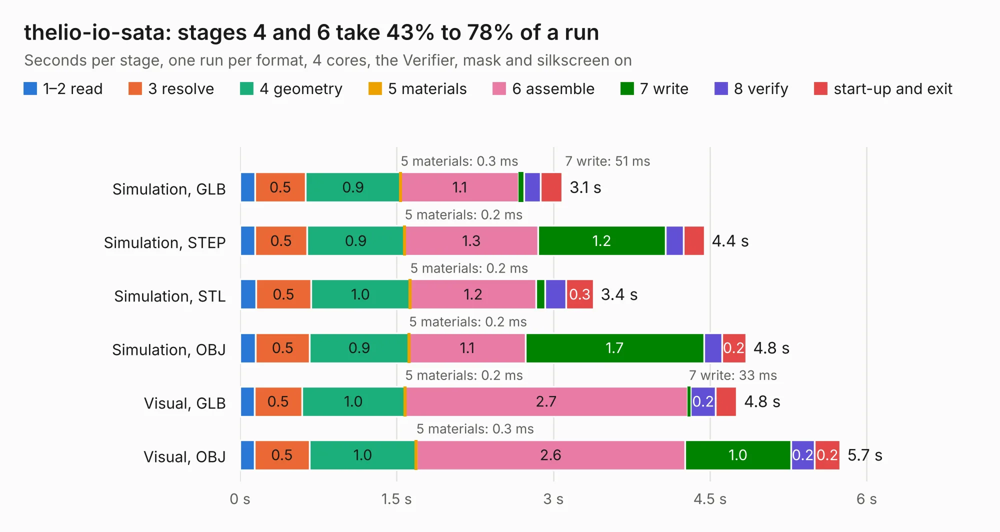

# 2736. thelio-io-sata

Board 2,736 of the 3,122 of [Corpus Testing](../Corpus-Testing.md), on [Corpus Page 26](../CorpusTestingPages/Corpus-Testing-26.md#2736-thelio-io-sata).

| Mode and format | 1–2 read | 3 resolve | 4 geometry | 5 materials | 6 assemble | 7 write | 8 verify | start-up and exit | Total |
|---|---:|---:|---:|---:|---:|---:|---:|---:|---:|
| Simulation, GLB | 0.1 | 0.5 | 0.9 | 0.3&nbsp;ms | 1.1 | 51&nbsp;ms | 0.2 | 0.2 | 3.1 |
| Simulation, STEP | 0.1 | 0.5 | 0.9 | 0.2&nbsp;ms | 1.3 | 1.2 | 0.2 | 0.2 | 4.4 |
| Simulation, STL | 0.2 | 0.5 | 1.0 | 0.2&nbsp;ms | 1.2 | 85&nbsp;ms | 0.2 | 0.3 | 3.4 |
| Simulation, OBJ | 0.1 | 0.5 | 0.9 | 0.2&nbsp;ms | 1.1 | 1.7 | 0.2 | 0.2 | 4.8 |
| Visual, GLB | 0.1 | 0.5 | 1.0 | 0.2&nbsp;ms | 2.7 | 33&nbsp;ms | 0.2 | 0.2 | 4.8 |
| Visual, OBJ | 0.1 | 0.5 | 1.0 | 0.3&nbsp;ms | 2.6 | 1.0 | 0.2 | 0.2 | 5.7 |

<table align="center"><tr><td valign="top">

| Board | Repo: [system76/thelio-io-hardware](https://github.com/system76/thelio-io-hardware) Board: `thelio-io-sata.kicad_pcb` |
|---|---|
| Folder | pcb-thelio-io-sata |
| Complexity | 244&nbsp;/&nbsp;1000 (size&nbsp;149, features&nbsp;95) |
| KESE&nbsp;features | through vias, rounded, trapezoid or chamfered pads, filled zones, copper text, curved board outline, stack-up, dielectric εr and tanδ |
| Tested | 9th November 2026 |
| Copper&nbsp;layers | 4 |
| File&nbsp;format | KiCad 7 (20221018) |
| Parts,&nbsp;tracks,&nbsp;vias | 9, 61, 65 |
| Triangles,&nbsp;simulation | 326,692 in 31 parts |
| Verifier | PASS in all six runs |

</td><td valign="top">

<table>
<tr><th>File type</th><th>File size</th><th>Peak memory used</th></tr>
<tr><th colspan="3" align="left">Simulation</th></tr>
<tr><td>GLB</td><td align="right">11&nbsp;MB</td><td align="right">239&nbsp;MB</td></tr>
<tr><td>STEP</td><td align="right">35&nbsp;MB</td><td align="right">275&nbsp;MB</td></tr>
<tr><td>STL</td><td align="right">16&nbsp;MB</td><td align="right">239&nbsp;MB</td></tr>
<tr><td>OBJ</td><td align="right">33&nbsp;MB</td><td align="right">249&nbsp;MB</td></tr>
<tr><th colspan="3" align="left">Visual</th></tr>
<tr><td>GLB</td><td align="right">6.6&nbsp;MB</td><td align="right">236&nbsp;MB</td></tr>
<tr><td>OBJ</td><td align="right">20&nbsp;MB</td><td align="right">234&nbsp;MB</td></tr>
</table>

</td></tr></table>

| Previous | Next |
|:---|---:|
| [2735. nebula-io](b2735b_thelio-io-hardware_nebula-io.md) | [2737. thelio-io](b2737b_thelio-io-hardware_thelio-io.md) |
