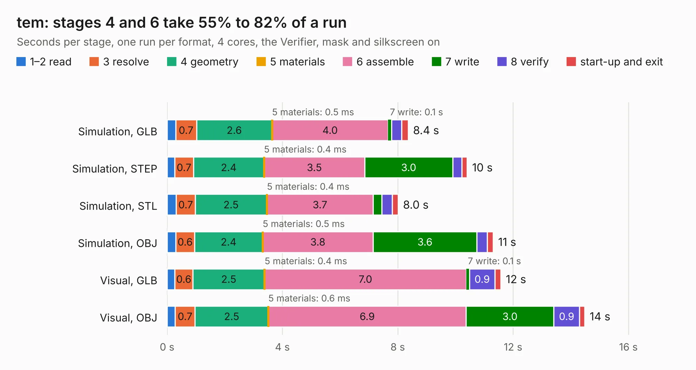

# 2738 tem

Board 2,738 of the 3,138 of [Corpus Testing](../Corpus-Testing.md), on [Corpus Page 26](../CorpusTestingPages/Corpus-Testing-26.md#2738-tem).

| Mode and format | 1–2 read | 3 resolve | 4 geometry | 5 materials | 6 assemble | 7 write | 8 verify | start-up and exit | Total |
|---|---:|---:|---:|---:|---:|---:|---:|---:|---:|
| Simulation, GLB | 0.3 | 0.7 | 2.6 | 0.5&nbsp;ms | 4.0 | 0.1 | 0.3 | 0.2 | 8.4 |
| Simulation, STEP | 0.3 | 0.7 | 2.4 | 0.4&nbsp;ms | 3.5 | 3.0 | 0.3 | 0.2 | 10.4 |
| Simulation, STL | 0.3 | 0.7 | 2.5 | 0.4&nbsp;ms | 3.7 | 0.3 | 0.4 | 0.2 | 8.0 |
| Simulation, OBJ | 0.3 | 0.6 | 2.4 | 0.5&nbsp;ms | 3.8 | 3.6 | 0.4 | 0.2 | 11.3 |
| Visual, GLB | 0.3 | 0.6 | 2.5 | 0.4&nbsp;ms | 7.0 | 0.1 | 0.9 | 0.2 | 11.6 |
| Visual, OBJ | 0.3 | 0.7 | 2.5 | 0.6&nbsp;ms | 6.9 | 3.0 | 0.9 | 0.2 | 14.5 |

<table align="center"><tr><td valign="top">

| Board | Repo: [sufst/pcb](https://github.com/sufst/pcb) Board: `tem.kicad_pcb` |
|---|---|
| Folder | tem |
| Complexity | 269&nbsp;/&nbsp;1000 (size&nbsp;224, features&nbsp;45) |
| KESE&nbsp;features | through vias, rounded, trapezoid or chamfered pads, filled zones |
| Tested | 9th November 2026 |
| Copper&nbsp;layers | 2 |
| File&nbsp;format | KiCad 7 (20221018) |
| Parts,&nbsp;tracks,&nbsp;vias | 103, 756, 169 |
| Triangles,&nbsp;simulation | 865,058 in 60 parts |
| Verifier | PASS in all six runs |

</td><td valign="top">

<table>
<tr><th>File type</th><th>File size</th><th>Peak memory used</th></tr>
<tr><th colspan="3" align="left">Simulation</th></tr>
<tr><td>GLB</td><td align="right">30&nbsp;MB</td><td align="right">485&nbsp;MB</td></tr>
<tr><td>STEP</td><td align="right">154&nbsp;MB</td><td align="right">519&nbsp;MB</td></tr>
<tr><td>STL</td><td align="right">43&nbsp;MB</td><td align="right">488&nbsp;MB</td></tr>
<tr><td>OBJ</td><td align="right">87&nbsp;MB</td><td align="right">620&nbsp;MB</td></tr>
<tr><th colspan="3" align="left">Visual</th></tr>
<tr><td>GLB</td><td align="right">25&nbsp;MB</td><td align="right">696&nbsp;MB</td></tr>
<tr><td>OBJ</td><td align="right">75&nbsp;MB</td><td align="right">651&nbsp;MB</td></tr>
</table>

</td></tr></table>

| Previous | Next |
|:---|---:|
| [2737 ss-relay](b2737b_pcb_ss-relay.md) | [2739 trc](b2739b_pcb_trc.md) |
