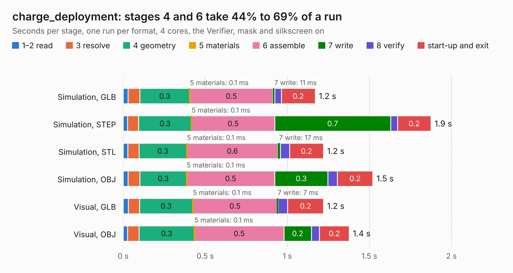

# 2738. charge_deployment

Board 2,738 of the 3,112 of [Corpus Testing](../Corpus-Testing.md), on [Corpus Page 26](../CorpusTestingPages/Corpus-Testing-26.md#2738-charge_deployment).

| Mode and format | 1–2 read | 3 resolve | 4 geometry | 5 materials | 6 assemble | 7 write | 8 verify | start-up and exit | Total |
|---|---:|---:|---:|---:|---:|---:|---:|---:|---:|
| Simulation, GLB | 30&nbsp;ms | 70&nbsp;ms | 0.3 | 0.1&nbsp;ms | 0.5 | 11&nbsp;ms | 40&nbsp;ms | 0.2 | 1.2 |
| Simulation, STEP | 27&nbsp;ms | 67&nbsp;ms | 0.3 | 0.1&nbsp;ms | 0.5 | 0.7 | 42&nbsp;ms | 0.2 | 1.9 |
| Simulation, STL | 28&nbsp;ms | 68&nbsp;ms | 0.3 | 0.1&nbsp;ms | 0.6 | 17&nbsp;ms | 56&nbsp;ms | 0.2 | 1.2 |
| Simulation, OBJ | 30&nbsp;ms | 72&nbsp;ms | 0.3 | 0.1&nbsp;ms | 0.5 | 0.3 | 57&nbsp;ms | 0.2 | 1.5 |
| Visual, GLB | 31&nbsp;ms | 69&nbsp;ms | 0.3 | 0.1&nbsp;ms | 0.5 | 7&nbsp;ms | 58&nbsp;ms | 0.2 | 1.2 |
| Visual, OBJ | 26&nbsp;ms | 70&nbsp;ms | 0.3 | 0.1&nbsp;ms | 0.5 | 0.2 | 50&nbsp;ms | 0.2 | 1.4 |

<table align="center"><tr><td valign="top">

| Board | Repo: [terrapin-rocket-team/srad-avionics](https://github.com/terrapin-rocket-team/srad-avionics) Board: `charge_deployment.kicad_pcb` |
|---|---|
| Folder | Side_Projects / Charge Deployment / Circuits |
| Complexity | 119&nbsp;/&nbsp;1000 (size&nbsp;99, features&nbsp;20) |
| KESE&nbsp;features | rounded, trapezoid or chamfered pads, curved board outline |
| Tested | 9th November 2026 |
| Copper&nbsp;layers | 2 |
| File&nbsp;format | KiCad 7 (20221018) |
| Parts,&nbsp;tracks,&nbsp;vias | 8, 35, 0 |
| Triangles,&nbsp;simulation | 58,226 in 16 parts |
| Verifier | PASS in all six runs |

</td><td valign="top">

<table>
<tr><th>File type</th><th>File size</th><th>Peak memory used</th></tr>
<tr><th colspan="3" align="left">Simulation</th></tr>
<tr><td>GLB</td><td align="right">2.0&nbsp;MB</td><td align="right">49&nbsp;MB</td></tr>
<tr><td>STEP</td><td align="right">7.6&nbsp;MB</td><td align="right">156&nbsp;MB</td></tr>
<tr><td>STL</td><td align="right">2.9&nbsp;MB</td><td align="right">52&nbsp;MB</td></tr>
<tr><td>OBJ</td><td align="right">5.5&nbsp;MB</td><td align="right">64&nbsp;MB</td></tr>
<tr><th colspan="3" align="left">Visual</th></tr>
<tr><td>GLB</td><td align="right">1.1&nbsp;MB</td><td align="right">75&nbsp;MB</td></tr>
<tr><td>OBJ</td><td align="right">3.1&nbsp;MB</td><td align="right">67&nbsp;MB</td></tr>
</table>

</td></tr></table>

| Previous | Next |
|:---|---:|
| [2737. LVPD-board_v2](b2737b_srad-avionics_LVPD-board-v2.md) | [2739. ARCH](b2739b_srad-avionics_ARCH.md) |
